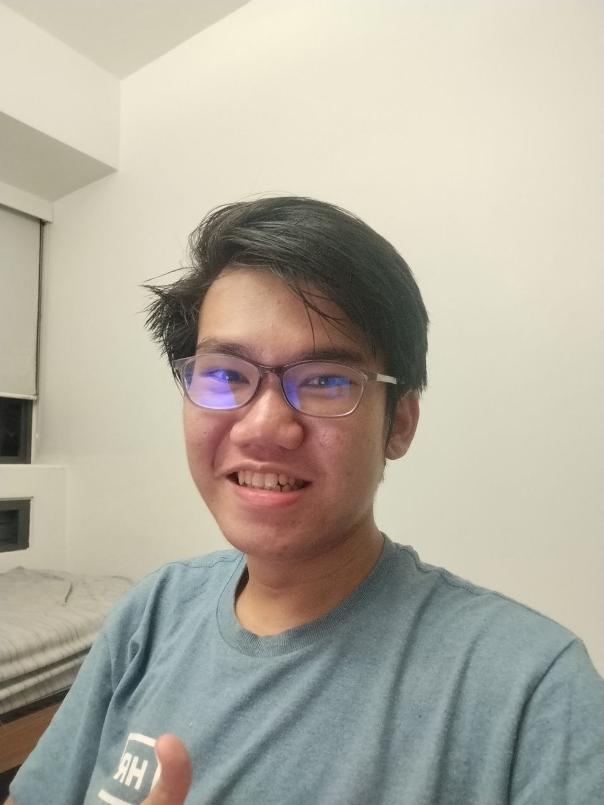
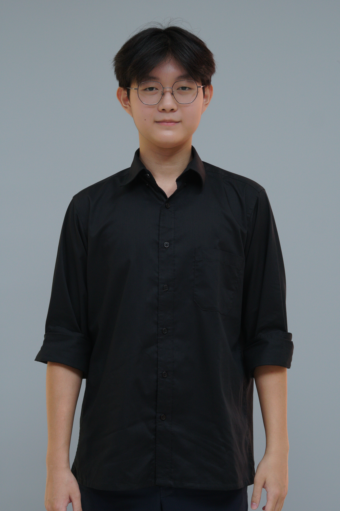
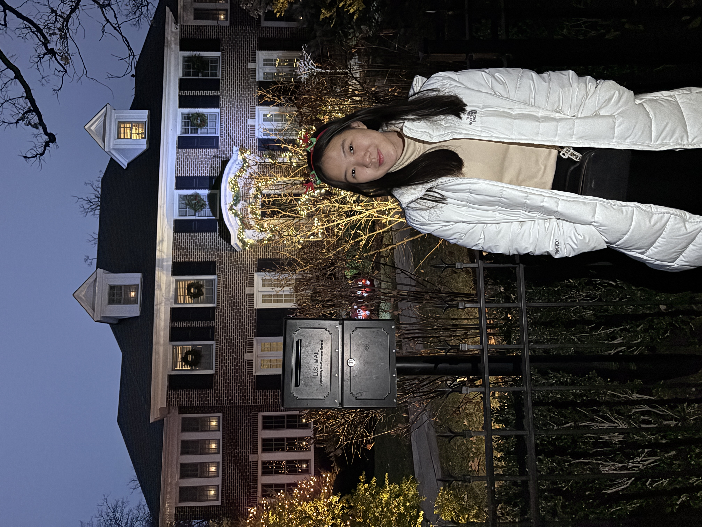
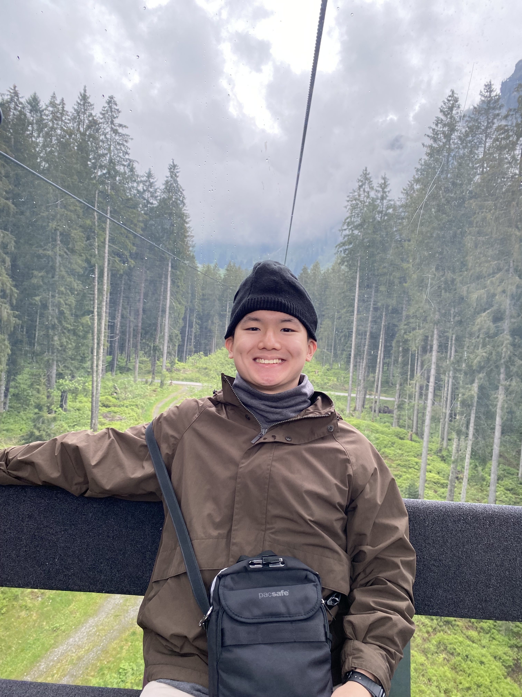
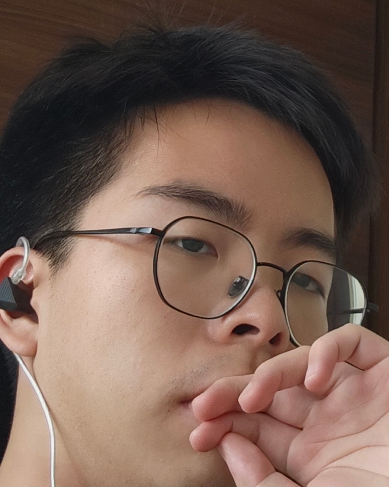

# About Us

We are a team based in the [School of Computing, National University of Singapore](https://www.comp.nus.edu.sg).

## Project team

<section class="team-member">

### Calvin Yoel Pandiangan

[[GitHub](https://github.com/CAYOPAN)]

* Role: Testing & Code Quality Lead
* Responsibilities: Exit, delete, and find commands; `tag` and `untag` commands.

</section>

<section class="team-member">

### Eron Dathan

[[GitHub](https://github.com/rondth)]

* Role: Integration Lead
* Responsibilities: Automatic saving and tag filtering (`filter`); `show` command and UI.

</section>

<section class="team-member">

### Glory Charity Lion

[[GitHub](https://github.com/glory-lion)]

* Role: Documentation Lead
* Responsibilities: Manual data-file editing and bulk tag editing (`tagall`, `untagall`); tag renaming (`renametag`).

</section>

<section class="team-member">

### Ian Abiel Wangsa

[[GitHub](https://github.com/Manutd1234)]

* Role: Team Lead
* Responsibilities: List members (`list`) and clear the roster (`clear`); sorting (`sort`).

</section>

<section class="team-member">

### Noah

[[GitHub](https://github.com/Asdao)]

* Role: Developer Lead
* Responsibilities: CLI workflows for adding and editing member records, and command help; partial-word name search.

</section>

