# Developer Guide

<span id="value-proposition"></span>

TrackCall helps club secretaries maintain member contact details and organise overlapping groups.
Users can search by name or email, filter members by tags, update group tags in bulk, and import
or export rosters as CSV files.

This guide describes the **v1.5 candidate**. Use the [User Guide](UserGuide.html)
for command syntax and the sections below for implementation decisions and failure handling.

## Contents

- [Acknowledgements](#acknowledgements)
- [Feature Map](#feature-map)
- [Setting Up](#setting-up-getting-started)
- [Design](#design)
  - [Architecture](#architecture)
  - [UI component](#ui-component)
  - [Logic component](#logic-component)
  - [Model component](#model-component)
  - [Storage component](#storage-component)
  - [Common classes](#common-classes)
- [Implementation](#implementation)
  - [1. Offline command help](#1-offline-command-help)
  - [2. List and clear commands](#2-list-and-clear-commands)
  - [3. Name sorting](#3-name-sorting)
  - [4. Email search](#4-email-search)
  - [5. Member details and command messages](#5-member-details-and-command-messages)
  - [6. Saving and recovery](#6-saving-and-recovery)
  - [7. Command parsing](#7-command-parsing)
  - [8. CSV import](#8-csv-import)
  - [9. CSV export](#9-csv-export)
  - [10. Selecting displayed members](#10-selecting-displayed-members)
  - [11. Tag filtering](#11-tag-filtering)
  - [12. Individual tag editing](#12-individual-tag-editing)
  - [13. Bulk tag editing](#13-bulk-tag-editing)
  - [14. Verification roadmap](#verification-roadmap)
  - [15. Limitations](#limitations)
- [Development workflow](#documentation-logging-testing-dev-ops)
- [Appendix: Requirements](#appendix-requirements)
  - [Product scope](#product-scope)
  - [User Stories for TrackCall](#user-stories)
  - [Shared behaviour rules](#shared-behaviour-rules)
  - [Use cases](#use-cases)
  - [Non-functional requirements](#non-functional-requirements)
  - [Glossary](#glossary)
- [Appendix: Instructions for Manual Testing](#appendix-instructions-for-manual-testing)

## Acknowledgements

* TrackCall builds on [AddressBook Level 3](https://se-education.org/addressbook-level3/) by the
  [SE-EDU initiative](https://se-education.org/). The starter supplies the architecture, source code, tests,
  and original diagrams.
* The application uses [JavaFX](https://openjfx.io/) for its interface and
  [Jackson](https://github.com/FasterXML/jackson) for JSON storage.
* [Apache Commons CSV](https://commons.apache.org/proper/commons-csv/) handles CSV import/export parsing and quoting.
  Its use was [approved by the teaching team](https://github.com/NUS-CS2103-AY2627-S1/forum/issues/627).
* The documentation website uses [MarkBind](https://markbind.org/) and adapts the
  [CS2103T starter layout](https://github.com/NUS-CS2103-AY2627-S1/tp/tree/switch-docs-to-markbind)
  with TrackCall's name, repository links, and guide sections.
* The feature grouping and release-note presentation were inspired by the
  [W12-3 team's User Guide](https://ay2627s1-cs2103t-w12-3.github.io/tp/UserGuide.html) and
  [CoordiMate releases](https://github.com/AY2627S1-CS2103T-W12-3/tp/releases).
  The adaptation concerns documentation layout and presentation; TrackCall retains its own feature descriptions,
  examples, screenshots, and application behaviour.
* [JUnit](https://junit.org/junit5/), [Gradle](https://gradle.org/),
  [Checkstyle](https://checkstyle.org/), and [JaCoCo](https://www.jacoco.org/jacoco/) support testing and builds.


## Feature Map

| Task | Commands or actions | Implementation |
| --- | --- | --- |
| Get help or exit | `help`, `exit` | [Offline help](#1-offline-command-help), [UI](#ui-component) |
| Restore or reset the roster | `list`, `clear` | [View reset and save rollback](#2-list-and-clear-commands) |
| Order the displayed members | `sort` | [Name sorting](#3-name-sorting) |
| Find members | `find`, `findemail` | [Email search](#4-email-search), [model views](#model-component) |
| Inspect and copy contact details | Select a roster row | [Member details and command messages](#5-member-details-and-command-messages) |
| Persist and protect data | Automatic | [Saving and recovery](#6-saving-and-recovery) |
| Maintain records | `add`, `edit`, `delete` | [Parsing](#7-command-parsing), [deletion confirmation](#deletion-confirmation) |
| Import records | `import` | [CSV import](#8-csv-import) |
| Export records | `export` | [CSV export](#9-csv-export) |
| Select displayed members | `show` | [Selections](#10-selecting-displayed-members) |
| Narrow a group by tag | `filter` | [Tag filtering](#11-tag-filtering) |
| Update one member's tags | `tag`, `untag` | [Individual tag editing](#12-individual-tag-editing) |
| Update a group's tags | `tagall`, `untagall`, `renametag` | [Bulk tag editing](#13-bulk-tag-editing) |


## Setting Up {id="setting-up-getting-started"}

Refer to the guide [_Setting up and getting started_](SettingUp.html).


## Design

<box type="tip">

:bulb: **Tip:** Diagram sources are in `docs/diagrams`. Wide diagrams shrink to fit the page; select one to open it at full size.
See the [PlantUML tutorial](https://se-education.org/guides/tutorials/plantUml.html) to create or edit a diagram.
</box>

### Architecture

<a class="dg-diagram" style="--dg-diagram-width: 19.0000em" href="images/ArchitectureDiagram.svg" aria-label="Open diagram at full size: TrackCall architecture and component dependencies">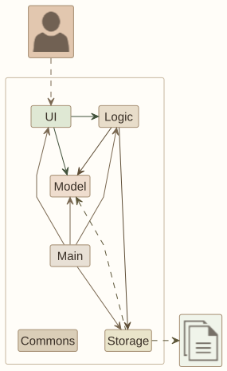</a>

The architecture diagram shows the main components and their dependencies.

#### Main components

`Main` manages startup and shutdown through two classes:
[`Main`](https://github.com/AY2627S1-CS2103T-W12-1/tp/tree/master/src/main/java/seedu/address/Main.java)
and [`MainApp`](https://github.com/AY2627S1-CS2103T-W12-1/tp/tree/master/src/main/java/seedu/address/MainApp.java).

* At startup, it acquires the application-instance lock, initialises preferences and components,
  then loads or recovers the roster before opening the main window.
* At shutdown, it stops the components and runs their cleanup methods.

| Component | Responsibility |
| --- | --- |
| [UI](#ui-component) | Display the interface and receive user input. |
| [Logic](#logic-component) | Parse and execute commands. |
| [Model](#model-component) | Hold the app's data in memory. |
| [Storage](#storage-component) | Read and write data on disk. |
| [Commons](#common-classes) | Provide classes shared by multiple components. |

#### Component interactions

The sequence diagram shows how the components handle `delete 1` and the `yes` that confirms it.

<a class="dg-diagram" style="--dg-diagram-width: 47.3077em" href="images/ArchitectureSequenceDiagram.svg" aria-label="Open diagram at full size: Component interactions when executing delete 1 and confirming it with yes">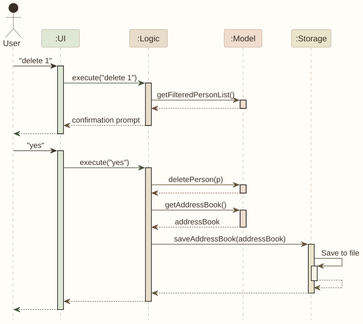</a>

Each of the four main components defines an API through an interface with the component's name.
A corresponding manager class implements that interface.
For example, `Logic.java` defines the API and `LogicManager.java` implements it.

Components communicate through these interfaces.
This reduces their dependence on each other's implementation details, as shown below.

<a class="dg-diagram" style="--dg-diagram-width: 21.6667em" href="images/ComponentManagers.svg" aria-label="Open diagram at full size: Component interfaces and their manager implementations">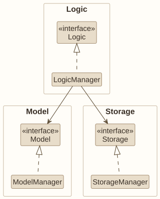</a>

### UI component

**API:** [`Ui.java`](https://github.com/AY2627S1-CS2103T-W12-1/tp/tree/master/src/main/java/seedu/address/ui/Ui.java)

<a class="dg-diagram" style="--dg-diagram-width: 44.6000em" href="images/UiClassDiagram.svg" aria-label="Open diagram at full size: Structure of the UI component">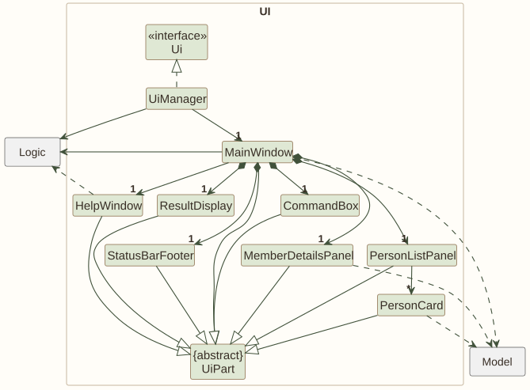</a>

**Structure**

- `MainWindow` contains the command box, result display, member list, details panel and status bar.
- These visible parts extend `UiPart`. JavaFX layouts are defined in `src/main/resources/view`.
- `HelpWindow` builds command cards from `CommandHelp` in Logic.
- `WindowPlacement` restores a usable window position and size.
- `MainApp` opens `RosterRecoveryDialog` before exposing an invalid roster for editing.
  The dialog shows the loading failure cause so the user knows what to correct.

**Interactions**

- Call the `Logic` interface to execute commands.
- Observe model data so displayed records update when data changes.
- Use `Person` and other model values to render the selected member's details.

### Logic component

**API:** [`Logic.java`](https://github.com/AY2627S1-CS2103T-W12-1/tp/tree/master/src/main/java/seedu/address/logic/Logic.java)

<a class="dg-diagram" style="--dg-diagram-width: 35.7333em" href="images/LogicClassDiagram.svg" aria-label="Open diagram at full size: Main classes in the Logic component">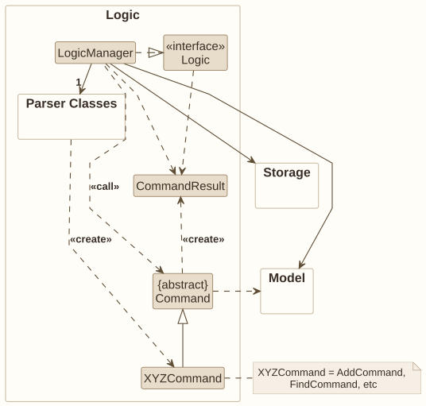</a>

The following sequence diagram illustrates parsing and executing `delete 1` to request confirmation.

<a class="dg-diagram" style="--dg-diagram-width: 76.0000em" href="images/DeleteSequenceDiagram.svg" aria-label="Open diagram at full size: Parsing delete 1 and requesting confirmation">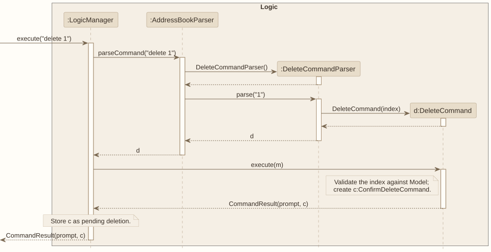</a>

The sequence shows a valid displayed index. The parser creates a deletion request, while the
command resolves the member through `Model`. It returns a confirmation command without deleting
or saving anything. The separate confirmation sequence below shows the later mutation.
Temporary parsers are left to Java garbage collection, so their lifelines have no destruction marker.

#### Command execution

1. `AddressBookParser` selects the matching parser, such as `DeleteCommandParser`.
2. That parser produces a `Command` subclass, such as `DeleteCommand`.
3. `LogicManager` executes the command. The command interacts with `Model` as needed.
4. `Logic` returns a `CommandResult` containing the result.

`XYZCommand` represents concrete commands with the same execution contract. `isReadOnly()` tells
`LogicManager` whether to save the roster after execution. Export is read-only with respect to the
roster even though it writes a separate CSV file.

#### Deletion confirmation

<a class="dg-diagram" style="--dg-diagram-width: 50.5em" href="images/ConfirmDeleteSequenceDiagram.svg" aria-label="Open diagram at full size: Confirmed deletion and automatic saving">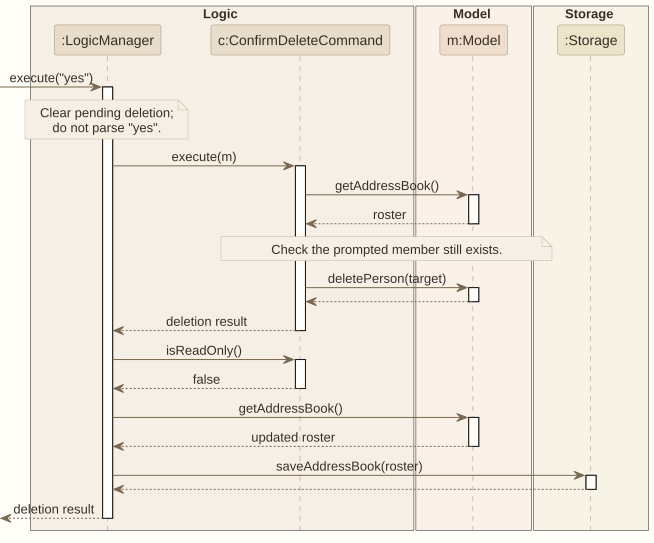</a>

**Flow**

1. **Request:** `DeleteCommand` validates the displayed index. It returns a prompt and a
   `ConfirmDeleteCommand` holding the selected `Person`. No record changes or save occur yet.
2. **Wait:** `LogicManager` retains the pending command. `MainWindow` highlights the command box
   and displays the confirmation hint.
3. **Answer:** the next input bypasses `AddressBookParser`.
   - Exactly `yes` in lowercase, after trimming surrounding whitespace, executes the pending deletion and saves.
   - A near miss (`y`, `Y`, `YES`, `Yes`) never confirms. `Confirmation#isNearMiss` detects it,
     and `LogicManager` keeps the deletion pending and repeats the prompt with a reminder to type `yes` exactly.
   - Any other input cancels. That input is consumed, not executed as another command. If it starts with a
     command word, the cancellation message says that the command was not run.
4. **Finish:** clear the pending command once the deletion runs or is cancelled. A later `yes` cannot repeat
   the deletion.

**Safety and failure handling**

- Store the `Person`, not its index. Removing a filter while waiting cannot redirect the deletion.
- If a filter is removed, show the confirmation prompt again beneath the filter feedback.
- If saving fails, keep the deletion in memory and show retry guidance. See [save failures](#failed-saves).
- Without a pending confirmation, `yes` is an unknown command.

**Design decisions**

- A typed confirmation preserves the keyboard workflow; a modal pop-up would interrupt it.
- The confirmation word is the full word `yes`, with no shortcut, to prevent accidental deletion or clearing.
  A single `y` is easy to send by a stray keystroke, by habit from earlier prompts or by auto-repeat.
  Requiring the whole word, in lowercase, makes confirmation a deliberate act for an action with no undo.
- A near miss keeps the prompt pending instead of cancelling or confirming. The user is not forced to repeat
  `delete` or `clear` after a typing slip, and the slip is never treated as consent.
- Consuming cancellation avoids treating replies such as `no` as new commands.

#### Parsing classes

<a class="dg-diagram" style="--dg-diagram-width: 46.4000em" href="images/ParserClasses.svg" aria-label="Open diagram at full size: Command parsers and shared parsing helpers">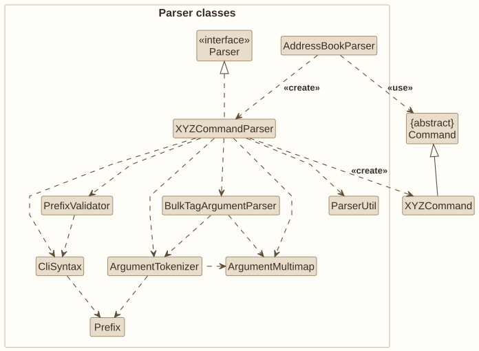</a>

- **Dispatch:** `AddressBookParser` selects a command-specific parser and returns its `Command`.
- **Parser contract:** command-specific parsers implement `Parser`. `XYZCommandParser` represents
  concrete classes such as `AddCommandParser`.
- **Tokenization:** `ArgumentTokenizer` splits prefixed fields into an `ArgumentMultimap`.
  `CliSyntax` defines the known `Prefix` values.
- **Value conversion:** `ParserUtil` validates and converts indexes and member fields.
- **Prefix checks:** add/edit parsers use `PrefixValidator` to reject unsupported field prefixes.
- **Tag checks:** tag, untag, bulk-tag and rename parsers share `BulkTagArgumentParser`.
  It recognizes `n/`, `p/`, `e/` and `a/` only to reject them with command-usage guidance.

### Model component

**API:** [`Model.java`](https://github.com/AY2627S1-CS2103T-W12-1/tp/blob/master/src/main/java/seedu/address/model/Model.java)

The model separates stored records from display state. The diagrams show one responsibility at a time.

**1. Stored records and preferences**

<a class="dg-diagram" style="--dg-diagram-width: 34.2667em" href="images/ModelClassDiagram.svg" aria-label="Open diagram at full size: Model ownership and stored roster structure">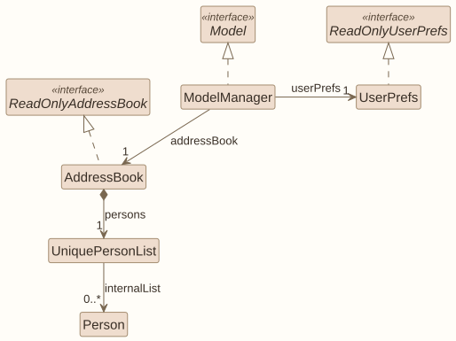</a>

- `ModelManager` holds an `AddressBook` and `UserPrefs`.
- `AddressBook` owns a `UniquePersonList`. It exposes a live, unmodifiable list of members.
- `UserPrefs` holds window settings. Other components read it through `ReadOnlyUserPrefs`.
- Model has no dependency on UI, Logic or Storage.

**2. Member values**

<a class="dg-diagram" style="--dg-diagram-width: 16.6154em" href="images/PersonValuesDiagram.svg" aria-label="Open diagram at full size: Person references immutable contact values and tags">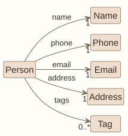</a>

- A `Person` references a name, phone, email, address and a set of tags.
- An absent address is an empty `Address` value, not a missing object.
- Contact values and tags are immutable and can be reused when replacing a record.
  Associations therefore fit these references better than exclusive composition.
- There is no separate shared tag registry.

**Contact identity:** `Person#isDuplicateContactOf` checks new add/edit/import input against the
whole roster, including hidden members. It ignores name case and repeated whitespace, compares the
other trimmed contact fields exactly, and ignores tags. Name case is compared with `equalsIgnoreCase` after
whitespace is collapsed, not by lowercasing, because lowercasing changes Greek sigma by its position in
the word. `Person#isSamePerson` retains exact name
matching for JSON loading, so older name variants remain loadable. `EditCommand` checks for duplicates
only when contact details change; tag-only and unchanged-contact edits remain possible on those records.

**3. Display pipeline**

<a class="dg-diagram" style="--dg-diagram-width: 29.3846em" href="images/ModelViewDiagram.svg" aria-label="Open diagram at full size: Stored records feed the filtered view and then the sorted display">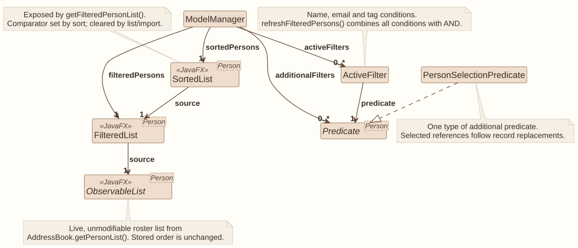</a>

- `FilteredList` applies the current conditions to stored records.
- `SortedList` optionally orders the filtered results by name.
- `getFilteredPersonList()` returns the sorted view. Indexed commands use this displayed order.
- Changing filters or sorting does not reorder the stored roster.

**4. Filter state**

The view is either showing all members or narrowed by one or more conditions. This state diagram shows
which commands move it between the two.

<a class="dg-diagram" style="--dg-diagram-width: 51.6154em" href="images/FilterLifecycleDiagram.svg" aria-label="Open diagram at full size: Commands that narrow the view or restore all members">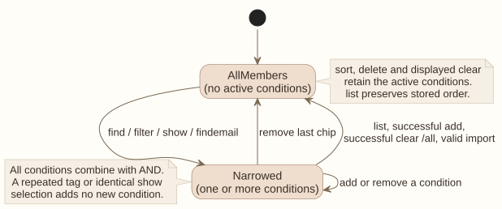</a>

The class diagram below shows how `ModelManager` stores those conditions.

<a class="dg-diagram" style="--dg-diagram-width: 48.2308em" href="images/FilterStateDiagram.svg" aria-label="Open diagram at full size: Structure of the stored active and additional conditions">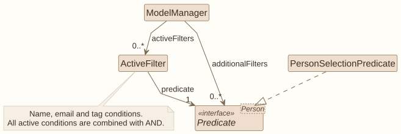</a>

- `activeFilters` contains removable name, email, tag and `show` conditions in application order.
- Each `show` condition wraps a `PersonSelectionPredicate`; `additionalFilters` holds other internal predicates.
- `refreshFilteredPersons()` combines all conditions with AND.
- Record replacement updates selected references; deletion removes the member from each selection.
- Each distinct selection has a **Show: N selected** chip. Removing it clears only that condition.
  `list` clears all conditions and sorting.

**Design rationale:** a view change should neither rewrite the JSON roster nor
change export order. JavaFX transformation lists let the UI observe updated results while commands
continue to resolve indexes against exactly what the user sees. Selection predicates need special
handling because edits replace `Person` objects: `setPerson(...)` updates their selected references
before refreshing the view.

### Storage component

**API:** [`Storage.java`](https://github.com/AY2627S1-CS2103T-W12-1/tp/blob/master/src/main/java/seedu/address/storage/Storage.java)

<a class="dg-diagram" style="--dg-diagram-width: 48.7333em" href="images/StorageClassDiagram.svg" aria-label="Open diagram at full size: JSON and CSV storage classes"></a>

**Responsibilities**

- `StorageManager` delegates roster JSON to `JsonAddressBookStorage` and preferences to `JsonUserPrefsStorage`.
- `ImportCommand` and `ExportCommand` call the CSV helpers directly.
- `CsvAddressBookCsv` provides their shared header and format. Commons CSV handles quoting and escaping.
- CSV export is a user-requested copy. It does not replace automatic JSON persistence.

**Write safeguards**

- `LogicManager` gives export the active roster and preferences paths for destination checks.
- Protected destinations include those files, backups, recovery copies, the running JAR and session lock.
- `FileUtil#writeAtomically` is the core helper. It lets the caller write a complete replacement to a sibling
  temporary file, then atomically replaces the target. The destination's parent directory must already exist.
  CSV export and backup copies call it directly.
- `FileUtil#writeToFile` wraps it for text content: it creates missing parent directories first.
  JSON roster saving reaches it through `JsonUtil`.
- On failure, preserve the previous destination and attempt temporary-file cleanup.
- An export's parent directory must already exist.

See [saving and recovery](#6-saving-and-recovery) for JSON failures and
[CSV export](#9-csv-export) for its separate write workflow.

### Common classes

Classes used by multiple components are in the `seedu.address.commons` package.


## Implementation

The sections below explain the implemented workflows and their design tradeoffs. Use the
[User Guide](UserGuide.html) for full command syntax and validation messages. The
[shared behaviour rules](#shared-behaviour-rules) collect the contracts that apply across features.

Sequence diagrams show the relevant path and omit minor calls and parameters. Labels in plain
language are pseudocode. A `ref` frame refers to the named detail diagram directly below it;
helpers may appear only in that detail. Lifelines marked `<<class>>` represent static helper calls.
Solid arrows show calls, dashed arrows show returns, and activation bars show execution where drawn.
Class diagrams omit unimportant members; arrowheads distinguish inheritance, interface realization
and navigable associations. Filled diamonds indicate composition.

<span id="offline-command-help"></span>

### 1. Offline command help

**Purpose:** show command instructions without a browser or network connection.

<span id="catalogue-and-command-flow"></span>

**Flow**

1. `HelpCommandParser` accepts no topic or one known lowercase topic.
2. `HelpCommand` returns the topic in a `CommandResult`.
3. `MainWindow` calls `HelpWindow#show(topic)`.
4. `HelpWindow` reads the local `CommandHelp` entry and displays the card.

<a class="dg-diagram" style="--dg-diagram-width: 59.3846em" href="images/HelpSequenceDiagram.svg" aria-label="Open diagram at full size: Offline help routing">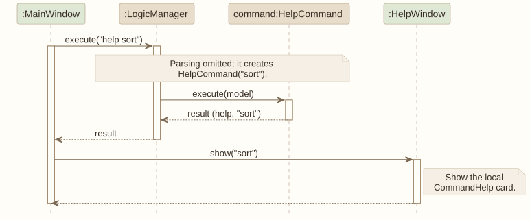</a>

<span id="help-navigation"></span>

**Rules and design**

- Keep the catalogue in Logic and window handling in UI. Commands do not construct windows.
- Include all nineteen commands, each with syntax, examples, expected results and common errors.
- `help COMMAND` and overview buttons open the same topic. F1 and the Help menu open the overview.
- Use two card columns in wide windows and one in narrow windows.
- Arrow/Page keys scroll; Home/End move to the ends; Escape closes help.
- Help is read-only. Invalid or multiple topics do not open a new topic.


<span id="list-and-clear-commands"></span>

### 2. List and clear commands

**Purpose:** restore the complete view with `list`, or remove the complete roster with `clear`.

<span id="list-behaviour"></span>

**List flow**

1. Clear predicates with `updateFilteredPersonList(PREDICATE_SHOW_ALL_PERSONS)`.
2. Disable sorting with `setNameSorting(false)`.
3. Report the full count. Do not change records or save the JSON file.

<span id="clear-and-save-recovery"></span>

**Clear flow**

1. For a non-empty roster, `LogicManager` retains the `ClearCommand` in `pendingConfirmation`
   and returns a prompt counting all records, including hidden ones. Nothing changes or saves yet.
2. The next input confirms only if it is exactly `yes` after surrounding whitespace is stripped.
   A near miss (`y`, `Y`, `YES`) keeps the confirmation pending and repeats the prompt. Any other input
   cancels and is consumed. If it starts with a command word, the message also says that the input was not
   run, so the user knows to enter it again. Confirming or cancelling ends the pending confirmation. As with deletion, the full
   word prevents an accidental clear of the entire roster.
3. On confirmation, snapshot the roster, then execute `ClearCommand` to install an empty roster.
   An already-empty roster skips confirmation but still follows the execution and save path.
4. Retain predicates and sorting until saving finishes. Return success only after saving completes.

<a class="dg-diagram" style="--dg-diagram-width: 65.6923em" href="images/ClearSequenceDiagram.svg" aria-label="Open diagram at full size: Clear save success and rollback">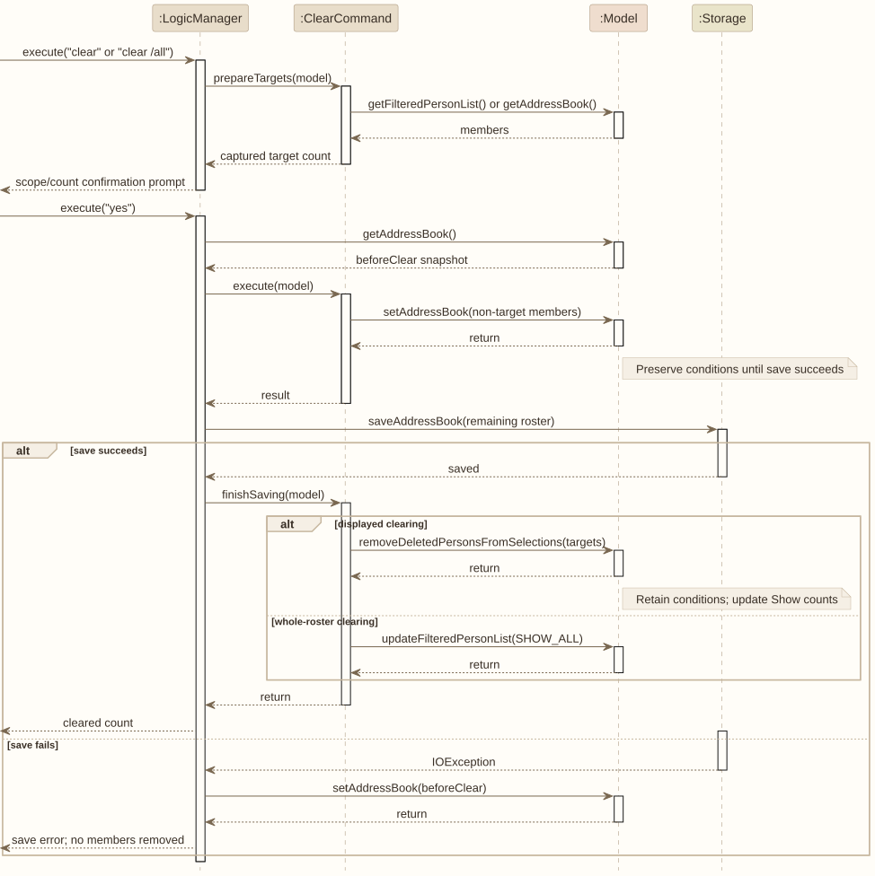</a>

`SHOW_ALL` in the diagram abbreviates `PREDICATE_SHOW_ALL_PERSONS`.

| Outcome | Records and view | Command input |
| --- | --- | --- |
| Save succeeds | Empty roster; conditions cleared; sorting setting retained. | Clear the input. |
| Save fails | Restore the snapshot under the original predicates and sorting. | Retain the submitted input; run `clear` again to restart confirmation. |

**Rules and design**

- Clearing a non-empty roster requires confirmation and has no undo. It does not change preferences.
- Even an empty clear attempts to save, allowing a retry after an unsaved deletion.
- Keep rollback in Logic because that layer knows the persistence outcome.
- Atomic roster replacement is separate from backup rotation; see [startup and validation](#startup-and-validation).

<span id="exact-feedback"></span>

`SaveFailureException#isChangeApplied()` lets the command box retain the last submitted input on
clear rollback while clearing input for changes that remain applied. After a confirmed clear fails,
the retained input is the answer `yes`; run `clear` again to start a fresh confirmation.


<span id="name-sorting"></span>

### 3. Name sorting

**Purpose:** sort displayed members without rewriting stored roster order.

**Flow**

1. `SortCommand` enables the comparator on `ModelManager`'s `SortedList`.
2. For comparison, trim names and collapse repeated ASCII spaces.
3. Compare with `compareToIgnoreCase`; leave stored names unchanged.

| Operation | Sorting | Conditions |
| --- | --- | --- |
| `sort` | Enable A–Z. | Retain. |
| `list`, valid `import` | Disable. | Clear. |
| `findemail` | Retain. | Narrow the view; add a distinct email condition. |
| `find`, `filter`, `show` | Retain. | Narrow the view. |
| Successful `add` execution | Retain. | Clear, even if the later save fails. |
| `clear` | Retain. | Clear after saving succeeds; retain on save failure. |
| Record or tag edit | Retain. | Re-evaluate against updated records. |

**Rules and design**

- Indexed commands read the sorted display, not the stored list.
- Export still uses stored order. No descending or multi-field sorting is provided.
- A view comparator avoids rewriting records for presentation changes.
- Break ties using stored roster order, including after member or tag updates. Names that differ only
  in case or repeated spaces use the same name key, then the stored-order tie-breaker.


<span id="find-members-by-email"></span>

### 4. Email search

**Purpose:** narrow the displayed members by an address or email fragments. `find` follows the same
cumulative and repeat-detection rules for names.

**Flow**

1. Parse a nonblank query into `EmailContainsKeywordsPredicate`.
2. `FindEmailCommand` calls `ModelManager#filterFilteredPersonListByEmail`. If an equivalent email search is
   not already active, append one email `ActiveFilter` and reapply all active conditions with AND.
3. Re-evaluate the live view and return its count with the feedback below. Retain the current sort comparator.

<a class="dg-diagram" style="--dg-diagram-width: 64.0000em" href="images/EmailSearchSequenceDiagram.svg" aria-label="Open diagram at full size: Cumulative email search">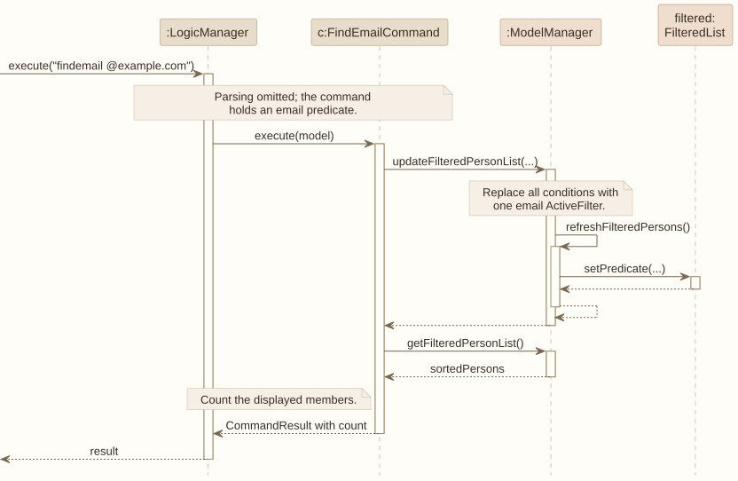</a>

**Rules and design**

- Split keywords on Java whitespace and Unicode space separators, including nonbreaking spaces.
  Lowercase keywords and email with `Locale.ROOT`; match literal substrings with OR within one command.
- Do not search names or phone numbers. Regex syntax has no special meaning.
- Keep earlier name searches, email searches, tag filters, `show` selections and sorting. Each distinct search
  adds its own box in application order; removing a box retains the other conditions, and `list` clears all.
- **Repeats:** `ActiveFilter#hasSameSearch` compares keyword sets of the same kind, ignoring keyword case,
  order and repetition. Names use `String.CASE_INSENSITIVE_ORDER` and emails use `Locale.ROOT` lowercase,
  matching their predicates. A repeat keeps the original box and label. Both model search methods return
  whether a condition was added.
- **Feedback:** a repeat reports that the search is already active. A different query that leaves the displayed
  count unchanged reports `Results unchanged.` and keeps its condition. Searches only narrow the list, so
  equal counts mean the same members remain visible.
- An email edit can remove a record from the view without deleting it.
- Blank input preserves the view. Searching never saves data.


<span id="readable-member-details-and-feedback"></span>

### 5. Member details and command messages

**Purpose:** keep the roster scannable, reveal selected members' contact details and explain command outcomes.

<span id="member-rows-and-results"></span>

**Display responsibilities**

- `PersonCard`: show index, name and sorted tags.
- `MemberDetailsPanel`: show and copy the selected member's phone, email and address.
  Disable address copying when the selected member has no address.
- `Messages#format(Person)`: produce labelled contact lines and sorted tags for command results.
- `MainWindow`: hide contact lines from successful add/edit/delete command messages.
- `UntagCommand`: return name and remaining tags directly, without contact fields.
- `ResultDisplay`: display, wrap and scroll command results and errors. Split panes let users resize the working areas.

**Interaction rules**

- Clear selection before executing any command, including commands that fail.
- This clears the highlighted row and its details only. A `show` selection is a model predicate
  and remains active unless the command explicitly clears it.
- F2 focuses the roster. Escape clears selection and hides details.
- Report data-changing success only after saving. Explain unsaved changes separately.
- Use `LightTheme.css` for shared colours and `HelpWindow.css` for help cards.

<span id="window-placement"></span>

**Window placement**

1. `WindowPlacement` checks saved bounds against available screens.
2. Keep a usable position; otherwise choose the screen with greatest overlap, or the primary screen.
3. Clamp off-screen or oversized bounds to the chosen screen. Replace invalid dimensions.


<span id="automatic-data-saving-and-load-recovery"></span>

### 6. Saving and recovery

**Purpose:** persist valid record changes and recover safely when storage is unavailable or invalid.

<span id="save-policy"></span>

**Save flow**

1. Parse and execute the command.
2. Return immediately for read-only commands, deletion/clear prompts or cancellations.
3. Save the complete roster for valid data-changing commands, including no-ops.
4. Return success only after saving. Parsing or execution errors do not save.

<a class="dg-diagram" style="--dg-diagram-width: 59.5333em" href="images/AutomaticSavingData.svg" aria-label="Open diagram at full size: Automatic saving policy">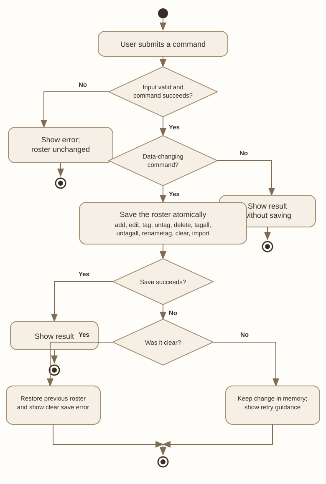</a>

<span id="file-writes"></span>

**Atomic writes**

- `StorageManager` delegates roster writes to `JsonAddressBookStorage`.
- The default path is `data/addressbook.json`, relative to the JAR folder in packaged builds.
- `JsonUtil` calls `FileUtil#writeToFile`, which creates missing parents and delegates to
  `FileUtil#writeAtomically` to write UTF-8 to a sibling temporary file. Backup copies call
  `writeAtomically` directly.
- Close the writer, then replace atomically. If atomic replacement is unavailable, report failure.
- Preserve the previous target on failure and attempt temporary-file cleanup.

<span id="failed-saves"></span>

**Save failures**

| Command | In-memory state | Retry behavior |
| --- | --- | --- |
| `clear` | Restore prior records and view. | Resolve the cause before running `clear` again; confirm if prompted. A lone `yes` cannot retry. |
| Other data-changing commands | Keep the applied change. | Clear the input to prevent accidental repetition. |

- `SaveFailureException` records whether the change remains applied.
- `clear` reports its failure message followed by the underlying storage error, including outside-change warnings.
  If external edits may exist, restart to load them; retry clear only when intentionally replacing them with an empty roster.
- The previous roster file is unchanged. Exiting can lose unsaved in-memory changes.
- After restoring access, inspect the list and use `edit` with an existing value to retry saving.
- If no records remain, use `clear`. Exit never retries a roster save.
- Preferences are saved separately during startup and shutdown.

<span id="startup-and-validation"></span>

**Startup and recovery**

1. Acquire `AppInstanceLock` before reading preferences or the roster.
2. Load valid records in stored order. A missing file loads sample members.
3. For invalid data, preserve the exact bytes in a unique `.corrupt-....json` copy.
4. Show the loading failure reason after `Reason:`: UTF-8 errors, JSON line/column syntax errors,
   a missing `persons` list, or an invalid member field. Offer a validated backup, an empty roster, or closing without replacement.
5. Verify the original still matches its preserved copy before recovery replacement.
6. Reload the recovered roster through the same storage instance to refresh its saved-data baseline.

**Safeguards and limits**

- Hold the instance lock through shutdown. A second instance is rejected; do not delete the lock file.
- Accept one leading UTF-8 byte-order mark in JSON. Trim surrounding member-field and tag whitespace.
- Reject null roots, null members, null tags and invalid or duplicate member values.
- Preserve an empty address, but reject a non-empty address that becomes blank after trimming or contains only Unicode spaces.
- JSON loading retains `Person#isSamePerson`: compare all four trimmed contact fields exactly and ignore tags.
  Older name variants remain loadable. Surrounding field/tag whitespace is trimmed on load; name case and
  internal spacing are preserved. An empty address is valid; a whitespace-only address is rejected.
- Accept an optional leading UTF-8 byte-order mark. The recovery dialog displays the load failure reason.
- Preservation failure prevents an editable roster from opening.
- Normal saves validate the existing roster and rotate `.bak` only when stored member values differ,
  including tag spelling. A capitalization-only tag change therefore creates a backup.
- An unchanged save still retries the write but retains the previous distinct backup.
- `saveWithBackup` preserves the old backup while replacing the active roster. A failed roster write
  attempts to restore that backup; if rollback also fails, the temporary backup copy is retained.
- Before saving, compare the valid file with the last loaded or saved roster. The first save after
  detecting an outside edit is refused and records the outside version as the new baseline.
  Restart to load that version, or retry saving to replace it while keeping its exact bytes in `.bak`, even if
  its member values match the requested save. This backup requirement stays pending after a failed write and
  clears after a successful save or an explicit reload.
- A roster file created externally after a missing-file start is also detected, because storage records that it
  observed the file as missing.
- Invalid preferences fall back to defaults. Logger initialization failure falls back to the console.


<span id="command-parsing"></span>

### 7. Command parsing

**Purpose:** reject malformed input before changing data or view state.

1. `AddressBookParser` reads a case-sensitive keyword and selects its parser.
2. Command-specific parsers check argument structure, indexes and field values.
3. Add/edit use tokenized prefixes and `PrefixValidator`. Tag commands use `BulkTagArgumentParser`
   to validate tag values and reject other member-field prefixes.
4. A successful parse returns a `Command`; failures return usage or field guidance.

**Rules**

- Add/edit accept fields in any order and reject repeated non-tag prefixes.
- Reject unsupported whitespace-delimited ASCII single-letter prefixes in add/edit, including wrong-case prefixes.
- Preserve the `c/o` address abbreviation, URLs, numeric slashes and slashes embedded within words in add/edit.
  `A/` followed by a digit is also literal within an address, as in `Block A/12`.
  A supported lowercase prefix still ends the address.
- Shared field validation, in the model value classes, applies these rules:
  - **Name:** starts with a Unicode letter or ASCII digit. The rest may be Unicode letters, combining marks,
    ASCII digits, spaces, hyphens and apostrophes, including the curly `’`. Leading hyphens or apostrophes,
    a lone combining mark, slashes, tabs, line breaks, `@` and emoji are rejected.
  - **Phone:** at least 3 ASCII digits, with an optional leading `+` and internal spaces. The first and last
    characters after any `+` must be digits.
  - **Email:** ASCII letters and digits in the local part, separated singly by `+ _ . - '`. The local part
    starts and ends with a letter or digit, and consecutive separators are rejected.
  - **Address:** optional. When present, it must contain a character other than whitespace or Unicode spaces.
- `tag`, `untag`, `tagall`, `untagall` and `renametag` reject standalone `n/`, `p/`, `e/` and `a/`
  with a format error. Unknown prefixes such as `x/` still fail tag-value validation.
- `list`, `sort`, `clear` and `exit` take no arguments. Each other command enforces its own grammar.


<span id="csv-import"></span>

### 8. CSV import

**Purpose:** validate an entire file before appending unique members.

**Flow**

1. `ImportCommandParser` accepts one `p/FILE_PATH`; quote paths containing whitespace.
   It rejects an empty path, unmatched quotes, unquoted whitespace and trailing arguments.
   For trailing arguments, it reports a repeated `p/` or an unknown single-letter prefix such as `x/`.
2. Resolve the path and validate the complete CSV before changing the model.
3. Skip duplicates against the stored roster and earlier accepted rows.
4. Append unique records in source order; clear conditions and sorting.
5. Save through `LogicManager`, even if the file is header-only or all rows are duplicates.

<span id="import-sequence"></span>

**Overview: `sd ImportRoster`**

<a class="dg-diagram" style="--dg-diagram-width: 58.6000em" href="images/CsvImportSequenceDiagram.svg" aria-label="Open diagram at full size: Import overview with reference frames">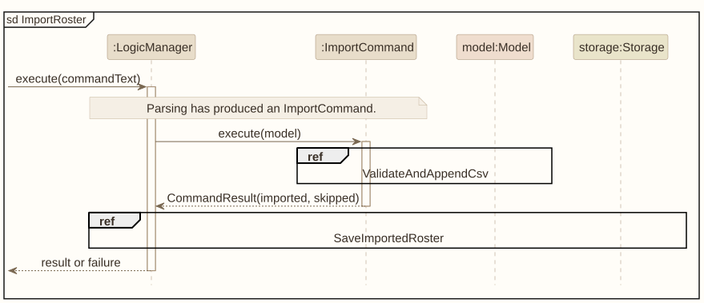</a>

**Detail: `sd ValidateAndAppendCsv`**

<a class="dg-diagram" style="--dg-diagram-width: 51.6667em" href="images/CsvImportApplyDiagram.svg" aria-label="Open diagram at full size: Validate the entire file before adding unique records">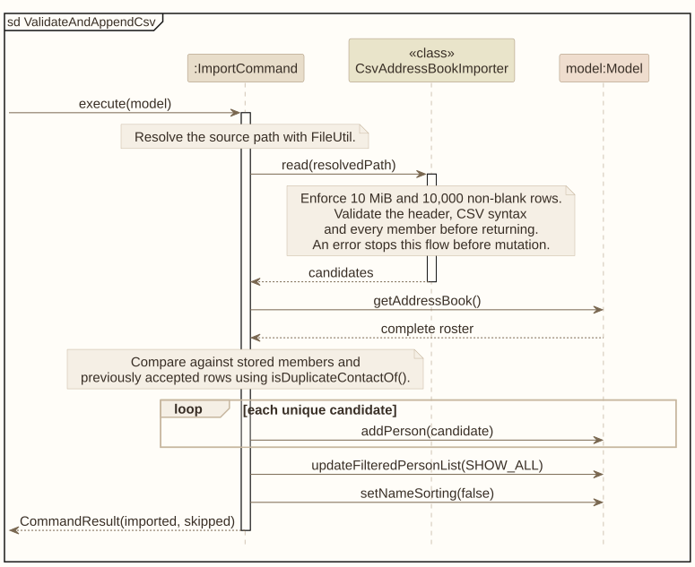</a>

**Detail: `sd SaveImportedRoster`**

<a class="dg-diagram" style="--dg-diagram-width: 44.4667em" href="images/CsvImportSaveDiagram.svg" aria-label="Open diagram at full size: Save imported records and report unsaved changes">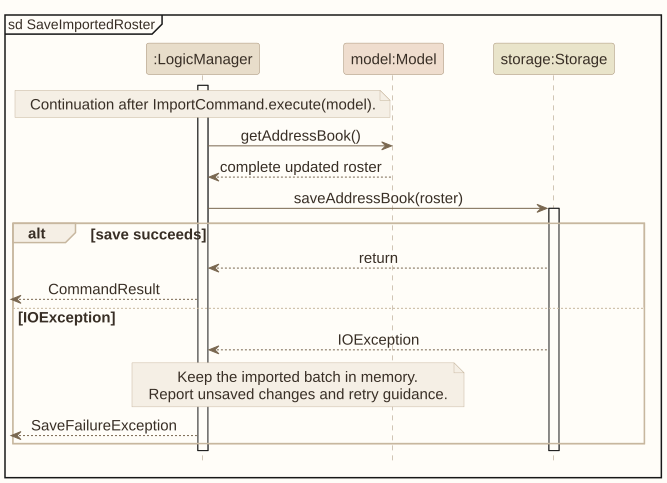</a>

**Validation and failure rules**

- Require a case-insensitive `.csv` extension. Preserve path case.
- Treat only a single letter followed by `/` as a parameter prefix, so a folder name such as `backup-2026/`
  is not reported as an unknown prefix. Uppercase `P/` is an unknown prefix, not a repeated `p/`.
- Reject files over 10 MiB and more than 10,000 nonblank member rows before duplicate removal.
  Bound the byte read as well as checking file size, so a growing source cannot bypass the limit.
- Read strict UTF-8, allowing an optional byte-order mark.
- Require the five headers in any order; validate CSV quoting and every member field.
- Trim surrounding field/tag whitespace. Reject embedded line breaks.
- Skip blank records but include them when reporting physical row numbers.
- Report a missing source with its resolved path. Other read failures, including directories, use the
  platform's I/O error text and do not always include the path. Reject repeated or unknown prefixes.
- Read or validation errors leave records, the view and saved data unchanged. Never modify the source CSV.
- A missing source reports the resolved path and asks the user to check its name and location.
- Save failures keep the imported batch in memory and report retry guidance.

**Design:** whole-file validation prevents partial imports. `Person#isDuplicateContactOf` provides the same
normalized-name duplicate check as new add/edit input; phone, email and address still compare exactly after trimming.
Commons CSV handles quoting instead of manual string splitting.


<span id="csv-export"></span>

### 9. CSV export

**Purpose:** write all stored members to a separate CSV without changing the displayed view.

**Flow**

1. `LogicManager` supplies protected roster and preferences paths to `ExportCommand`.
2. Parse the path, rejecting any double quote before checking the extension, then resolve and validate the
   destination before writing.
3. Export the full roster, including hidden members, in stored order.
4. Return the exported count and path. Do not save the automatic JSON roster.

**Overview: `sd ExportRoster`**

<a class="dg-diagram" style="--dg-diagram-width: 60.6667em" href="images/CsvExportSequenceDiagram.svg" aria-label="Open diagram at full size: Export overview with reference frames">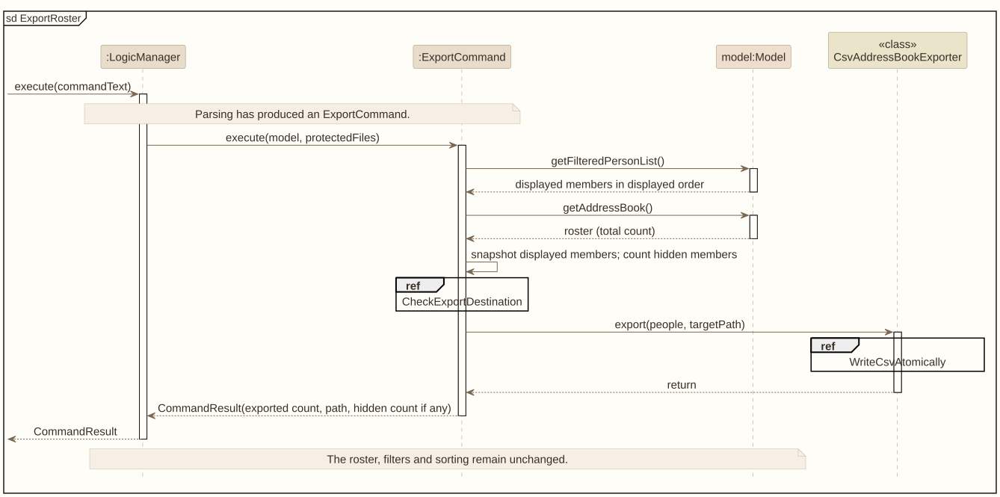</a>

**Detail: `sd CheckExportDestination`**

<a class="dg-diagram" style="--dg-diagram-width: 39.0667em" href="images/CsvExportDestinationDiagram.svg" aria-label="Open diagram at full size: Resolve the path and reject protected application destinations">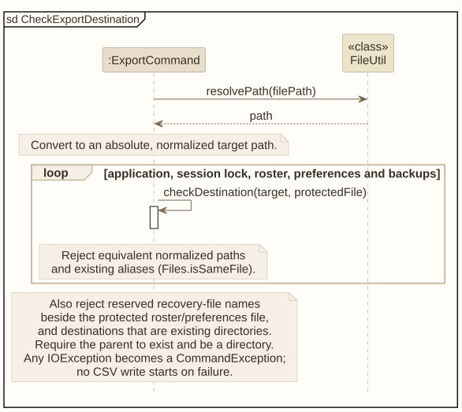</a>

**Detail: `sd WriteCsvAtomically`**

<a class="dg-diagram" style="--dg-diagram-width: 38.0000em" href="images/CsvExportWriteDiagram.svg" aria-label="Open diagram at full size: Write a complete CSV to a temporary file before replacement">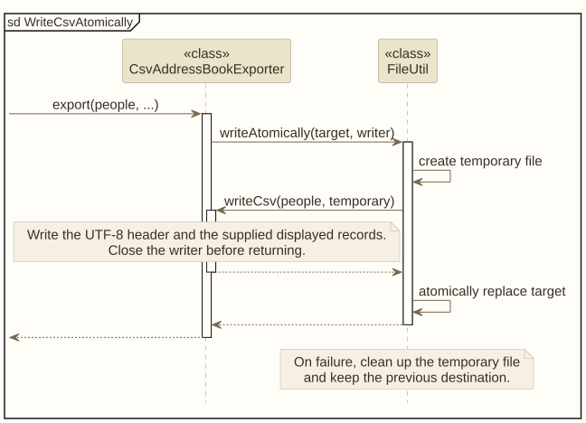</a>

**Rules and design**

- Write UTF-8 with a header row. Sort each member's tags and join them with semicolons.
- Use Commons CSV for quoting and escaping. An empty roster produces a header-only file.
- `ExportCommandParser` requires a `.csv` extension, ignoring letter case.
- Reject a double quote anywhere in the path, including directory names, because `import` cannot read such
  filenames. Spaces need no surrounding quotes, unlike `import`.
- Require an existing parent directory and reject a directory as the destination; apply packaged file-location restrictions.
- Report missing/non-directory parents and write failures with actionable messages instead of temporary-file paths.
- Close the CSV writer before atomic replacement. Attempt temporary-file cleanup on failure.
- Preserve an existing export if writing fails. Keep roster data, filters and sorting unchanged.
- Reject aliases of protected files by checking existing file identity as well as normalized paths.


<span id="selecting-members-and-sorting"></span>

### 10. Selecting displayed members

**Purpose:** narrow the current view using displayed indexes.

1. Validate every requested index before changing the view.
2. Resolve indexes against the sorted display and create a `PersonSelectionPredicate`.
3. Unless the same member set is already selected by an active `show` condition, append a
   `SHOW`-kind `ActiveFilter` containing the selection predicate.

**Rules**

- Repeated indexes collapse to one member. Argument order does not reorder the display.
- Each `show` can only narrow the view. Record replacement updates selected references.
- Each distinct selection has a **Show: N selected** chip in command order alongside other filters.
  Its tooltip lists selected names alphabetically, ignoring case. Repeating the same member set
  creates no extra chip.
- Removing a chip removes only that selection. Its count reflects the remaining selected records,
  including those hidden by other conditions. Deleting every selected record leaves a removable
  **Show: 0 selected** chip.
- `list`, successful `add`/`clear` and valid `import` clear selections.
- Show is read-only and does not save.


<span id="filter-members-by-tag"></span>

### 11. Tag filtering

**Purpose:** narrow the view to members with one tag, ignoring letter case.

<span id="parsing"></span>

**Input:** `FilterCommandParser` accepts exactly one `t/TAG`, trims surrounding whitespace and
checks the shared 1–30-character rule: ASCII letters or digits with optional internal hyphens.
A second `t/` reports that only one filter tag is allowed and suggests a separate command.

<span id="execution"></span>

**Flow**

1. Check active tag conditions using case-insensitive `Tag` equality.
2. If already active, keep the view and conditions unchanged. Report the existing tag spelling and current count.
3. Otherwise call `ModelManager#filterFilteredPersonListByTag` to add a condition.
4. Combine conditions with AND, refresh the observable view and report the result count.

<span id="design-considerations"></span>

**Rules and design**

- Retain earlier name/email/tag conditions and sorting. A zero-match result is successful.
- Keep predicates, not frozen matches, so edits re-evaluate membership automatically.
- `committee` and `Committee` match the same tag. Repeating an active filter leaves the conditions
  and their order unchanged, and explicitly reports that it was already active before giving the result count.
- Show conditions in application order. Removing one retains the others.
- Renumber visible records; later indexed commands use that new view. Filtering never saves.


<span id="individual-tag-editing"></span>

### 12. Individual tag editing

**Purpose:** add or remove one tag without replacing the member's other tags.

1. Resolve the member from the displayed index.
2. Copy the tag set and add or remove the requested tag.
3. Construct a new `Person` with unchanged contact fields and call `Model#setPerson`.
4. Save the complete roster and report the result.

**Rules**

- Retain searches, filters, sorting and `show` selections. Removing a required tag can hide the record.
- Match tags ignoring case. An existing addition or absent removal is a valid no-op and still saves.
  Keep the stored spelling when skipping an already-present tag.
- Invalid indexes or arguments fail before saving. Applied-but-unsaved changes remain in memory.
- The shared tag parser rejects member-field prefixes (`n/`, `p/`, `e/`, `a/`) with command usage.


<span id="bulk-tag-editing"></span>

### 13. Bulk tag editing

**Purpose:** update one tag for every displayed member.

<span id="parsing-1"></span>

**Input:** `TagAllCommandParser` and `UntagAllCommandParser` share `BulkTagArgumentParser`.
Require exactly one valid `t/TAG`.

- Missing `t/`, preambles, or `n/`, `p/`, `e/`, `a/` report invalid format with command usage.
- Empty tags report `Tag cannot be empty.`; multiple tags report
  `Only one tag can be applied per command. Run the command once for each tag.`
- Other invalid values, including internal spaces or `x/`, report the tag-format constraint.

<span id="execution-1"></span>

**Flow**

`TagAllCommand` and `UntagAllCommand` inherit this flow from `BulkTagCommand#execute`.
Each subclass supplies `needsUpdate` and `updateTags`.

1. Snapshot the displayed list. This prevents updates from changing the targets mid-loop.
2. Reject an empty target set before saving, with guidance to run `list` or choose a group using `find` or `filter`.
3. Replace each target that needs a change, preserving contact fields and unrelated tags.
4. Count changed and skipped members against the original snapshot, then save the full roster.
   Feedback explains case-insensitive matching and adds `No changes were made.` when all targets were skipped.
   If `untagall` hides updated members through an active filter, `TagUpdateUtil#describeHiddenUpdates`
   also reports the current list and suggests `list`.

<a class="dg-diagram" style="--dg-diagram-width: 48.1429em" href="images/BulkTagSequenceDiagram.svg" aria-label="Open diagram at full size: Bulk tag parsing, displayed-member updates and saving">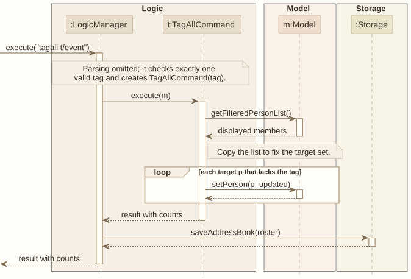</a>

`untagall` changes only the subclass update rules;
`renametag` follows the same displayed-target/save pattern through its own parser.

<span id="design-considerations-1"></span>

**Design tradeoff:** iterating the live filtered list would let an update hide a member and shift
the remaining indexes. A snapshot fixes membership for the whole operation. Replacement `Person`
objects preserve unrelated values and trigger the observable view to re-evaluate.

**Shared implementation:** `TagAllCommand` and `UntagAllCommand` extend the abstract `BulkTagCommand`.
It owns the snapshot, the empty-list rejection, the skip-and-count loop and the feedback. A subclass
supplies only `needsUpdate(Person)`, the membership check, and `updateTags(Set<Tag>)`, which adds or
removes the tag. `tagall` updates members who lack the tag; `untagall` updates members who have it.
`LogicManager` saves the roster afterwards, as for any data-changing command.

**Rules and design**

- Never visit hidden members. Removing an active filter tag can hide targets after their update.
- Retain conditions and sorting. Skip redundant assignments rather than rejecting the batch.
- Feedback adds "No changes were made." for a zero count. If active filters now hide updated members, it adds
  the displayed-list summary and a reminder to run `list` (`FilterCommand#describeHiddenUpdates`).
- A valid all-skipped batch still saves. A save failure leaves the complete batch in memory.
- The shared base class keeps targeting, logging and feedback consistent between add/remove operations.
- Acting on the whole roster would prevent group targeting; `list` supplies that behavior when wanted.
  Explicit index lists would be error-prone for large groups; `show` can choose a precise target set first.


<span id="renaming-a-tag"></span>

**Renaming within the displayed group**

`RenameTagCommand` extends `Command` directly instead of `BulkTagCommand`. It handles two tags, rejects an
old tag that no displayed member has, and counts merges as well as changes, which the shared loop does not.
Like `BulkTagCommand`, it snapshots the displayed members before updating them.

1. `RenameTagCommandParser` uses `BulkTagArgumentParser#parseTagValues` to require exactly two tags.
   Reject preambles, other member-field prefixes and identical spellings. Allow case-only renames.
2. Snapshot displayed members with the old tag, matching without regard to case. Leave hidden members unchanged.
3. Reject an old tag that no displayed member has. If hidden members have it, report their count and suggest `list`.
   Otherwise replace it on targets requiring a change.
4. Merge a distinct already-present new tag into one assignment; report changed and merged counts.
   A case-only rename skips members already using the requested spelling and does not count them as merges.
5. Retain conditions/sorting and save the complete roster. Report members hidden by an active filter after renaming,
   and the count of hidden members that still retain the old tag. A case-only rename that changes nobody
   reports that every displayed member already uses the requested spelling.

All three bulk tag commands, although they do not share one base class, use the displayed list so the secretary
can limit a change to a reviewed group. Run `list` first to rename across the whole roster.
When merging into an existing tag, retain the spelling typed in the command. `Tag#equals` ignores case while
`tagName` preserves spelling, so after `filter t/committee`, `renametag t/committee t/Committee` keeps matching
members visible. Renaming to a different tag name leaves the old filter active and hides the renamed members
without deleting them. Rejecting an unused current tag catches likely typos; allowing case-only renames supports
consistent spelling.

<span id="test-coverage"></span>
<span id="test-coverage-1"></span>
<span id="test-coverage-2"></span>
<span id="individual-tag-test-coverage"></span>
<span id="test-coverage-3"></span>

### 14. Verification roadmap {id="verification-roadmap"}

Use these entry points when changing a workflow; the [manual testing appendix](#appendix-instructions-for-manual-testing)
covers interactions that also depend on JavaFX, the file system or a packaged build.

| Change | Relevant tests |
| --- | --- |
| Command grammar and execution | The corresponding `*CommandParserTest` and `*CommandTest`; `AddressBookParserTest` for dispatch. |
| Filters, selections and stable sorting | `ModelManagerTest`, `SortOrderIntegrationTest`. |
| Saving, clear rollback and applied-but-unsaved changes | `LogicManagerTest`, `ListClearIntegrationTest`, `JsonAddressBookStorageTest`, `FileUtilTest`. |
| CSV validation and export destinations | `CsvAddressBookImporterTest`, `ExportCommandTest`. |
| Offline help, details and window placement | `CommandHelpTest`, `HelpWindowTest`, `MainWindowTest`, `WindowPlacementTest`. |

### 15. Limitations {id="limitations"}

- JSON uses a `persons` array and member `tags` arrays. Unknown fields are ignored and repeated fields
  retain the last value. Numeric JSON values in text fields become text. Comments and trailing commas fail.
- Deletion and clearing a non-empty roster require confirmation. Neither has undo after confirmation.
- The backup retains the previous distinct saved roster, not a full history. Later changed saves replace it.
- Names are compared and searched as entered, without Unicode normalization. Sorting uses Java's
  case-insensitive order, so accented names can sort after `Z`.
- After an accidental clear, stop changing data and follow the [manual recovery steps](UserGuide.html#automatic-backup-and-recovery).

## Development workflow {id="documentation-logging-testing-dev-ops"}

* [Documentation guide](Documentation.html)
* [Testing guide](Testing.html)
* [Logging guide](Logging.html)
* [DevOps guide](DevOps.html)


## Appendix: Requirements {id="appendix-requirements"}

These requirements describe the implemented feature set and retain unimplemented requirements in the
[future and excluded user stories](#future-and-excluded-user-stories).
Command syntax for current features is in the [User Guide](UserGuide.html).
Acceptance targets are listed separately under [non-functional requirements](#non-functional-requirements).

### Product scope

TrackCall supports a membership secretary's workflow from recording and finding members to
updating groups, exchanging rosters and recovering saved data. The capabilities below describe
the implemented product in this guide's version.

#### Target user profile

- A membership secretary managing one club's roster on their own computer.
- Comfortable with typing commands and reviewing results before group updates.
- Maintains contact details and overlapping groups such as committees, cohorts and alumni.
- Typical workload: up to 500 members. This is a performance target, not a record limit.

#### Product capabilities {id="product-capabilities"}

- **Records:** add, edit, delete, list, clear and select displayed members.
- **Search and order:** name search, email search, cumulative tag filters and name sorting.
- **Groups:** individual tags, bulk tags and renaming tags on displayed members.
- **Files:** CSV import/export, automatic JSON saving and startup recovery.
- **Help and session:** offline help, keyboard navigation and exit.

See the [Feature Map](#feature-map) for all nineteen command names.

#### Scope boundaries

- Groups are tags, not separate stored objects.
- All bulk tag commands, including renaming, target the displayed group. Use `list` to include everyone.
- The app is local and single-user. It does not provide cloud sync, shared accounts or concurrent editing.
- No phone search, vCard exchange, archiving, undo, billing, messaging or event management is implemented.
- Manual JSON editing is supported only while the app is closed, with a backup retained.

### User Stories for TrackCall {id="user-stories"}

Priorities: `***` essential, `**` useful, `*` convenience. Implemented and unimplemented stories are listed separately.
Each story identifies a user role, a desired capability and its benefit.

#### Implemented user stories {id="implemented-user-stories"}

| ID | Priority | As a... | I want to... | So that I can... |
| --- | --- | --- | --- | --- |
| US01 | `***` | club secretary | read an offline command overview and topic instructions with examples and expected results | learn and check command syntax without leaving the app |
| US02 | `***` | club secretary | add a member with name, phone, email, an optional address and optional tags | record a new member even before their address is known |
| US03 | `***` | club secretary | see every member in a readable list with their current displayed index | review the roster and select the right record |
| US04 | `***` | club secretary | edit a member's contact details | correct mistakes and keep the roster up to date |
| US05 | `***` | club secretary | find members using complete or partial words from their names | retrieve contact details even when I remember only part of a name |
| US06 | `***` | club secretary | review a single-member deletion and confirm or cancel it | remove unwanted records while avoiding accidental deletion |
| US07 | `***` | club secretary | review a request to clear the whole roster and confirm or cancel it | reset the directory only when I intend to remove all members |
| US08 | `***` | club secretary | filter the displayed members by an exact tag | work with one group or an overlap of groups |
| US09 | `***` | club secretary | add or remove one group tag for all displayed members while retaining other tags | update a reviewed group without editing each member separately |
| US11 | `***` | club secretary | have valid changes saved automatically | recover my saved roster when I next open the app |
| US12 | `***` | club secretary | receive clear error messages for invalid commands and storage failures | correct my input or the storage problem and know whether my changes were saved |
| US13 | `***` | club secretary | close the app with a command | finish my work using the keyboard |
| US14 | `***` | experienced secretary | edit a backed-up data file while the app is closed | make awkward data corrections outside the app when necessary |
| US15 | `**` | club secretary | export member records as a CSV file | share a reviewable copy, prepare submissions or hand over records to my successor |
| US16 | `**` | club secretary | hide private contact details until a member is selected | reduce accidental disclosure to people nearby |
| US17 | `*` | club secretary | sort the displayed members by name | browse a long roster more easily |
| US18 | `***` | prospective club secretary | try TrackCall with sample member data | understand the workflow without risking real records |
| US19 | `**` | first-time user | follow the User Guide's quick start | learn the basic workflow |
| US21 | `**` | club secretary | import CSV member records and review accepted and skipped counts and the resulting roster | bring in an existing roster efficiently and verify the outcome |
| US24 | `***` | club secretary | add or remove one group tag from a member while preserving their other tags | keep overlapping group memberships up to date |
| US25 | `***` | club secretary | view a selected member's details and copy their contact fields | check the correct record and reuse contact details without retyping |
| US29 | `**` | club secretary | rename a group tag for displayed members | correct a group name for a reviewed set of members |
| US35 | `***` | club secretary | have duplicate contact details rejected during data entry | avoid storing the same contact twice |
| US37 | `**` | club secretary | find members by a full email address or domain fragment | retrieve contacts or select an email-domain group |
| US38 | `***` | club secretary | choose a startup recovery action when the roster cannot be read | recover usable records while keeping a copy of the damaged file |
| US39 | `**` | club secretary | remove one active name, email, tag or show condition | broaden the displayed results while keeping other conditions |
| US40 | `**` | club secretary | show a subset using current displayed member numbers | focus on selected records before applying a group command |

`tag` and `untag` change one assignment while preserving other tags. `edit` replaces the supplied tag set.
Import review consists of result counts and inspecting the roster; there is no staged review screen.

#### Future and excluded user stories {id="future-and-excluded-user-stories"}

These requirements are **not implemented in the current version**. They are retained for future planning,
not promised releases, in line with the
[course's Developer Guide guidance](https://nus-cs2103-ay2627-s1.github.io/website/admin/tp-deliverables.html#deliverable-developer-guide-dg).

| ID | Priority | As a... | I want to... | So that I can... | Scope decision |
| --- | --- | --- | --- | --- | --- |
| US27 | `**` | club secretary | search by phone number | identify a member when I only have their number | Considered; the current version searches names and emails only. |
| US30 | `**` | club secretary | update a non-tag field for a group in one operation | handle repeated renewal changes efficiently | Considered; bulk changes in the current version affect tags only. |
| US31 | `**` | long-time secretary | archive an inactive member | reduce clutter while keeping their history | Considered; deletion in the current version does not retain history. |
| US32 | `*` | long-time secretary | archive an unused group tag | keep old groups out of my active work without losing their history | Considered; the current version has no tag archive or separate tag catalogue. |
| US33 | `*` | club secretary | sort members by class | review members in the order relevant to my task | Considered; no class field or class sorting is implemented. |

### Shared behaviour rules

These contracts apply across commands. Feature sections explain their implementation and exceptions.

1. **Input validation:** use lowercase keywords and prefixes; trim surrounding field whitespace.
   Reject invalid input before changing records, filters, sorting or files. Submitting any command
   still clears the highlighted row and its details. See [command parsing](#7-command-parsing) for field rules.
2. **Duplicate identity:** add/edit/import compare normalized names (case and repeated whitespace ignored)
   and exact trimmed phone, email and address values, ignoring tags and the edited record itself.
   Preserve stored spelling. JSON loading keeps the legacy exact-contact rule; tag-only and unchanged-contact
   edits remain possible on legacy variants. See [contact identity](#model-component).
3. **Tags:** store each tag once per member, match without regard to case, retain its spelling and
   display tags in ASCII order. See the [User Guide](UserGuide.html) for tag syntax and length limits.
4. **Listing and search:** `list` clears conditions and sorting. `find` adds a partial-name condition;
   `findemail` also narrows the displayed list with a literal email search. Keywords within
   one search use OR; successive conditions use AND. Repeating a search reports that it is already active,
   and a different query with unchanged results reports `Results unchanged.` Searches retain sorting.
5. **Tag filtering:** each `filter` adds one tag condition. Repeating it, including with different case,
   reports an already-active filter without changing conditions. Zero matches is a valid result.
6. **Displayed indexes:** indexed commands use the current filtered and sorted display, numbered from 1.
   Accept ASCII positive integers and leading zeroes; reject signs, decimals, internal spaces and
   out-of-range values. A view change can renumber members.
7. **Individual updates:** `edit` changes supplied fields only; supplied tags replace the entire tag set.
   Bare `a/` clears an address and bare `t/` clears tags. `tag`/`untag` change one assignment.
   Re-evaluate conditions after updates, so a changed member can leave the view without being deleted.
8. **Bulk tag updates:** snapshot displayed targets; preserve hidden members and unrelated tags.
   Skip redundant assignments and count against the snapshot. Reject an empty target set or a rename
   with no matching old tag. Case-only renames skip members already using the requested spelling.
9. **Save policy:** executed record-changing commands save the complete roster, including valid no-ops.
   View commands, help, export, exit, and confirmation prompts/cancellations do not save the JSON roster.
10. **Save failures:** report success only after saving; a failed write preserves the previous roster file.
    Failed `clear` restores records and the prior view; retry with `clear` after fixing storage.
    Other applied changes remain in memory and can be lost on exit; retry saving with a valid no-op.
    See [saving and recovery](#6-saving-and-recovery) for backup rollback and retry details.
11. **Add and destructive actions:** add appends a record and clears conditions. Delete retains conditions;
    successful clear removes hidden records too and clears conditions. Non-empty delete/clear requests
    require the next input to be exactly `yes`, to prevent accidental deletion. A near miss such as `y` keeps
    the prompt pending; any other reply cancels and is consumed. Neither action has undo.
    Empty clear saves immediately. List, sort, clear and exit reject extra arguments.
12. **Startup and exit:** load the packaged JAR's `data/addressbook.json`; missing data loads samples,
    while a valid empty roster stays empty. Invalid data requires preservation and recovery before editing.
    Normal startup, read-only commands and exit do not save the roster.
13. **Feedback:** input errors explain correction or direct the user to help; duplicate errors reject
    rather than merge records. Storage errors identify unsaved changes using rule 10.

<span id="member-field-rules"></span>
<span id="offline-help-and-readable-feedback"></span>

#### Command and field reference

The [User Guide](UserGuide.html) specifies command syntax, field constraints and offline help.
Implementation details belong in [command parsing](#7-command-parsing),
[member details](#5-member-details-and-command-messages) and [offline help](#1-offline-command-help).

**Current address-parser limitation:** trailing Java whitespace is stripped before validation, so
`edit 1 a/` followed only by U+2003 (EM SPACE) can clear an existing address. This is a known defect
tracked by [PR #319](https://github.com/AY2627S1-CS2103T-W12-1/tp/pull/319), not supported clear syntax.

### Use cases

**System:** TrackCall.

**Primary actor:** the membership secretary.
**MSS:** main success scenario.
The app is open unless a use case states otherwise.
Any step that saves can fail; shared rule 10 describes recovery.
These use cases cover distinct interactions with meaningful alternatives: individual changes,
bulk changes, confirmation, clear rollback, CSV exchange and startup recovery. Simple help and exit
interactions are covered by their user stories and manual tests. Internal method calls belong in Implementation.

#### UC01: Register a member

**Related stories:** US02, US35.

**Goal:** add a new member and retain the record for later sessions.

**MSS**

1. The secretary submits the member's required contact details and optional tags.
2. TrackCall validates the details and checks for a duplicate under shared rule 2.
3. TrackCall adds the member, saves the roster, and restores the complete member list.
4. TrackCall reports the added member. The use case ends.

**Extensions**

* **2a.** The command structure or a field is invalid, or the member duplicates an existing record.
  TrackCall explains the error and changes nothing. The secretary can correct the input at step 1.

#### UC02: Find and update a member

**Related stories:** US03, US04, US05, US24, US25.

**Goal:** correct one member's record.

**MSS**

1. The secretary searches for complete words or parts of words from the member's name.
2. TrackCall lists matching records and their current indices.
3. The secretary identifies the intended member and submits its displayed index and the requested
   contact or tag changes.
4. TrackCall validates the request, updates the record, saves the roster, and reapplies the search
   and filters.
5. TrackCall reports the update. The use case ends.

**Extensions**

* **1a.** The search has no keyword. TrackCall reports the input error and preserves the view.
  The secretary can retry step 1.
* **2a.** No record matches. TrackCall shows an empty result. The secretary can search again at step 1
  or end the use case without changing data.
* **4a.** The index or fields are invalid, no field is supplied, or the edit duplicates another record.
  TrackCall reports the error without changing records or the view. The secretary can retry step 3.

An edited member that no longer matches the search or filters disappears from the displayed list
but remains in the roster. The secretary can use `list` to see it again.

#### UC03: Update a group's tags {id="uc03-update-a-groups-tags"}

**Related stories:** US08, US09.

**Goal:** change one group assignment without changing unrelated tags.

**MSS**

1. The secretary requests the complete roster.
2. TrackCall lists all members.
3. The secretary searches or filters to identify the intended group.
4. TrackCall displays the matching members.
5. The secretary checks the affected group and requests adding or removing one tag from it.
6. TrackCall validates the request, updates the group's tags, and saves the roster.
7. TrackCall reapplies the search and filters and reports changed and skipped counts. The use case ends.

**Example:** enter `list`, `filter t/year1`, and `tagall t/committee` as separate commands.
This adds `committee` to the displayed year-one members and retains their other tags.

**Extensions**

* **3a.** A search or filter request is invalid. TrackCall reports the error and preserves the prior
  view. The secretary can correct the request at step 3.
* **4a.** No members match. The secretary can restart at step 1 or end the use case. A bulk update
  on an empty list is rejected without changing or saving data.
* **6a.** The tag is empty or invalid, or more than one tag or an unknown prefix is supplied.
  TrackCall reports the error and changes nothing. The secretary can retry step 5.
* **6b.** Some targets already have the added tag or lack the removed tag. TrackCall skips those
  assignments, saves the roster, and continues to step 7. A non-empty target with no changes is
  still a valid operation; it does not create duplicate tags.

Removing a tag required by an active filter can hide the affected members after step 7. It does
not delete them. Counts still refer to the target set fixed at step 6.

#### UC04: Remove one member

**Related stories:** US05, US06, US25.

**Goal:** remove one unwanted record while retaining other members.

**Guarantees:** no member is removed unless the secretary enters exactly `yes`.

**MSS**

1. The secretary lists, searches, or filters the roster.
2. TrackCall displays the resulting records and their current indices.
3. The secretary checks the intended member's details and requests deletion using its displayed index.
4. TrackCall validates the request and asks for confirmation, naming the member, their displayed number and their tags.
5. The secretary confirms the deletion.
6. TrackCall removes that record, saves the roster, and renumbers the remaining displayed records
   while retaining the active search and filters.
7. TrackCall reports the deleted record. The use case ends.

**Extensions**

* **1a.** The listing, search, or filter command is invalid. TrackCall reports the error and preserves
  the current view. The secretary can retry step 1.
* **2a.** The result is empty. No member can be selected. The use case ends without changes.
* **4a.** The deletion command or index is invalid. TrackCall reports the error and removes nothing.
  The secretary checks the current list and retries step 3.
* **5a.** The secretary enters a near miss such as `y` or `YES`. TrackCall keeps the deletion pending,
  reminds the secretary to type `yes` exactly, and the use case resumes at step 5.
* **5b.** The secretary enters anything else. TrackCall cancels the deletion, removes
  nothing, does not run that input, and does not save. If the input starts with a command word, TrackCall
  says it was not run so the secretary can enter it again. The use case ends.
* **6a.** Saving fails. The record remains deleted in memory but may return after restart. TrackCall
  reports the storage error and leaves the saved file unchanged. The use case ends without
  confirmed persistence; recovery follows rule 10.

Deletion has no undo after confirmation. It removes the underlying record, not just its visible card.

#### UC05: Reset the whole roster

**Related story:** US07.

**Goal:** remove all member records, including records outside the current view.

**Guarantees:** no member is removed unless the secretary enters exactly `yes`.

**MSS**

1. The secretary decides to remove all records and requests clearing the roster.
2. TrackCall validates the request and asks for confirmation, counting the whole roster including hidden records.
3. The secretary confirms by entering `yes`.
4. TrackCall removes every member, saves the empty roster, clears the search, tag, and selection filters,
   and reports the number removed. The use case ends.

**Extensions**

* **2a.** The command contains extra arguments. TrackCall rejects it without changing anything.
  The secretary can retry step 1.
* **2b.** The roster is already empty. TrackCall skips confirmation and reports that no changes were
  needed once the roster is saved. The use case ends. If saving fails, TrackCall responds as in 4a.
* **3a.** The next input is a near miss such as `y` or `YES`. TrackCall keeps clearing pending and
  reminds the secretary to type `yes` exactly. The use case resumes at step 3.
* **3b.** The next input is anything else. TrackCall cancels clearing, consumes the answer, and changes and
  saves nothing. If the input starts with a command word, TrackCall says it was not run so the secretary
  can enter it again. The use case ends.
* **4a.** Saving fails. TrackCall restores the previous records, displayed list, and filters and
  leaves the saved file unchanged. It reports that no members were removed. The secretary can
  resolve the storage problem and retry step 1.

Confirmation ends even when saving fails, so a retry must start with `clear` again.
There is no undo after confirmation. Recovery after a successful clear requires a usable backup,
such as the automatic previous-version backup.

#### UC06: Import members from CSV

**Related stories:** US15, US21, US35.

**Goal:** import a batch of member records without accepting an incomplete file.

**Guarantees:** no member is imported if any row is invalid.

**MSS**

1. The secretary supplies the CSV file to import.
2. TrackCall validates the complete file.
3. TrackCall appends unique members, saves the roster and displays the complete list in stored order.
4. TrackCall reports imported and skipped-duplicate counts. The use case ends.

**Extensions**

* **2a.** The file cannot be read or contains invalid data. TrackCall explains the failure and leaves
  the roster, view and saved file unchanged. The secretary can correct the file and retry step 1.
* **3a.** Some rows duplicate existing members or earlier rows. TrackCall skips them without merging
  tags and continues. A header-only file or an all-duplicate file is also valid.

**Export variation:** the secretary supplies an optional destination; TrackCall writes the entire
stored roster in stored order and reports the count and destination. Hidden members are included.
An invalid destination or write failure leaves an existing destination unchanged. Export does not
alter the roster, view or JSON file.

#### UC07: Load a manually edited data file

**Related stories:** US11, US12, US14.

**Goal:** load valid corrections made outside the app.

**Preconditions:** TrackCall is closed and the secretary has backed up the data file.

**MSS**

1. The secretary edits and saves the JSON data file while preserving its structure and valid member fields.
2. The secretary starts TrackCall.
3. TrackCall validates the complete file and loads its members in file order.
4. TrackCall displays the loaded roster. The secretary checks the corrections. The use case ends.

**Extensions**

* **1a.** After a valid roster was loaded or saved, an outside edit changes its member data.
  The next save is refused. Restart to load the outside version and discard this session's unsaved changes,
  or deliberately retry a roster-changing command to replace it. The retry updates `.bak` only if outside and
  session data differ. Initially missing files and matching-roster retries have the limits described under
  [storage safeguards](#startup-and-validation).
* **3a.** The file is missing. TrackCall loads sample members and logs that the file was missing.
  It creates the file only after a valid data-changing command saves successfully. The use case ends.
* **3b.** The file is invalid or unreadable. TrackCall preserves its bytes in a uniquely named
  recovery copy and opens a dialog explaining the failure before editing is allowed. The secretary can restore a
  valid backup, start with an empty roster, or close without replacing the file. No partial roster
  is loaded. The use case ends after the chosen recovery action.
* **3c.** TrackCall cannot preserve the damaged file. It reports the failure and closes without
  opening an editable roster. The secretary fixes access or restores a backup, then retries step 2.

### Non-functional requirements

These are acceptance targets, not a record of passed tests. They include the
[course constraints](https://nus-cs2103-ay2627-s1.github.io/website/admin/tp-constraints.html).

1. **NFR01: Platforms:** run on Windows, macOS and Linux using Java 25. Do not require another Java version.
2. **NFR02: Distribution:** deliver one JAR of at most 100 MB. Require no installer or separate application dependencies.
3. **NFR03: Offline use:** core commands and help work with networking disabled. No team-operated server is required.
4. **NFR04: Keyboard access:** complete every in-app operation using commands and keyboard navigation.
   Manual file editing uses an external editor.
5. **NFR05: Display:** keep controls and text readable, without overlap, at:
   - 1920 × 1080 or higher with 100% and 125% scaling.
   - 1280 × 720 or higher with 150% scaling.
   - Long lists and help text remain reachable through scrolling.
6. **NFR06: Privacy:** core operations do not transmit contacts to external services.
   Local files rely on OS access controls; the app provides no login or encryption.
7. **NFR07: Storage:** use local, human-editable UTF-8 JSON without a DBMS.
   Support corrections in a text editor while the app is closed.
8. **NFR08: Response time:** complete each valid command within two seconds under this test workload:
   - 500 members; writable data file up to 1 MB; command up to 256 characters.
   - 2 GHz dual-core CPU, 4 GB RAM and local SSD, without competing heavy work.
   - Measure submission to visible result, including saving. Exclude startup and shutdown.
   - Record OS, Java version, hardware, dataset and timings. These are test conditions, not input limits.
9. **NFR09: Reliability:** retain successfully saved data after restart.
   - A write failure preserves the previous roster and never reports success.
   - Apply the in-memory failure policy in shared rule 10, including clear rollback.
   - Exit closes without a separate roster save.

Validation, duplicates and filters are functional rules. Development-process rules are not product NFRs.

### Glossary

| Term | Meaning |
| --- | --- |
| Active condition | A removable name, email, tag or index-selection restriction on the displayed list. All active conditions must match for a member to be displayed. |
| Backup | The `.bak` copy of the previous distinct saved roster. It contains one earlier version, not a complete history. |
| Bulk tag update | A tag change applied to the members displayed when the command is submitted. |
| CSV | Comma-separated values: a text format that represents a table as rows of fields. TrackCall uses CSV to import and export rosters for use with spreadsheets and other tools. |
| Data-changing command | A command intended to modify roster records, including a valid request that makes no change. |
| Displayed list | The members visible after applying the current conditions and sorting. Displayed indexes refer to this view. |
| Duplicate record | A contact whose normalized name and trimmed phone, email and address match another record; tags do not distinguish contacts. See [contact identity](#model-component) for the separate JSON-loading rule. |
| Group | Members sharing a tag, such as a committee or cohort. A group is not a separate stored object. |
| In-memory data | The working roster held by the running app, which can differ from the saved file after a save failure. |
| Index | A member's position in the displayed list, starting at 1. It can change when the view changes. |
| JAR | Java Archive: the packaged application file, launched with `java -jar`. |
| JSON | JavaScript Object Notation: a structured text format using objects, arrays and values. TrackCall uses JSON for its local roster and preferences files. |
| No-op | A valid operation that leaves record values unchanged. |
| Partial-word matching | Matching a contiguous part of a name word without regard to case; for example, `oh` matches `John Tan`. |
| Persisted data | The roster successfully written to disk and available after restarting the app. |
| Read-only command | A command that leaves roster records and the automatic JSON roster file unchanged. It may change the view or write a separate export file. |
| Roster / address book | The complete collection of member records, including hidden members. The starter code uses the name address book. |
| Tag | A case-insensitive label assigned to a member to represent group membership. Its original spelling is retained for display. |


## Appendix: Instructions for Manual Testing {id="appendix-instructions-for-manual-testing"}

Use a disposable folder and synthetic contacts. These are test instructions, not a record of passed tests.
Record the release version, JAR checksum, Java version, OS and actual result for each run.
Vary the inputs freely; the cases below are starting points that complement the [User Guide](UserGuide.html).

### Test setup

1. Put the supplied TrackCall JAR in a new, writable folder. Run `java -version` to confirm Java 25, then launch
   with `java -jar "trackcall.jar"` from that folder in a terminal.
2. Before each independent scenario below, recreate this fixture by entering each command separately:

```text
clear
yes
add n/Zara Lim p/90000001 e/zara@example.com a/Test Road t/friends
add n/Bob Lee p/90000002 e/bob@school.edu t/committee
add n/Alice Tan p/90000003 e/alice@example.com a/Main Street t/committee
```

**Expected baseline:** three members in stored order: Zara, Bob, Alice. Bob has no address.
Enter `yes` only when `clear` prompts for confirmation; an already-empty roster needs no answer.
Use `list` and check the displayed indices before any indexed command. Read-only commands must not change the
roster file's bytes or timestamp. Back up test files before fault injection.

### Launch and shutdown

1. Start in a new folder without a roster file. **Expect:** sample members and a usable command box.
2. Run `list extra`, `clear extra`, and `exit extra`. **Expect:** input errors, unchanged records, and an open app.
   Run `exit`, then restart. **Expect:** the last successfully saved roster.
3. Launch the same JAR twice. **Expect:** the second process reports that the app is already running.
   Close the first and relaunch. **Expect:** startup succeeds without deleting `.trackcall.lock`.
4. Move and resize the window, close, and restart. **Expect:** valid saved bounds are restored.
   Repeat after disconnecting its former display. **Expect:** the window remains reachable.

### Offline help and readable feedback {id="offline-help-and-readable-feedback-1"}

**Setup:** restore the fixture and disable networking.

1. Open `help`, F1, and the Help menu. **Expect:** the same offline overview of all 19 commands.
   Open `help edit` and the overview's edit button. **Expect:** matching syntax, examples, rules, and errors.
   Use Tab, arrow keys, Page Up/Down, Home/End, and Escape. **Expect:** reachable content and visible focus.
2. Try `help ADD`, `help unknown`, and `help add edit`. **Expect:** useful errors without record or view changes.
3. Press F2 and select a member with arrow keys. **Expect:** that member's complete contact details.
   Copy a field, then select Bob. **Expect:** the absent-address copy control is disabled and the clipboard is unchanged.
   Press Escape. **Expect:** hidden details and focus in the command box.
4. Add, edit, untag, and confirm a delete. **Expect:** the details panel clears; feedback contains the name and
   sorted tags but no phone, email, or address, and routine logs hold no synthetic contact values.
5. Add long values and several 30-character tags, apply many name filters, and resize the main and help windows.
   **Expect:** reachable text, no overlapping controls, and each filter's removal control usable by keyboard.

### Commands and displayed indices

Start each subsection below from the baseline fixture and run its numbered steps in order.

#### Add, edit and validation

1. Add a fourth member without `a/`. **Expect:** an absent address that survives restart.
   Run `edit 1 a/`. **Expect:** Zara's address is cleared. Run `edit 1 t/committee t/year1`, then `edit 1 t/`.
   **Expect:** replaced tags, then no tags.
2. Try, separately, a missing required field, repeated `n/`, invalid phone/email, empty `add ... a/`, `edit 1`,
   and appending `x/extra` or `T/committee`. **Expect:** rejection without changes. Tab separators before valid
   prefixes parse like spaces.
3. Add Alice's contact details with different tags, then repeat using `alice tan` and `Alice  Tan`.
   **Expect:** duplicate rejection each time. Change the phone and retry. **Expect:** a separate record.
4. Add a member using `n/Chloé O'Connor`, `p/+65 9123 4567`, `e/chloe.o'connor@example.com`,
   `a/Block A/12` and `t/year-1`. **Expect:** accepted values with their spelling and formatting preserved.
   Then add the same member with one invalid value at a time: `n/-Anne`, `n/Alice/Other`, `p/1 2` (two digits),
   `p/65+`, `e/john..doe@example.com`, and `a/` followed only by a nonbreaking space (U+00A0).
   **Expect:** a field-specific error each time, with no record added.

#### Search, filter and selection

1. Run `find ali`, then `find Zara Bob`, then `find Nobody`. **Expect:** Alice; Zara and Bob; no matches.
   `list` restores Zara, Bob, Alice in stored order.
2. Run `filter t/committee`, then `find Alice`. **Expect:** Alice only. Remove the name-filter box.
   **Expect:** Bob and Alice; the committee filter remains. Run `filter t/COMMITTEE`.
   **Expect:** one tag chip, unchanged results, and feedback that the filter is already active.
3. Run `list`, `show 1 3`, then `show 2`. **Expect:** Zara and Alice, then Alice only, with chips
   **Show: 2 selected** and **Show: 1 selected** in command order. Repeat `show 1`. **Expect:** no extra chip.
   Remove the one-member chip. **Expect:** Zara and Alice return. Hover over the remaining chip.
   **Expect:** Alice Tan and Zara Lim in alphabetical order.
4. Try `find` without a keyword, an empty tag filter, and an out-of-range selection.
   **Expect:** errors preserving the preceding view.

#### Individual and bulk tags

1. Run `tag 1 t/year1` twice. **Expect:** Zara gains one tag; repetition reports no change.
   Run `list`, `filter t/committee`, then `tagall t/year1` twice. **Expect:** Bob and Alice gain the tag;
   the second command skips both.
2. Run `untagall t/committee`. **Expect:** both members leave the filtered view. Run `list`.
   **Expect:** all three remain stored with their other tags intact.
3. Run `find Alice`, then `renametag t/year1 t/alumni`, followed by `list`.
   **Expect:** only Alice's tag is renamed; hidden Bob and Zara retain `year1`.
4. Restore the fixture. Run `filter t/committee`, then `untag 1 t/committee`.
   **Expect:** Bob disappears from the view but remains in the roster.
5. Try invalid indices, empty tags, two tags for `tagall`, identical old/new tags for `renametag`, a bulk update
   on an empty view, and each tag command with `n/extra`, `p/123`, `e/a@example.com` or `a/Home`.
   **Expect:** format or usage errors without changes.
6. Restore the fixture. Run `filter t/committee`, then `renametag t/committee t/Committee`.
   **Expect:** two changed members, both still displayed, and the `committee` filter retained.
   Repeat. **Expect:** zero changed and no merges. Run `renametag t/committee t/alumni`.
   **Expect:** both members leave the old-tag filter; removing it returns all three, with `alumni` on Bob and Alice.

#### Delete and clear

1. Run `find Alice`, then `delete 1`. **Expect:** a confirmation naming Alice; no deletion yet.
   Enter `list`. **Expect:** cancellation; `list` is consumed and the message adds
   `"list" was not run. Enter it again to run it.` Repeat `delete 1`, then enter `no`.
   **Expect:** only the plain cancellation message.
2. Run `delete 1`, then `y`, `Y` and `YES` in turn. **Expect:** each keeps the prompt pending with a reminder to
   type `yes` exactly, and nothing is deleted. Enter `yes`. **Expect:** Alice is deleted; `list` shows Zara and Bob.
3. Try `delete 0`, `delete -1`, a very large integer, and an index beyond the displayed list.
   **Expect:** errors without deletion.
4. Restore the fixture, run `find Alice`, then `clear`. **Expect:** a prompt counting all three records; nothing
   removed or saved yet. Enter `list`. **Expect:** cancellation noting that `list` was not run.
   Run `clear`, then `y`. **Expect:** the prompt stays pending. Enter `yes`.
   **Expect:** all three records are removed, including hidden members.
5. Run `clear` again. **Expect:** the already-empty message after saving, without confirmation.
   `.bak` still holds the previous distinct roster. Confirmed clear has no undo.

The EM SPACE edit case in the [current parser limitation](#member-field-rules) is a known failure in
this candidate. Record it separately from the nonbreaking-space cases above; rejection is pending #319.

### Email search

**Setup:** restore the fixture before each independent check.

1. **Cumulative conditions:** run `list`, `sort`, `filter t/committee`, then `findemail @EXAMPLE.COM`.
   **Expect:** Alice only, with boxes `Tag: committee` and `Email: @EXAMPLE.COM`.
   Run `findemail alice`. **Expect:** `Results unchanged. 1 member listed.` and a third box, `Email: alice`.
   Run `findemail ALICE alice`. **Expect:** `This email search is already active. 1 member listed.` and still
   three boxes, with the original spelling. Remove the `Email: alice` box with X: Alice remains.
   Remove the domain box: Alice and Bob reappear in name order.
2. **Empty results:** run `find Nobody`, then `findemail @example.com`. **Expect:** an empty list; the email search
   does not restore hidden members. Run `findemail` without arguments. **Expect:** invalid input and unchanged
   boxes and results.
3. **Alternatives within a search:** run `list`, then `findemail alice@example.com @school.edu`.
   **Expect:** Alice and Bob (OR matching), also with a nonbreaking space (U+00A0) between the keywords.
   Run `findemail example.com`. **Expect:** Alice only. Remove the first Email box. **Expect:** Alice and Zara.
   Run `list`, then `findemail .*`. **Expect:** zero matches, not regular-expression matching.
4. **Selections and edits:** run `list`, `sort`, `show 1`, then `findemail @example.com`. **Expect:** Alice only
   with the Show condition still active. Run `list`, then `findemail @example.com`, and edit Alice's email to
   `alice@other.net` using her displayed index. **Expect:** Alice leaves the view but remains stored;
   `list` shows all three members.
5. **Name-search feedback:** run `list`, then `find Alice`, then `find ALICE alice`. **Expect:** one Name box and
   `This name search is already active. 1 member listed.` Run `find Ali`. **Expect:** a second Name box and
   `Results unchanged. 1 member listed.` Remove `Name: Alice`: `Name: Ali` stays active.

### Sorting and CSV workflows

**Setup:** restore the fixture. Use only files inside the disposable application folder.

1. Run `sort` twice. **Expect:** Alice, Bob, Zara both times; `list` restores Zara, Bob, Alice.
   Try `sort date`. **Expect:** an error preserving the view. Sorting must not save the roster.
2. Run `filter t/committee`, `sort`, then `export members.csv`. **Expect:** all three records in stored order,
   including hidden Zara, with the view unchanged. Inspect the CSV. **Expect:** the documented UTF-8 header,
   correctly quoted fields, and sorted semicolon-separated tags.
3. Run `import p/members.csv`. **Expect:** zero imports and three skipped duplicates; filters and sorting reset.
   Run `clear`, confirm with `yes`, then import again. **Expect:** three imports that persist after restart.
   Import Alice's details with a lowercase or repeated-space name. **Expect:** a skipped duplicate, no merged tags.
4. Copy the CSV to `member list.csv`. **Expect:** `import p/"member list.csv"` works and a missing source fails
   without changes. `export member list.csv`, without quotes, creates a file named exactly that.
   Try each malformed import separately. **Expect:** an error naming the problem, with no change to the roster,
   view or saved file.
   - `import p/"member list.csv` (unmatched quote).
   - `import p/member list.csv` (unquoted whitespace) and `import p/members.csv extra` (trailing argument).
   - `import p/a.csv p/b.csv` (repeated `p/`), `import x/a.csv` (unknown prefix) and `import p/""` (empty path).
5. Import this CSV. **Expect:** a row-specific error with no partial import, save, or view change.

   ```csv
   name,phone,email,address,tags
   New Member,90000004,new@example.com,,committee
   Invalid Member,12,invalid@example.com,,committee
   ```

   Repeat separately for a bad header, broken quoting, and a line break inside a quoted field.
   A header-only CSV import and an empty-roster export are valid zero-record operations.
6. Try `export "members.csv"` and `export back"ups/members.csv`. **Expect:** the double-quote error and no file.
   Export to a missing directory, a protected application file, a path outside the application folder (also through
   symbolic links), `members.txt`, and a directory named `folder.csv`.
   **Expect:** handled errors with extension or folder guidance, and no file replaced.
7. In a separate disposable roster, add two, then four, members with the same name and distinct phone/email fields.
   Run `sort`, `tagall t/year1`, `renametag t/year1 t/year2`, a phone-only `edit` and an individual `tag`.
   **Expect:** tied names retain stored roster order after each. Also test names differing only in case or spaces.
8. Import a file over 10 MiB, then a separate file with 10,001 valid nonblank member rows.
   **Expect:** the matching limit error with no imports, saves or view changes, even if the rows are duplicates.

11. Import valid files at the 10 MiB and 10,000 non-blank-row boundaries, then files exceeding each limit.
    Count rows before duplicate removal. **Expect:** accepted boundary files and rejected oversized files,
    with no partial import or view change on rejection.

### Persistence and invalid files

Use a fresh fixture and backup for each failure scenario. Restore access before exiting the app.

1. Save a change, restart the packaged JAR from a different working directory, and check the roster.
   **Expect:** the same application-folder data and complete fields and tags.
2. With the app closed, replace the roster with malformed JSON, `null`, a null member, or a null tag, each
   separately. **Expect:** a recovery dialog stating the load failure and an exact-byte, uniquely named recovery copy.
   Try Close, Restore backup, and Start empty. **Expect:** Close preserves the invalid file; recovery preserves the
   damaged copy and existing backup. If no recovery copy can be written, startup stops before an editable roster opens.
3. Test null preferences and null `guiSettings`. **Expect:** usable defaults. In a valid JSON roster, keep two names
   differing only in case with identical other fields. **Expect:** both load; tag-only and unchanged-contact edits
   remain possible.
4. While the app is open, prevent file creation or replacement in its `data` directory: on macOS/Linux remove
   directory write permission, on Windows deny write access. Keep read access. Making only `addressbook.json`
   read-only may still allow atomic replacement, so first confirm a save error occurs. Test each of `add`, `edit`,
   `tag`, `untag`, confirmed `delete`, `tagall`, `untagall`, `renametag`, and `import` independently.
   - **Expect:** a save error with retry guidance; the change stays in memory and saved bytes are unchanged.
     Pressing Enter again must not repeat the command.
   - Restore access, reapply an existing field with `edit`, then restart. **Expect:** the current roster is saved.
5. Repeat the write failure with `clear` while a filter hides members, confirming with `yes`.
   **Expect:** no members removed, the full roster and previous filtered view restored, and unchanged saved bytes.
   Restore access, run `clear` again, and confirm. **Expect:** all members removed.
   Repeat with an already-empty roster, which saves without confirmation.
6. With the app closed, add surrounding whitespace to valid JSON contact and tag fields and a leading UTF-8
   byte-order mark, then restart. **Expect:** loading succeeds with outer whitespace trimmed.
   Test a whitespace-only address separately. **Expect:** a recovery dialog, not an empty address.
7. While the app is open, replace the data file with a different valid roster, then attempt a data change.
   **Expect:** the first save is refused with outside-edit guidance and the file is preserved.
   Restart to load the outside version, or retry with an existing field value. **Expect on retry:** the outside
   version is backed up. Repeat after startup recovery.
8. Rename a tag by capitalization only. **Expect:** `.bak` retains the previous spelling. During a later simulated
   roster-write failure, **expect** the active file and the older backup are both restored when rollback succeeds.

### Release acceptance checks still required

Use the supplied release JAR for every check. Record pass/fail and evidence for:

- Windows, macOS and Linux with the required Java 25 distribution.
- Startup from a folder containing spaces, and operation with networking disabled.
- Keyboard access, long values, and every resolution and scaling combination in NFR05.
- Every User Guide example, comparing actual output with the documented outcome.
- The NFR08 response-time workload, including machine details and measured timings.
- Save failures, recovery, empty inputs, overlapping filters, hidden members, and restart persistence.

Record unresolved failures with the release version and JAR checksum so they can be reproduced.
