# Developer Guide

## Value proposition

TrackCall helps a membership secretary keep a club roster accurate using short typed commands.
The intended MVP supports overlapping groups without repetitive edits to each record.

The secretary can:

* Find members by name or email and narrow the displayed group by tag.
* Add or remove a tag for the whole displayed group in one operation.
* Keep unrelated tags and hidden members unchanged.
* Save valid changes automatically to a local file.
* Complete the core workflow without an internet connection or a separate save command.

This guide describes the **v1.5 release candidate**, which has not yet been published. It supports individual member management, name and email search, tag filtering, bulk tag
editing, offline command help, local saving, CSV import/export, and name sorting.
See [Limitations](#limitations) for constraints in the current release.

## Acknowledgements

* TrackCall builds on [AddressBook Level 3](https://se-education.org/addressbook-level3/) by the
  [SE-EDU initiative](https://se-education.org/). The starter supplies the architecture, source code, tests,
  and original diagrams.
* The application uses [JavaFX](https://openjfx.io/) for its interface and
  [Jackson](https://github.com/FasterXML/jackson) for JSON storage.
* [Apache Commons CSV](https://commons.apache.org/proper/commons-csv/) handles CSV import/export parsing and quoting.
  Its use was [approved by the teaching team](https://github.com/NUS-CS2103-AY2627-S1/forum/issues/627).
* The documentation website uses [MarkBind](https://markbind.org/) and adapts the
  [CS2103T starter layout](https://github.com/NUS-CS2103-AY2627-S1/tp/tree/switch-docs-to-markbind)
  with TrackCall's name, repository links, and guide sections.
* The feature grouping and release-note presentation were inspired by the
  [W12-3 team's User Guide](https://ay2627s1-cs2103t-w12-3.github.io/tp/UserGuide.html) and
  [CoordiMate releases](https://github.com/AY2627S1-CS2103T-W12-3/tp/releases).
  The adaptation concerns documentation layout and presentation; TrackCall retains its own feature descriptions,
  examples, screenshots, and application behaviour.
* The previous Jekyll website adapted the
  [W13-1 team's layout](https://github.com/AY2627S1-CS2103T-W13-1/tp/blob/master/docs/stylesheets/main.css),
  including its sidebar widths, reading width, and responsive breakpoints, under its
  [MIT licence](https://github.com/AY2627S1-CS2103T-W13-1/tp/blob/master/LICENSE).
* [JUnit](https://junit.org/junit5/), [Gradle](https://gradle.org/),
  [Checkstyle](https://checkstyle.org/), and [JaCoCo](https://www.jacoco.org/jacoco/) support testing and builds.


## Getting started {id="setting-up-getting-started"}

Refer to the guide [_Setting up and getting started_](SettingUp.html).


## Design

<box type="tip">

:bulb: **Tip:** Diagram sources are in `docs/diagrams`.
See the [PlantUML tutorial](https://se-education.org/guides/tutorials/plantUml.html) to create or edit a diagram.
</box>

### Architecture

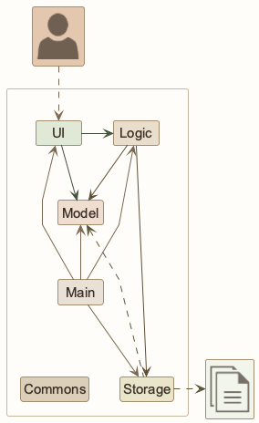

The architecture diagram shows the main components and their dependencies.

#### Main components

`Main` manages startup and shutdown through two classes:
[`Main`](https://github.com/AY2627S1-CS2103T-W12-1/tp/tree/master/src/main/java/seedu/address/Main.java)
and [`MainApp`](https://github.com/AY2627S1-CS2103T-W12-1/tp/tree/master/src/main/java/seedu/address/MainApp.java).

* At startup, it acquires the application-instance lock, initialises preferences and components,
  then loads or recovers the roster before opening the main window.
* At shutdown, it stops the components and runs their cleanup methods.

| Component | Responsibility |
| --- | --- |
| [UI](#ui-component) | Display the interface and receive user input. |
| [Logic](#logic-component) | Parse and execute commands. |
| [Model](#model-component) | Hold the app's data in memory. |
| [Storage](#storage-component) | Read and write data on disk. |
| [Commons](#common-classes) | Provide classes shared by multiple components. |

#### Component interactions

The sequence diagram shows how the components handle `delete 1` and the `yes` that confirms it.

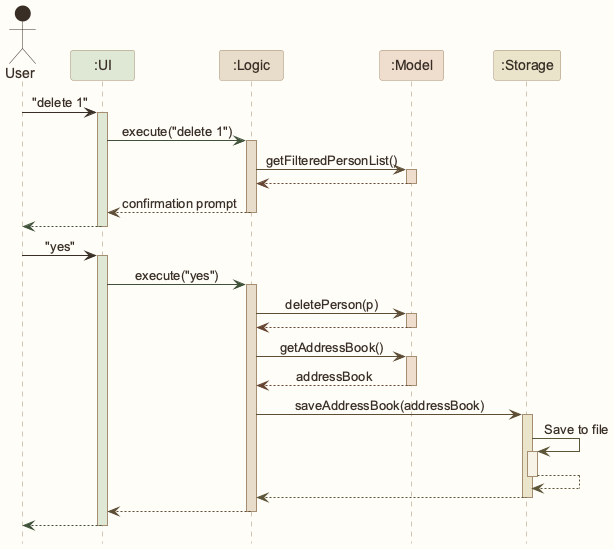

Each of the four main components defines an API through an interface with the component's name.
A corresponding manager class implements that interface.
For example, `Logic.java` defines the API and `LogicManager.java` implements it.

Components communicate through these interfaces.
This reduces their dependence on each other's implementation details, as shown below.

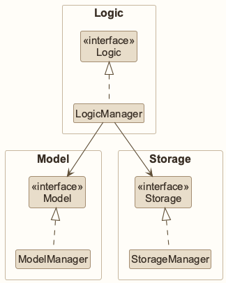

### UI component

**API:** [`Ui.java`](https://github.com/AY2627S1-CS2103T-W12-1/tp/tree/master/src/main/java/seedu/address/ui/Ui.java)

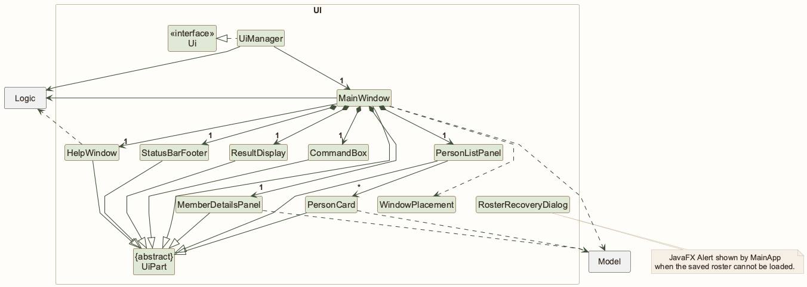

The diagram includes
`MemberDetailsPanel` beside `PersonListPanel`.

`MainWindow` contains `CommandBox`, `ResultDisplay`, `PersonListPanel`, `MemberDetailsPanel`,
and `StatusBarFooter`.
These classes inherit from `UiPart`, which provides behaviour shared by visible interface parts.
`HelpWindow` builds its command cards from `CommandHelp` in the Logic component.
`MainWindow` uses `WindowPlacement` to restore the saved window size and position.
`RosterRecoveryDialog` is a JavaFX `Alert` that `MainApp` shows when the saved roster cannot be loaded.
It shows the message of the `DataLoadingException` cause, so the user knows what to fix in the file.

The interface uses JavaFX. Matching `.fxml` files in `src/main/resources/view` define the layouts.
For example, [`MainWindow.fxml`](https://github.com/AY2627S1-CS2103T-W12-1/tp/tree/master/src/main/resources/view/MainWindow.fxml)
defines the layout of
[`MainWindow`](https://github.com/AY2627S1-CS2103T-W12-1/tp/tree/master/src/main/java/seedu/address/ui/MainWindow.java).

The UI component:

* Holds a reference to `Logic` and uses it to execute commands.
* Observes model data so the interface updates when the data changes.
* Uses model classes, including `Person`, to display member details.

### Logic component

**API:** [`Logic.java`](https://github.com/AY2627S1-CS2103T-W12-1/tp/tree/master/src/main/java/seedu/address/logic/Logic.java)

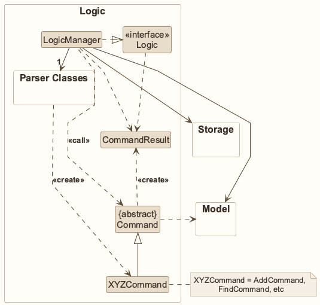

The following sequence diagram illustrates parsing and executing `delete 1` to request confirmation.

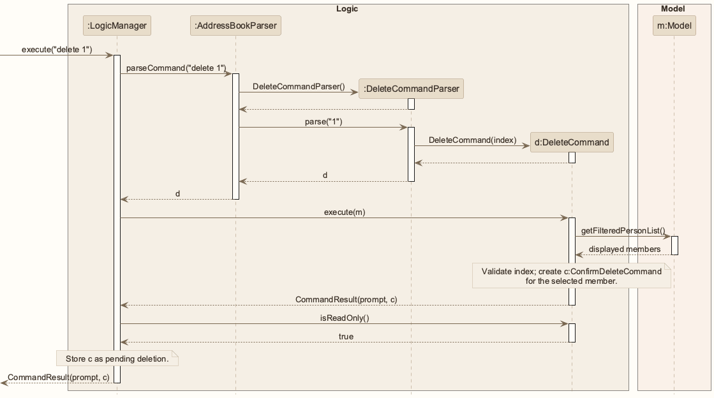

The sequence shows a valid index. Temporary parser objects are left to Java garbage collection,
not explicitly destroyed. Result construction and other small internal operations are abbreviated.

#### Command execution

1. `AddressBookParser` selects the matching parser, such as `DeleteCommandParser`.
2. That parser produces a `Command` subclass, such as `DeleteCommand`.
3. `LogicManager` executes the command. The command interacts with `Model` as needed.
4. `Logic` returns a `CommandResult` containing the result.

The diagram groups model interactions into one step for clarity.
An implementation may need several calls to complete that step.

#### Deletion confirmation

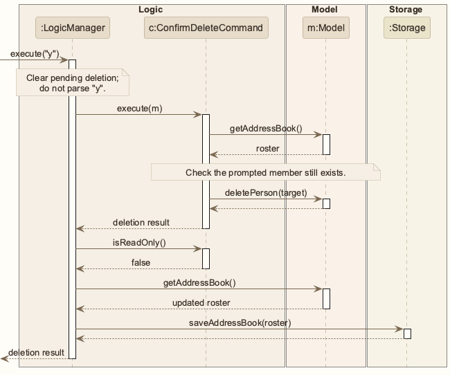

This trace shows the next input `yes` and a successful save. Cancellation and failures follow the
policies below.

`delete INDEX` deletes only after the user confirms it with the next input:

1. `DeleteCommand` checks the index and returns a `CommandResult` naming the member and their tags.
   The result also carries a `ConfirmDeleteCommand` for that `Person`. `DeleteCommand#isReadOnly()`
   returns true, so this step neither changes nor saves the roster.
2. `LogicManager` stores the pending `ConfirmDeleteCommand`. While one is pending,
   `Logic#isAwaitingConfirmation()` returns true. `MainWindow` then highlights the `CommandBox` and
   shows a confirmation hint. If a filter box is removed before the user answers, `MainWindow` shows
   the prompt again below the filter message, so the member to be deleted stays visible.
3. The next input does not reach `AddressBookParser`. If it is exactly `yes` after surrounding whitespace
   is ignored, `LogicManager` executes the `ConfirmDeleteCommand` and saves the roster as for other
   data-changing commands. A near miss (`y`, or `yes` in another letter case, checked by
   `Confirmation#isNearMiss`) keeps the deletion pending and reminds the user to type `yes` exactly.
   The reminder repeats the original prompt, and `MainWindow` keeps that prompt for later filter-box removals.
   Any other input cancels the deletion and is not run as a command; when it starts with a command word,
   the cancellation says that command was not run. Except for a near miss, the pending deletion is cleared.

`ConfirmDeleteCommand` stores the member rather than the index. A filter removed while the prompt is
shown therefore cannot redirect the deletion to a different member. `yes` without a pending confirmation
is an unknown command.

Alternatives considered:

* **A pop-up dialog:** clearer for mouse users, but it interrupts typing, and a modal dialog
  would block the UI tests that drive `MainWindow`.
* **Running the cancelling input as a command:** saves retyping, but a reply such as `n` would then
  be reported as an unknown command instead of a cancellation.

#### Parsing classes

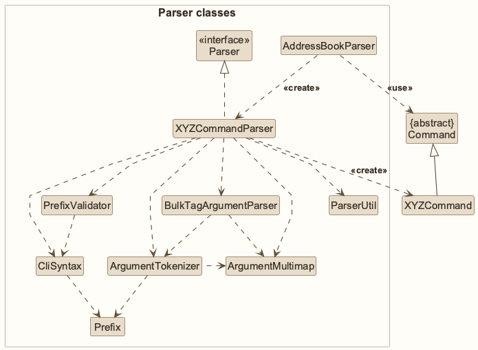

`AddressBookParser` creates a command-specific parser, represented here as `XYZCommandParser`.
For example, `AddCommandParser` uses the helper classes to create an `AddCommand`.
`AddressBookParser` returns the result as a `Command`.
`AddCommandParser` and `EditCommandParser` use `PrefixValidator` to reject unsupported field prefixes.
`TagCommandParser`, `UntagCommandParser`, `TagAllCommandParser`, `UntagAllCommandParser`, and
`RenameTagCommandParser` use `BulkTagArgumentParser`
to check tag values.

Command-specific parsers implement the shared `Parser` interface.
This allows common handling where appropriate, including in tests.

### Model component

**API:** [`Model.java`](https://github.com/AY2627S1-CS2103T-W12-1/tp/tree/master/src/main/java/seedu/address/model/Model.java)

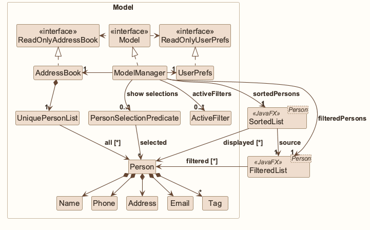

`Person` holds references to immutable contact values and tags. Edits can reuse those objects, so
the diagram uses associations rather than exclusive composition for these fields.

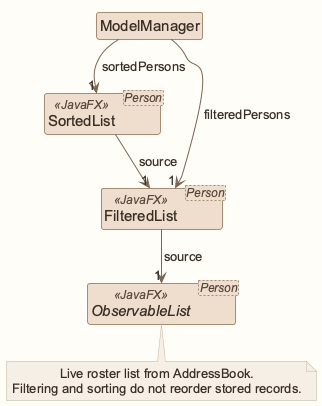

The Model component stores:

* **Member data:** `Person` objects held in a `UniquePersonList`.
* **Displayed data:** a filtered list, such as name-search results or an index selection.
  A `FilteredList` follows the stored roster order, including changes made by `sort`.
  An unmodifiable `ObservableList<Person>` lets the UI observe changes and update its display.
* **Removable filters:** `ModelManager` keeps `ActiveFilter` objects for name, email, tag, and
  `show` conditions in application order. Each `show` condition wraps one `PersonSelectionPredicate`,
  so the UI can display and remove its box independently. Other internal predicates remain in
  `additionalFilters`. `list` and a successful `import` or `clear` remove the conditions.
  The roster heading follows the observable displayed-list size, including zero-result views.
* **Preferences:** a `UserPrefs` object, currently containing GUI settings.
  Other components access it through `ReadOnlyUserPrefs`.

Model does not depend on UI, Logic, or Storage.
Its data entities can be used independently of those components.

`ModelManager#getFilteredPersonList()` exposes the filtered roster in stored order.
`show` resolves indexes against the current displayed view and adds a selection predicate to narrow it.
`list` clears the search, tag, and selection predicates, restoring every member in the current stored order.

<box type="info">

**Alternative design:** `AddressBook` could keep one shared `Tag` object for each unique tag.
Each `Person` would reference those shared objects instead of holding its own copies.

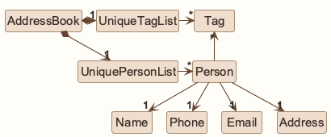

</box>

### Storage component

**API:** [`Storage.java`](https://github.com/AY2627S1-CS2103T-W12-1/tp/tree/master/src/main/java/seedu/address/storage/Storage.java)

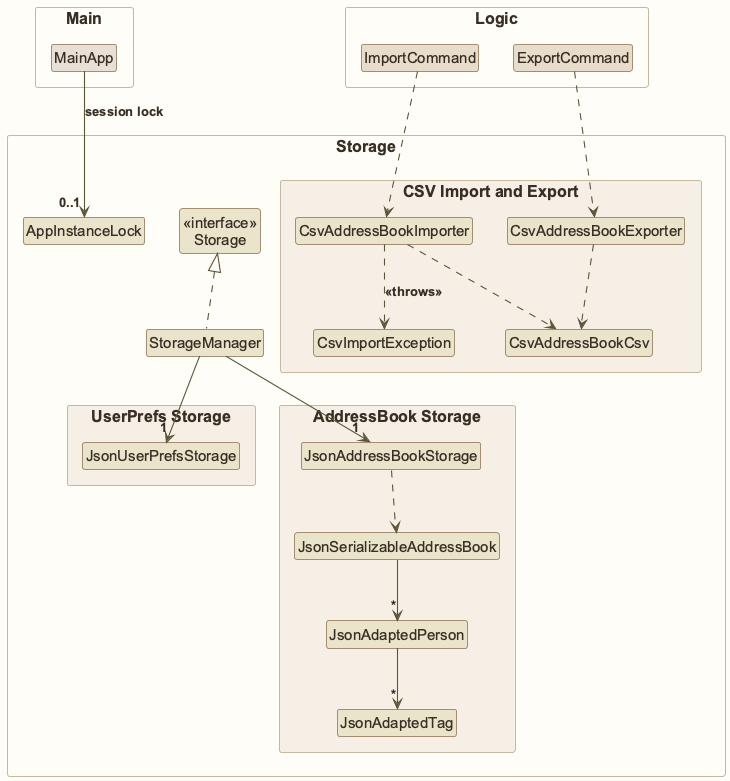

Storage reads and writes member data and preferences as JSON.
`StorageManager` delegates file access to `JsonAddressBookStorage` and `JsonUserPrefsStorage`, one class per file.
It depends on model classes because it saves and restores model objects.
`ImportCommand` and `ExportCommand` use the CSV classes directly, not through `StorageManager`.
`CsvAddressBookCsv` holds the CSV header and format shared by the importer and exporter.

CSV export is implemented as a separate `CsvAddressBookExporter` in the `storage` package. `ExportCommand` supplies a
snapshot of the currently displayed members, in displayed order, and the destination path; the exporter writes a
UTF-8 CSV file with a header row and one row per member. Apache Commons CSV handles RFC 4180 quoting and escaping.
This export is a user-requested copy and does not replace or modify the JSON file used for automatic persistence.

`LogicManager` supplies the active roster and preferences paths to `ExportCommand`, which rejects destinations
matching those files, their backups and recovery copies, the running JAR, or `.trackcall.lock`, including
existing file aliases. Reserved path spellings are compared without case on every platform, including
parent directories and files that do not exist yet. This intentionally also reserves case variants on
case-sensitive filesystems, giving exports the same portable safety rule. `CsvAddressBookExporter` writes and closes
a sibling temporary file before `FileUtil#writeAtomically` replaces the destination. A failed export preserves the
previous destination and removes its temporary file; the destination's parent directory must already exist.

### Common classes

Classes used by multiple components are in the `seedu.address.commons` package.


## Implementation

This section describes the implemented v1.5 candidate. The requirements appendix distinguishes
delivered features from considered extensions. Release acceptance checks remain necessary before publication.

### Offline command help

#### Catalogue and command flow

`CommandHelp` stores the nineteen implemented commands in one local catalogue.
Each entry contains its purpose, syntax, example, expected result, and common errors.
Only executable commands appear, so planned commands are never shown as available.

1. `HelpCommandParser` accepts zero or one lowercase topic. It rejects unknown or multiple topics.
2. `HelpCommand` returns the topic through `CommandResult`.
3. `MainWindow` passes the topic to `HelpWindow`.

#### Help navigation

The overview groups commands into four category cards.
Each command shows a purpose, runnable example, and button for its details.
The layout uses two columns in a wide window and one in a narrow window.

* `help COMMAND` opens the same detail card as its overview button.
* **All commands** returns to the overview.
* **F1** and the Help menu open the overview.
* Arrow and page keys scroll. **Home/End** move to the ends, and **Escape** closes help.

#### Test coverage {id="test-coverage"}

* `CommandHelpTest` checks catalogue completeness and executable examples.
* `HelpWindowTest` checks the overview, detail pages, responsive columns, navigation, and keyboard scrolling.
* `MainWindowTest` exercises `help add`, F1, Escape, exit, rejected `/help`, and failed-save recovery.
  It uses the real command box with temporary storage.

### List and clear commands

#### List behaviour

`ListCommand` resets the model predicate to `PREDICATE_SHOW_ALL_PERSONS`, preserves stored order,
and reports the complete count using singular, plural, or empty-roster wording. `LogicManager`
returns its result without invoking storage. Extra arguments are rejected by `AddressBookParser`
before either the view or data changes.

Compact roster cards show member numbers, names, and tags. The details panel reveals contact fields
for only the selected member.
`LightTheme.css` provides the beige main-list palette. See [Offline command help](#offline-command-help) for the bundled guide.

#### Clear and save recovery

`clear` snapshots displayed members; `clear /all` snapshots the complete roster. `LogicManager`
retains the command and confirms the target count and scope before deleting any non-empty target set.
Exactly `yes` confirms, near misses keep the prompt pending, and other replies cancel without executing them.
The captured targets do not expand when a filter is removed while confirmation is pending.
An empty displayed list with hidden records fails without saving. An already-empty roster still saves.

Before execution, Logic snapshots the complete roster. `ClearCommand` replaces its records with the
non-target members without mutating the current selection predicates. After saving, Logic updates Show
descriptions for displayed clearing while retaining conditions;
whole-roster clearing resets the view. If saving fails, it restores the complete snapshot under the original
predicates, including Show selections. Both forms retain preferences and use normal backup safeguards.


To meet clear's previous-file preservation requirement, `FileUtil#writeToFile` writes UTF-8 to a
sibling temporary file and atomically replaces the destination. `JsonAddressBookStorage` no longer
pre-creates an empty destination. Unsupported atomic replacement produces a handled failure;
there is no unsafe partial-write fallback. This shared storage helper also benefits existing
callers; their command policies and load validation are described below.

#### Exact feedback

These messages follow the list and clear feature specifications:

| Case | Feedback |
| --- | --- |
| List zero members | `No members in the roster.` |
| List one member | `Showing 1 member.` |
| List multiple members | `Showing N members.` |
| Invalid list arguments | `Invalid command format. Usage: list` |
| Cancel clearing | `Clear cancelled. No members were removed.` |
| Clear zero members | `The roster is already empty. No changes were made.` |
| Clear one member | `Cleared 1 member. The roster is now empty.` |
| Clear multiple members | `Cleared N members. The roster is now empty.` |
| Invalid clear arguments | `Invalid command format. Usage: clear [/all]. Use /all to remove hidden members too.` |
| Failed clear save | `Unable to clear the roster because the changes could not be saved. No members were removed.` |

#### Test coverage {id="test-coverage-1"}

Regression coverage is in `ListClearIntegrationTest`, the two command tests, parser tests, and
`FileUtilTest`. `PersonCardTest` lays out compact roster cards off-screen and verifies names,
case-sensitive ASCII tag order, hidden empty tag rows, and wrapping at narrow widths. Linux CI supplies a
virtual display with `xvfb-run` for JavaFX. UI integration tests use synthetic members and temporary
storage; they never open the user's roster.
Command tests cover:

* Singular, plural, and empty-roster feedback.
* Hidden members, no-match views, order, repetition, and rejected arguments.
* Read-only listing, persisted empty data, settings, and predicate reset.
* Failed-save rollback, retry, and temporary-file cleanup.

### Readable member details and feedback

#### Member rows and results

`Messages#format(Person)` formats names, phone numbers, email addresses, addresses, and sorted tags
as labelled lines for command results. `MainWindow` removes contact-field
lines from successful add, edit, and delete feedback before showing it. `UntagCommand` formats
its result directly as the member's name and sorted remaining tags, omitting contact fields. The roster's `PersonCard` displays
only the member number, name, and tags. `MemberDetailsPanel` reveals one selected member's contact fields
and provides copy buttons. Running any command clears the selection before the roster can change;
F2 focuses the list and Escape hides the details. `ResultDisplay` wraps and scrolls text, and the split
panes let the user resize the feedback and roster areas.

`LightTheme.css` supplies the beige palette and dark text for the main window, help, and alerts.
`HelpWindow.css` adds the help-card layout. A welcome message points to `help` and `help add`.

Find feedback reports `1 member listed.` or `N members listed.`, including `0 members listed.`
List and clear use the exact count messages above.
Data-changing feedback is shown only after saving. Duplicate errors state that a member with these contact details
already exists and suggest `edit`.

#### Window placement

`MainWindow` uses `WindowPlacement` to check saved bounds against available display areas at startup. It retains valid
positions, selects the display with the greatest overlap or the primary display as a fallback,
and brings oversized or off-screen bounds back within that display. Invalid saved dimensions
also recover to usable bounds. This handles monitor changes between sessions.

### Automatic data saving and load recovery

#### Save policy

`LogicManager#execute(String)` parses and executes a command, then checks `Command#isReadOnly()`.
`help`, `list`, `show`, `find`, `findemail`, `filter`, `export`, and `exit` return without saving member data.
`sort` saves the reordered roster through the normal data-changing command path.
`delete INDEX` and a non-empty `clear` return without saving while awaiting confirmation.
Cancellation also returns without saving.
Successful `add`, `edit`, `tag`, `untag`, confirmed `delete`, `tagall`, `untagall`, `renametag`, `clear`, `import`,
and `sort` commands pass the complete roster, including hidden members, to `Storage#saveAddressBook`.
Parsing and execution failures do not save. Data-changing commands return normal success only after
the save succeeds.


#### File writes

`StorageManager` delegates JSON storage to `JsonAddressBookStorage`. The default file is
`data/addressbook.json`, relative to the JAR folder in packaged builds or the working directory in development.
`FileUtil#writeToFile` creates missing parent directories, writes UTF-8 to a sibling temporary file,
and replaces the destination with an atomic move.
It reports a failure if atomic replacement is unavailable instead of falling back to a potentially
partial overwrite. An existing saved file remains intact on failure; temporary-file cleanup is attempted.

#### Failed saves

If saving fails, `LogicManager` reports a `SaveFailureException`, a `CommandException` subtype that
also records whether the change remains applied.

For `add`, `edit`, `tag`, `untag`, confirmed `delete`, `tagall`, `untagall`, `renametag`, `import`, and `sort`, the model change
remains in memory. `CommandBox` clears the already-applied input so pressing Enter cannot accidentally
repeat an indexed edit or deletion. The result explains that the previous saved roster is unchanged.

To retry, the user resolves the storage problem and checks the current list.
They reapply an existing field value with `edit`, or use `clear` if the roster is empty.
This saves without changing another record.

Before executing a confirmed `clear`, `LogicManager` snapshots the roster. A successful save resets the search predicate.
If saving fails, it restores those records while
retaining the existing search predicate, so the previous displayed list returns. The result says
`No members were removed.` and `CommandBox` retains the submitted input. The user must run
`clear` again to start a fresh confirmation; another `yes` alone cannot repeat the action. A failed
clear of an already-empty roster also reports failure rather than the normal empty result.
Exiting never retries a save. Application preferences are stored separately at startup and shutdown.

#### Startup and validation

`MainApp#init()` acquires `AppInstanceLock` before reading preferences or roster data. The lock is
held on `.trackcall.lock` in the application folder for the complete session, including shutdown
preference saving. A second instance is rejected with an already-running explanation. The lock
is released on initialization failure or normal shutdown; the operating system also releases it
when the process terminates. The lock file remains on disk and must not be deleted to start another session.
The overload accepting explicit preferences/roster paths supports isolated startup tests.

Startup loads a valid roster in file order.
A missing file produces sample members; a loading error requires recovery before the editable roster opens.
A JSON `null` root, null person, and null tag are rejected through the normal loading-error path.
`JsonAddressBookStorage` preserves the exact damaged bytes in a unique sibling `.corrupt-....json` file.
The startup dialog offers a validated backup, an explicit empty roster, or closing without replacement.
Preservation failure prevents startup. Recovery verifies that the original still matches its preserved copy
and replaces the roster atomically without rotating the existing backup.

Normal saves validate the current roster. If its member list differs from the requested save,
they atomically copy the previous roster to the sibling `.bak` file;
backup failure prevents replacement, and an invalid existing roster blocks normal saves until recovery.
An unchanged save still attempts to write the current roster but retains the previous distinct backup.
`JsonAddressBookStorage` also remembers the roster it last read from or wrote to the data file. If the file
now holds a different valid roster, it was changed outside TrackCall, so the first save is refused with a
storage error and the change stays in memory. The refused save records the outside version, so a retry
replaces it and keeps its exact bytes in `.bak`, even if its member values match the requested save.
This backup requirement remains pending after a failed write and clears after a successful save or explicit reload.
Formatting-only edits are not refused.

Design considerations for outside-edit detection: comparing the parsed roster (the current choice) ignores
formatting-only edits and unchanged files, at the cost of one extra read per save. Alternatives: a modification
time or hash is cheaper, but a hash flags whitespace-only edits and timestamps can be unreliable; watching the file
and reloading would silently discard unsaved in-memory changes and needs platform-specific watchers. An edit that
leaves the file invalid is not treated as an outside change; saves then fail until restart and recovery.

Export protects both backup and recovery filenames. Null or invalid preferences fall back to defaults, which are saved
through the usual preferences setup.

The current JSON format uses a `persons` array and a `tags` array per member. Duplicate identity compares
all four trimmed contact fields exactly, including case and internal spacing, and ignores tags.
This legacy `Person#isSamePerson` rule remains the storage invariant so older rosters continue to load.
For new input, `Person#isDuplicateContactOf` compares names with `String.equalsIgnoreCase` after whitespace
collapse, with exact trimmed phone/email/address comparisons. This handles Unicode case pairs such as Greek sigma
without context-sensitive lowercasing. Add and edit reject a match against
another stored member; import skips matches against the roster and earlier accepted rows. Stored names,
`equals` and `hashCode` are unchanged. Tags and unchanged-contact edits remain possible on legacy variants.
The email validator avoids excessive backtracking on long
input, and a log-file initialisation failure uses the console logger instead of aborting startup.

### Command parsing

`ArgumentTokenizer` recognises the supported lowercase field prefixes when preceded by whitespace,
including a tab. It trims surrounding value whitespace without removing internal address tabs or
slashes. `list`, `sort`, `clear`, and `exit` reject extra arguments before execution. Invalid commands leave
records, the current list, and the saved file unchanged; the input remains available for correction.

`AddCommandParser` and `EditCommandParser` use `PrefixValidator` to check whitespace-delimited
single ASCII letters followed by `/` before tokenising.
Only `n/`, `p/`, `e/`, `a/`, and `t/` are supported. Unknown letters and uppercase prefixes
report the corresponding command's usage message before field validation. The standalone `c/o` abbreviation
(case-insensitive) is exempt; URLs, numeric slashes, and slashes embedded in words are literal text.
While inside an `a/` field, `A/` followed by an ASCII digit is exempt too, preserving `Block A/12`.
Supported lowercase prefixes end that address context; other unsupported prefixes still fail.
Other commands retain their own parsing rules.

### CSV import

`ImportCommandParser` accepts exactly one `p/FILE_PATH` parameter. It removes matching outer quotes,
requires quotes around paths containing whitespace, rejects repeated or unknown prefixes, and accepts the
`.csv` extension case-insensitively while preserving path case.

`CsvAddressBookImporter` rejects sources over 10 MiB, bounds the read to detect files that grow,
and rejects more than 10,000 non-blank member rows before duplicate removal. It reads strict UTF-8,
accepts an optional byte-order mark,
checks the exact lowercase five-column header in any column order, and uses the shared Apache Commons CSV
format for quoting and escaping. It rejects embedded line breaks and trims surrounding whitespace from
field values and individual tags before validation. Records are parsed and validated in source order,
with syntax and field errors identifying the physical row. It returns an immutable member list only after
validating the whole file, so errors cannot cause a partial import. Completely blank records are skipped
but still contribute to reported row numbers.

`ImportCommand` compares each valid candidate with the complete stored roster and earlier accepted rows
using `Person#isDuplicateContactOf`. It appends only unique members in source order, then clears search, filter,
and selection state. Existing members retain their stored positions; new members stay at the end until the next `sort`.
`LogicManager` performs the normal automatic save even for a header-only or duplicate-only import. If saving fails,
the imported batch remains in memory. The import-specific save error is followed
by the shared warning about unsaved changes, loss on exit, and retrying after storage access is restored.
The source CSV is read-only throughout the workflow.

#### Import sequence

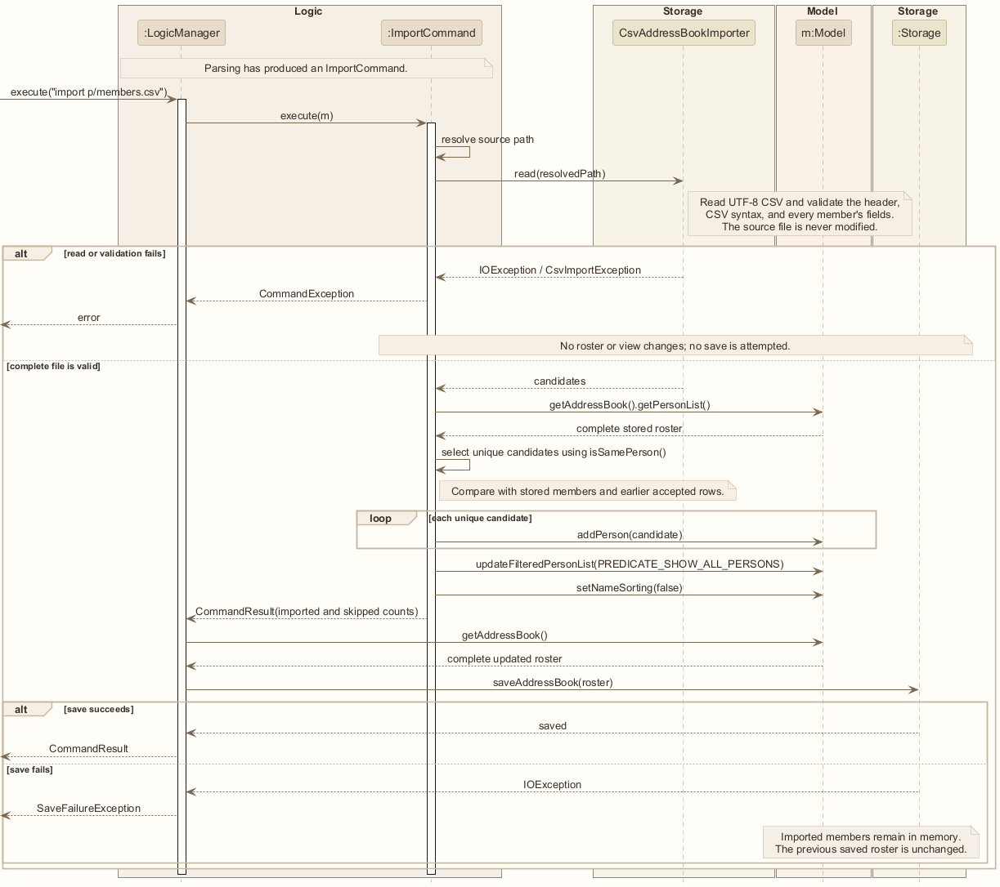

The sequence shows a valid file after command parsing. The importer validates the complete file before the command
changes the model, so a read or validation failure cannot import a partial batch. Duplicate selection
uses the complete roster, including hidden members, and earlier accepted CSV rows. The logic layer
returns success only after saving, including when every row is skipped or the file contains only a header.
An import-save failure leaves the imported batch in memory and preserves the previous saved roster.

### CSV export

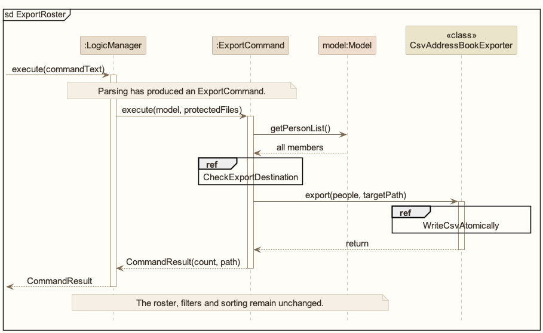

`ExportCommandParser` rejects double quotes in destination paths before any file is written, so exports do not
produce filenames that `ImportCommandParser` cannot read. Spaces remain supported without surrounding quotes.

The sequence shows a successful export after command parsing. `LogicManager` supplies the active roster and preferences
paths to `ExportCommand`, which checks the destination against protected application files before
calling `CsvAddressBookExporter`. Path resolution also applies the shared file-location restrictions.
The command snapshots `model.getFilteredPersonList()` and exports only those members in displayed order,
including active sorting. It counts hidden members against the complete roster and reports both counts when
any are excluded. With everyone visible, existing success feedback is retained. An empty displayed list writes
only the header. Run `list` first to export everyone in stored order.

`FileUtil#writeAtomically` invokes the exporter's `FileWriter#write` callback with a sibling temporary file.
Apache Commons CSV handles quoting and escaping; the writer closes before atomic replacement.
A write or replacement failure preserves the previous destination and attempts temporary-file cleanup.
On success, `isReadOnly()` prevents the logic layer from saving the automatic JSON roster.
Neither successful nor failed export changes the displayed filters or stored roster order.

### Selecting members and sorting

`show INDEX [MORE_INDEXES]...` validates every index against the current displayed list before
changing the view. `ShowCommand` stores the corresponding members in a `PersonSelectionPredicate`;
repeated indexes collapse to one member, and argument order does not reorder the list. Each distinct
`show` selection adds another condition, so it can only narrow the current view. `ModelManager#setPerson`
updates these predicates after an edit or tag change to keep the selection attached to the member.
Each distinct `show` selection has a separate box in command order. Repeating a selection with the
same members leaves the existing box in place. Its label reports the number of selected
members and its tooltip lists their names. Removing that box removes only its predicate, leaving the
other `show`, name, email, and tag conditions active.
`ActiveFilter#getShowSelectionNames()` sorts tooltip names with `String.CASE_INSENSITIVE_ORDER`;
this does not change the displayed roster order.
`list`, successful `add`, successful `clear`, and valid `import` clear the selections.

`SortCommand` stably reorders the complete stored roster by full name, ignoring case, surrounding
spaces, and repeated internal spaces. It preserves stored name spellings and the current relative order
of equal names. Active searches, tag filters, and `show` selections remain applied, including when
only a subset of the roster is displayed. There is no separate display-sort mode.

`sort` is data-changing (`isReadOnly()` is `false`), so `LogicManager` saves the reordered roster.
An empty or already sorted roster still follows that save path. After saving, `list`, restart, and
export retain the new order. Add and import append new members; edits retain each member
in its current position until another `sort`. A failed save keeps the reordered session in memory
and reports the standard save-failure guidance while preserving the previous saved file.
`show` remains read-only and never saves the roster.

`ShowCommandParserTest`, `ShowCommandTest`, `AddressBookParserTest`, and `LogicManagerTest` cover validation,
selection narrowing, record replacement, and read-only show execution. `SortOrderIntegrationTest`
covers stored ordering, stable ties, active conditions, persistence, and subsequent changes.

### Find members by email

`findemail KEYWORD [MORE_KEYWORDS]...` narrows the displayed members by their email addresses.

* **Matching:** accept any whitespace-separated keyword within one command, including nonbreaking-space separators.
  Lowercase the email and
  keywords with `Locale.ROOT`, then match literal substrings. Full addresses and fragments such as
  `@example.com` are supported; regular expressions, names, and phone numbers are not searched.
* **Validation:** reject blank input before changing the view.
* **Model update:** `FindEmailCommand` calls `ModelManager#filterFilteredPersonListByEmail`.
  A distinct query appends a removable `ActiveFilter` and reapplies all active conditions using logical AND.
* **Repeated queries:** `ActiveFilter#hasSameSearch` compares keyword sets for searches of the same kind.
  Name comparisons use Java's case-insensitive ordering; email comparisons use `Locale.ROOT` lowercase,
  matching their respective predicates. Keyword case, order, and repetitions are ignored; the original label is retained.
  Both model search operations return whether a condition was added.
* **Feedback:** a repeat reports that the search is already active. A different query that leaves the displayed
  count unchanged reports `Results unchanged.` and keeps its new condition. Because searches only narrow the list,
  equal counts mean the same members remain visible.
* **Retained state:** keep earlier name searches, email searches, tag filters, `show` selections, and stored roster order.
* **Filter boxes:** show one Email box per distinct search, in application order with name, tag, and `show` boxes.
  Its X removes only that condition. Remaining conditions still determine which members appear.
* **Edits:** re-evaluate the email predicates when a member changes. A nonmatching member disappears
  from the view but remains stored. Edit and delete use current displayed indices.
* **Reset and storage:** `list` restores the full roster in stored order. Email searches are read-only and do not save.

`FindEmailCommandTest`, `LogicManagerTest`, `CommandSequenceOracleTest`, and `MainWindowTest` cover
cumulative searches, order-independent matching, selections, chip removal, sorting, and unchanged saved data.

### Filter members by tag

`filter t/TAG [t/MORE_TAGS]...` narrows the displayed list to members with at least one of the given tags,
ignoring letter case, without changing member data. Tags in the same command are alternatives (logical OR);
separate commands narrow the list further (logical AND).
Usage examples are in the [User Guide](UserGuide.html#filter-displayed-members-by-tag-filter).

#### Parsing {id="parsing"}

`FilterCommandParser` accepts one or more `t/TAG` arguments. It splits them on whitespace followed by `t/`, trims
each value, and requires 1 to 30 characters using ASCII letters or digits with optional internal hyphens.
A missing `t/`, an unknown prefix, or any invalid or empty tag rejects the whole command before the view changes.
Each value is validated by `BulkTagArgumentParser#parseTagName`, the same method `tagall`, `untagall` and
`renametag` use, so an invalid tag reports the same specific reason (unsupported character, hyphen placement,
length, or empty) before any tag is added. A repeated tag, in any letter case,
counts once because `FilterCommand` keeps its tags in a `LinkedHashSet`.

#### Execution {id="execution"}

`FilterCommand` passes its tags to `ModelManager#filterFilteredPersonListByTags`, which adds one
`ActiveFilter` of kind `TAG` whose predicate is true when a member has any of those tags (`anyMatch`).
The model combines this filter with the active name, email, tag, and `show` conditions using logical AND.
So `filter t/a t/b` followed by `filter t/c` means (`a` or `b`) and `c`.
`ActiveFilter#hasSameTags` compares tag sets ignoring order and letter case. If an equal filter is already active,
`FilterCommand` leaves the conditions and displayed list unchanged and reports the active filter's stored
spelling followed by the current result summary.
The filter box label joins alternatives with `/` (`ActiveFilter#ALTERNATIVES_SEPARATOR`), for example
`Tag: committee / alumni`. `find` and `findemail` boxes use the same separator, for example `Name: Alice / Tan`
and `Email: @example.com / @school.edu`, because keywords within one of those commands are also alternatives.
The word "or" is not used as the separator because a tag can legally be named `or`, which would make
`Tag: a or or or b` ambiguous; `/` cannot appear in a tag.
`ActiveFilter#getLabel` caps a tag group at `ActiveFilter.MAX_SHOWN_TAGS` (4) tags, so a long group cannot make
one box wrap across the filter area: `filter t/a t/b t/c t/d t/e t/f` shows `Tag: a / b / c / d / +2 more`.
`+` cannot occur in a tag, so `+N more` is never mistaken for one. `ActiveFilter#getFullLabel` always lists
every tag, and `MainWindow` uses it for the box's tooltip and the remove button's accessible text, so no
information is lost. Name and email boxes are not capped; JavaFX ellipsizes an over-long label and the tooltip
holds the full text.
The model keeps removable name, email, tag, and `show` conditions in application order, shown left to right in the UI.
`find` adds a distinct name condition and `findemail` adds a distinct email condition; `list` clears all conditions.
Applying name, email, and tag conditions in a different order gives the same matching
members when the roster is unchanged.
The observable filtered list updates automatically, and the command reports the resulting member
count and all active tag names.
A single tag uses `N member(s) listed with tag "TAG".`; multiple tags use
`N member(s) listed with tags "TAG1", "TAG2".` in application order. Tags that came from one command are
joined with `/`, for example `N member(s) listed with tags "TAG1" / "TAG2".` A comma between conditions means
AND and a slash within one means OR. To keep the two readable, `FilterCommand#formatCondition` puts a group in
parentheses whenever more than one tag condition is listed, for example
`N member(s) listed with tags ("TAG1" / "TAG2"), "TAG3".`; a lone group stays unparenthesized.
A zero-match result is successful.

Filtering preserves the stored roster order. Visible members are renumbered,
and subsequent `edit` and `delete` commands use those displayed indices. The command is read-only, so
`LogicManager` returns its result without saving the roster.

#### Design considerations {id="design-considerations"}

* **Preserve earlier conditions:** combining predicates lets users narrow an existing name search, email search, or tag
  filter without restoring hidden members. For example, filtering by `committee` and then `year1` keeps
  members with both tags. Another `find` or `findemail` also narrows the view;
  `list` clears all conditions.
* **OR within a command, AND between commands:** keywords of `find` and `findemail` already mean "any",
  so allowing several tags in one `filter` keeps the three commands consistent. Without it, a request such as
  "committee or alumni" could not be expressed, because successive filters can only narrow. One `ActiveFilter`
  holds the whole group, so its X removes all alternatives together. An alternative was one box per tag with an
  OR flag, but that makes the left-to-right box order ambiguous and the X button's effect unclear.
* **Keep filters active after edits:** the model retains the predicate rather than a fixed set of matching
  members. Replacing an edited member in the observable list re-evaluates that predicate. A member who no
  longer matches disappears from view but remains in the roster, so later commands operate on the updated group.

#### Test coverage {id="test-coverage-2"}

* `FilterCommandParserTest` and `FilterCommandTest` cover argument validation, narrowing an existing view,
  feedback for a repeated tag with different letter case, alternatives within one command (OR), and a
  grouped filter combined with a separate filter (AND), the parenthesized result line, and the four-tag cap
  with its full-list label. `ModelManagerTest` and `MainWindowTest` cover the `A / B` box labels, including
  the capped box's tooltip and accessible text.
* `LogicManagerTest` covers cumulative filters, case-insensitive matching, empty results, interactions with
  `find`, `list`, and sorting, and read-only filter execution.
* `EditCommandTest` checks that edits retain search and tag conditions and hide members who no longer match.

### Individual tag editing

`tag INDEX t/TAG` adds one tag to the member at the displayed index. `untag INDEX t/TAG` removes
one tag from that member. Both commands use the displayed-index convention of `edit` and `delete`
and the existing single-tag validation used by the bulk tag parsers.

Each command reads the member from `Model#getFilteredPersonList()` at execution time. It copies the
member's tag set, changes only the requested tag, constructs a new `Person` with the original
contact fields, and calls `Model#setPerson`. This preserves active search and tag filters, roster order,
and `show` selection. If removing a tag causes a member to fail an active filter, the member leaves
the displayed list but remains in the roster.

Adding an existing tag or removing an absent tag is a valid no-op with explicit feedback. No model
replacement occurs, but `LogicManager` still saves the full roster. A bad or out-of-range index and
invalid arguments fail before saving. A save failure after an actual change follows the standard
`SaveFailureException` path and leaves the change in memory.

#### Test coverage {id="individual-tag-test-coverage"}

* `TagCommandTest` and `UntagCommandTest` cover tag preservation, no-op results, displayed indices,
  filters, selected members, and invalid indices.
* `TagCommandParserTest` and `UntagCommandParserTest` cover index syntax, tag validation, malformed
  arguments, and tag boundaries.
* `LogicManagerTest` checks single-member updates, persistence, and saving valid no-op commands.

### Bulk tag editing

`tagall t/TAG` adds one tag, and `untagall t/TAG` removes one tag, for every member in the displayed list.

#### Parsing {id="parsing-1"}

`TagAllCommandParser` and `UntagAllCommandParser` both delegate to `BulkTagArgumentParser#parse`, so the two
commands share one grammar and one set of error messages. It accepts exactly one tag of
1 to 30 characters using ASCII letters or digits with optional internal hyphens. Surrounding spaces are ignored. `tag` and `untag` use the same method for
their tag argument.

* A missing `t/` reports `Missing t/ prefix. Supply tags using t/TAG.`
* Text before a supplied `t/` is named in an `Unexpected text before t/` error.
* An `n/`, `p/`, `e/`, or `a/` prefix is named as an unsupported field.
  Each of these errors includes the calling command's usage.
* An empty tag reports `Tag cannot be empty.`
* More than one `t/` reports `Only one tag can be applied per command. Run the command once for each tag.`
* Unsupported characters are named in the error, followed by the allowed ASCII letters, digits, and internal
  single hyphens. A space, tab or other whitespace inside a tag reports `Tag cannot contain spaces. Use a hyphen
  instead, e.g. year-1.` A double quote is shown escaped as `\"`.
* Leading, trailing, and consecutive hyphens each report a specific error with `year-1` as a valid example.
* Unsupported characters are checked before length, so non-ASCII code points are not misreported as
  overlong ASCII tags. Invisible control characters are shown as code points, for example `U+0000`.
* Overlong tags report their actual length and the limit from `Tag.MAX_LENGTH`.
* These argument errors give the reason followed by usage without a generic format-error header.
  Existing index parsing in `tag` and `untag` retains its format-error header.

#### Execution {id="execution-1"}

`TagAllCommand` and `UntagAllCommand` extend the abstract `BulkTagCommand`, whose `execute` method
follows the steps below. Each subclass supplies only `needsUpdate`, which decides whether a member changes,
and `updateTags`, which adds or removes the tag.

1. Copy `Model#getFilteredPersonList()` into a new list. This fixes the target set before any update.
   The copy matters because each update refreshes the displayed list. For example, removing the tag used by an
   active single-tag filter hides the updated member immediately. A member stays visible if they still satisfy
   every active condition, for example by matching another alternative in a `filter t/a t/b` group.
2. Reject an empty target set with `There are no members in the current list to update. Run list to show everyone,
   or use find or filter to choose a group.`
3. For each target that lacks the tag (`tagall`) or has it (`untagall`), build a new `Person` with an updated
   copy of its tag set and call `Model#setPerson`. Other targets are skipped. Hidden members are never visited.
4. Report the changed count, and the skipped count when it is non-zero, for example
   `Added tag "committee" to 9 member(s). 3 already had this tag (any letter case).` A zero changed count adds
   `No changes were made.`, for example
   `Removed tag "committee" (any letter case) from 0 member(s). 3 did not have this tag. No changes were made.`
   If the active filters now hide updated members, which only `untagall` can cause, it also reports the
   displayed list using
   `TagUpdateUtil#describeHiddenUpdates`, for example
   `0 member(s) listed with tag "committee". Run list to show everyone.`

Neither command changes the search predicate or roster order, so the current view stays applied after the
batch. Tags are not part of a member's identity, so an update can never create a duplicate member.

Both commands are data-changing (`isReadOnly()` is `false`). `LogicManager` therefore saves the complete
roster after every valid invocation, including one where every target is skipped. An empty target set throws
before saving. A failed save follows the standard `SaveFailureException` path: the whole batch remains in
memory and the previous saved file is unchanged.

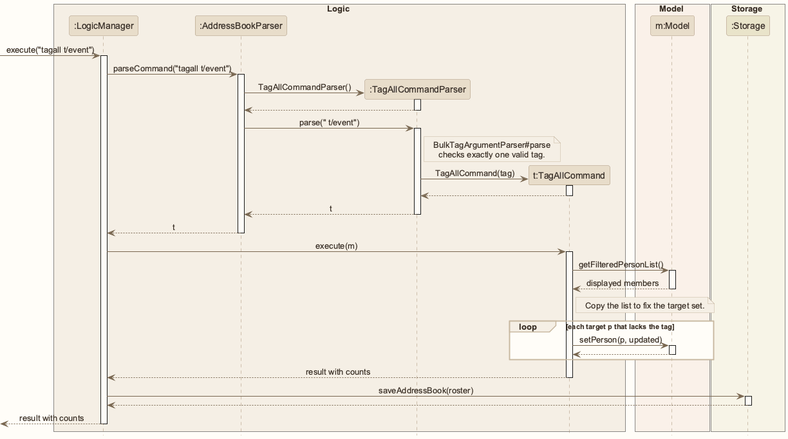

`untagall` differs only in `needsUpdate` and `updateTags`. `renametag` follows the same flow through
`RenameTagCommandParser`. Temporary parser objects are left to garbage collection, not explicitly destroyed.

#### Design considerations {id="design-considerations-1"}

* **One shared argument parser:** keeps `tagall` and `untagall` input rules and messages identical.
  It and `FilterCommandParser` use the shared `Tag` model rule, which also applies to `add`, `edit`,
  and loading saved data.
* **Shared base class:** `BulkTagCommand` holds the steps both commands share, so the two commands
  cannot drift apart in how they select targets, log results, or word their feedback.
* **Skip instead of reject:** a member who already has (or lacks) the tag is skipped and counted, so one
  overlapping group does not block the rest of the batch (UC03 extension 6b).
* **Alternative: act on the whole roster:** simpler, but it cannot target a filtered group (US09). Running
  `list` first gives whole-roster behaviour when it is wanted.
* **Alternative: an index list such as `tagall 1 3 5 t/TAG`:** precise for small groups but error-prone for large
  ones. Using `show` first to narrow the displayed list achieves the same result.

#### Test coverage {id="test-coverage-3"}

* `TagAllCommandTest` and `UntagAllCommandTest` cover partial, complete, and zero changes, filtered lists with
  hidden members, removing the filtered tag, and empty lists.
* `TagAllCommandParserTest`, `UntagAllCommandParserTest`, and `BulkTagArgumentParserTest` cover valid tags,
  length boundaries, missing prefixes, preambles, and empty, invalid, or repeated tags.
* `LogicManagerTest` checks that only displayed members change, that no-op batches save, and that an empty
  list does not save.

### Renaming a tag

`renametag t/CURRENT_TAG t/NEW_TAG` replaces one tag with another for every displayed member who has it.

`RenameTagCommandParser` reads the `t/` values with `BulkTagArgumentParser#parseTagValues` and requires
exactly two. A different count reports the received count and explains that the current tag precedes the
new tag. Text before the first `t/` and unsupported member field prefixes receive the shared specific
errors, with the `renametag` usage. Each value is validated by
`BulkTagArgumentParser#parseTagName`, so empty and invalid tags report the same messages as `tagall` and
`untagall`. Identical spellings report `The new tag must be different from the current tag.`
Case-only changes are allowed so a group can use one capitalization.

`RenameTagCommand#execute`:

1. Collects every member in `Model#getFilteredPersonList()` who has the current tag. Like `tagall` and
   `untagall`, the target set is the **displayed list**, so members hidden by a search or filter are not changed.
2. Rejects an empty target set with `No member in the current list has the tag "CURRENT_TAG".`, followed by
   how many hidden members have the tag when there are any. This throws before saving.
3. For each target requiring a change, builds a new `Person` whose tag set has the current tag removed
   and the new tag added, then calls `Model#setPerson`. A target that already has a distinct new tag
   keeps one copy and is counted as merged. A case-only rename skips members already using the
   requested spelling and does not count matching tags as merges.
4. Reports the changed count, and the merged count when it is non-zero, for example
   `Renamed tag "year1" to "year2" for 10 member(s). 2 already had "year2".` If renamed members are now
   hidden, it also reports the displayed list using `TagUpdateUtil#describeHiddenUpdates`, for example
   `0 member(s) listed with tag "year1". Run list to show everyone.` A case-only rename that changes nobody
   reports `Every displayed member with this tag already uses "NEW_TAG". No changes were made.` Finally, if
   hidden members still have the current tag, it adds `N hidden member(s) still have "CURRENT_TAG". Run list, then
   renametag again to rename it for everyone.`

Like the other bulk commands, it keeps the current search, filters and roster order, and saves the complete roster
through the standard data-changing path.

#### Design considerations {id="design-considerations-rename"}

* **Displayed list instead of whole roster:** all three bulk tag commands act on what the user can see, so
  a rename can be limited to part of a group. Running `list` first renames the tag for everyone (US29).
* **Reject an unused current tag:** reporting `0 member(s)` would hide a likely typo. Matching ignores
  letter case, and rejecting an unused tag also avoids an unnecessary save.
* **Allow case-only renames:** tag identity ignores case, but the displayed spelling matters. Comparing
  the two spellings exactly allows a bulk capitalization change without creating duplicate tags.
* **Merge keeps the typed spelling:** when a member already has the new tag in another letter case, that member
  ends up with the spelling typed in the command, so the result is predictable for the user.
* **Alternative: `untagall` then `tagall`:** reuses existing commands, but removing the old tag can hide members
  from an active filter on it before the second step runs, and it needs two saves. Rejected.

#### Test coverage {id="test-coverage-rename"}

`RenameTagCommandTest`, `RenameTagCommandParserTest`, and `LogicManagerTest` cover renaming, merging with an
existing tag, hidden members that keep the current tag, unused and differently cased tags, wrong tag counts, invalid and identical tags, and
whether each case saves.

### Limitations

These are constraints of the current implementation:

* The saved JSON format uses a `persons` array with a `tags` array for each member. Loading
  ignores unknown member fields, keeps the last value of repeated fields, and accepts JSON
  numbers in text fields as text. Comments and trailing commas are rejected.
* Deletion and clearing a non-empty roster ask for confirmation. Neither has undo after confirmation.
  After an accidental confirmed clear,
  stop making changes and close TrackCall before restoring. The backup at `data/addressbook.json.bak`
  retains the previous distinct saved roster. An unchanged save preserves it, but a later save with
  different data replaces it. Follow the [User Guide's manual recovery steps](UserGuide.html#automatic-backup-and-recovery).


## Development workflow {id="documentation-logging-testing-dev-ops"}

* [Documentation guide](Documentation.html)
* [Testing guide](Testing.html)
* [Logging guide](Logging.html)
* [DevOps guide](DevOps.html)


## Appendix: Requirements {id="appendix-requirements"}

These requirements describe the v1.5 candidate and explicitly identified future ideas.
See [Limitations](#limitations) for constraints of the current release.

The requirements were reviewed on **29 September 2026** against two sources:

* The [planning workbook][planning-workbook], especially its **Narrative** and **User Stories** tabs, records the wider product vision.
* The [feature specification][feature-specification] defines the selected MVP.

Ideas outside that MVP are retained for future decisions. They are not implemented features or promised releases.

[planning-workbook]: https://docs.google.com/spreadsheets/d/1yUrRwuZCovk-RjYpmL3fycJ850GcwzuLhNevJNQymYk/edit?gid=703584466
[feature-specification]: https://docs.google.com/document/d/1bjGzN0JqTA53ARoBUS9S9BcrwjB0BaFffD3k8ise17M/edit?tab=t.9anhuzxluv4w

### Product scope

#### Target user profile

* A club or small organisation's membership secretary who maintains its member roster.
* Works with names, phone numbers, email addresses, addresses, and overlapping groups such as
  committees, cohorts, membership tiers, and alumni. The source persona, Rachel Ng, uses the
  roster especially during term starts, renewals, and committee changes.
* Can type quickly and prefers short keyboard commands to repeated form filling or mouse actions.
* Regularly adds new members, corrects contact details, looks up members, and updates group tags.
* Starts by trying sample records and checking results, then learns frequently used commands.
* Uses the app on their own computer as a single operator. Shared accounts, concurrent editing,
  and routine shared-file access by several users are outside the product scope.
* Needs a small local roster. The performance target is 500 members; this is not a limit that
  rejects a 501st record.

**Value proposition:** See the [product value proposition](#value-proposition) at the start of this guide.

#### Selected MVP

The MVP includes these commands:

* **Help and session:** `help`, `exit`.
* **Individual records:** `add`, `edit`, `delete`.
* **Roster and search:** `list`, `show`, `find`, `findemail`, `clear`, `filter`.
* **Individual and group tags:** `tag`, `untag`, `tagall`, `untagall`, `renametag`.
* **CSV files:** `export`, `import`.
* **Stored roster order:** `sort`.

The MVP also includes automatic saving and manual editing of the local data file.
Each member has a name, phone number, email address, an optional address, and zero or more tags.

#### Scope boundaries

The broader narrative must be read with these MVP decisions:

* Groups are tag assignments, not separate group objects. A label such as "Batch 2026" must be
  represented by a valid tag such as `Batch2026`; spaces are not allowed inside tags.
* Bulk selection means everyone in the displayed list after searching, filtering, or selecting
  displayed indexes with `show`. There is no direct edit/delete-by-name command. Individual edits and
  deletions use the current displayed index, which the secretary must check first.
* `find` matches complete or partial name words. `findemail` matches literal email substrings.
  Phone-number search is a considered idea, not current MVP search behaviour.
* `sort` saves the roster in name order; `list` and restart retain that order. New members append until the next sort.
* vCard import/export, sorting by criteria other than name, archiving,
  bulk editing of non-tag fields, and an in-app handover/access feature are outside the
  selected MVP. The initial discussion also considered dedicated grade, class,
  membership-status, and joining-date fields. These remain future ideas; the MVP stores the
  contact fields and tags listed above. Cohorts, tiers, or paid/unpaid categories
  may be represented by tags, without calculating fees or payment status.
* Deletion asks for confirmation and has no undo. Archiving with retained history is
  different from deleting a record.
* Sharing for president verification, newsletters, mail merge, phone contacts, or submissions is
  the motivation for the CSV export story (US15). `export [FILEPATH]` and `import p/FILE_PATH`
  are available. vCard is not supported. Reviewing a manually edited JSON file is a
  separate workflow, not an implementation of import/export.
* TrackCall does not make calls, send messages, process fees, track payment balances, create
  invoices, manage events/RSVPs/attendance, or renew memberships automatically. It has no cloud
  syncing, concurrent editing, or server-backed account system.

### User stories

Priorities describe importance to the target user: `***` = essential, `**` = useful,
`*` = convenience. The current-release table contains implemented stories. The separate backlog
retains unimplemented and excluded ideas without presenting them as current features.

The [planning workbook][planning-workbook] contains **41 story rows**: **36 covered by the current feature set**
and **5 future stories**. Its coverage column identifies the command or workflow for every row.
The original 32 rows and existing story IDs are retained. Overlapping source stories are consolidated:

* Rows 9 and 14 share US09; row 14 also uses `show` (US40) before bulk tagging.
* Row 22 maps to name sorting (US17). Row 23 also requests class sorting, which remains future (US33).
* Row 28 is covered by the group-removal workflow in US10.
* Row 24 maps to substring name lookup (US26), alongside the general lookup story US05.
* Added rows 33–41 cover exit, clearing, saving, recovery, privacy, manual file editing,
  removing active conditions, showing a subset, and email lookup.

#### Stories implemented in the v1.5 candidate {id="stories-selected-for-the-mvp"}

| ID | Priority | As a... | I want to... | So that I can... |
| --- | --- | --- | --- | --- |
| US01 | `***` | new secretary | see an offline summary of all available commands and help for one command | check syntax without leaving the app |
| US02 | `***` | club secretary | add a member with name, phone, email, an optional address and optional tags | record a new member even before their address is known |
| US03 | `***` | club secretary | see every member in a readable list with their current displayed index | review the roster and select the right record |
| US04 | `***` | club secretary | edit a member's contact details | correct mistakes and keep the roster up to date |
| US05 | `***` | club secretary | find members using complete or partial words from their names | retrieve a member's contact details quickly |
| US06 | `***` | club secretary | delete one selected member record | remove a record that is no longer needed |
| US07 | `***` | club secretary | clear the whole roster | reset the directory when all existing records are no longer needed |
| US08 | `***` | club secretary | filter the displayed members by an exact tag | work with one group or an overlap of groups |
| US09 | `***` | club secretary | add one tag to all displayed members without removing other tags | assign a group without editing each member separately |
| US10 | `***` | club secretary | review a group and remove one tag from every displayed member | remove an obsolete group assignment while keeping member records and other tags |
| US11 | `***` | club secretary | have valid changes saved automatically | recover my saved roster when I next open the app |
| US12 | `***` | club secretary | receive clear error messages for invalid commands and storage failures | correct my input or the storage problem and know whether my changes were saved |
| US13 | `***` | club secretary | close the app with a command | finish my work using the keyboard |
| US14 | `***` | experienced secretary | edit a backed-up data file while the app is closed | make awkward data corrections outside the app when necessary |
| US15 | `**` | club secretary | export member records as a CSV file | share a copy for verification, newsletters, mail merge, or submissions |
| US16 | `**` | club secretary | hide private contact details until a member is selected | reduce accidental disclosure to people nearby |
| US17 | `*` | club secretary | sort the displayed members by name | browse a long roster more easily |
| US18 | `***` | prospective club secretary | try TrackCall with sample member data | understand the workflow without risking real records |
| US19 | `**` | first-time user | follow the User Guide's quick start | learn the basic workflow |
| US20 | `***` | first-time user | read valid command examples and their expected results in offline help | learn to use commands independently |
| US21 | `**` | club secretary | import member records from a CSV file | avoid entering every member manually |
| US22 | `**` | club secretary | check import counts and inspect the resulting member list | verify accepted records and skipped duplicates |
| US23 | `***` | club secretary | assign a valid group tag to a member | represent groups such as Committee or Batch2026 |
| US24 | `***` | club secretary | add a tag to one member while retaining their other tags | let that member belong to several groups |
| US25 | `***` | club secretary | view a selected member's details and copy their contact fields | check the correct record and reuse contact details without retyping |
| US26 | `**` | club secretary | search using part of a name word | find someone when I cannot remember the complete word |
| US28 | `***` | club secretary | remove one member's tag while retaining their other tags | update their group membership without losing unrelated information |
| US29 | `**` | club secretary | rename a group tag across its members | correct a group name without rebuilding its membership |
| US34 | `**` | club secretary | cancel a pending single-member deletion before confirming it | avoid losing a record after choosing the wrong member |
| US35 | `***` | club secretary | have exact duplicate records rejected during data entry | avoid recording the same contact details twice |
| US37 | `**` | club secretary | find members by a full email address or domain fragment | retrieve contacts or select an email-domain group |
| US38 | `***` | club secretary | choose a startup recovery action when the roster cannot be read | recover usable records while keeping a copy of the damaged file |
| US39 | `**` | club secretary | remove one active search, tag filter, or show selection | broaden the displayed results while keeping other conditions |
| US40 | `**` | club secretary | show a subset using current displayed member numbers | focus on selected records before applying a group command |

US24 is implemented by `tag INDEX t/TAG`; US28 is implemented by `untag INDEX t/TAG`. Each
command changes one tag while retaining all other tags. An individual `edit` still requires the
complete tag set that should remain. The bulk commands preserve unrelated tags and can also be
used when the checked displayed list contains exactly one intended member.

US19 uses the website's quick start. US22 uses the import result counts and manual inspection of
the resulting roster. A separate in-app onboarding wizard and a staged import-review screen
remain potential extensions.

The following source stories remain explicit even where their requirements overlap other workflows.
The row numbers refer to the **User Stories** tab of the [planning workbook][planning-workbook].

| Source row | Requirement | Coverage in this guide |
| --- | --- | --- |
| 29 | Explain invalid commands so the secretary can correct them. | US12; shared rule 13; UC09. US12 also covers storage failures. |
| 31 | Detect duplicate member records during entry. | US35; shared rule 2; UC01 extension 2a and UC02 extension 4a. |
| 32 | Show valid examples and expected results. | US20; offline-help acceptance requirements; UC06 and UC09. |

#### Future and excluded stories {id="considered-stories-and-extensions-to-the-selected-mvp"}

| ID | Priority | As a... | I want to... | So that I can... | Scope decision |
| --- | --- | --- | --- | --- | --- |
| US27 | `**` | club secretary | search by phone number | identify a member when I only have their number | Considered; the MVP searches names and emails only. |
| US30 | `**` | club secretary | update a non-tag field for a group in one operation | handle repeated renewal changes efficiently | Considered; bulk changes in the MVP affect tags only. |
| US31 | `**` | long-time secretary | archive an inactive member | reduce clutter while keeping their history | Considered; deletion in the MVP does not retain history. |
| US32 | `*` | long-time secretary | archive an unused group tag | keep old groups out of my active work without losing their history | Considered; no tag archive or separate tag catalogue in the MVP. |
| US33 | `*` | club secretary | sort members by class | review members in the order relevant to my task | Considered; no class field or class sorting is implemented. |
| US36 | `**` | outgoing secretary | hand over my roster and command guidance to my successor | let the next secretary continue club administration | No in-app access-transfer feature. Shared accounts and routine multi-user data access are excluded by the course's single-user constraint. |


### Shared behaviour rules

These rules describe the selected MVP and apply to the use cases below.

1. Command keywords and prefixes are lowercase. Trim surrounding spaces and tabs from values.
   Reject invalid input before changing records, the displayed list, filters, or the saved file.
   Supplied non-empty field values use the same validation in `add` and `edit`. A bare `a/` in
   `edit` clears the optional address; a bare `a/` in `add` is rejected. Manual data loading also
   accepts an empty address value to represent an address that was not supplied.
2. New contact input is a duplicate when names match after ignoring capitalization and collapsing
   whitespace, and trimmed phone, email and address match exactly. Tags are ignored. Stored names
   retain their original capitalization and spacing; accents and punctuation are not removed.
   Different people may share a name when another contact field differs. An edit excludes its own
   record. Older saved name variants remain loadable; tag-only and unchanged-contact edits remain
   available. Duplicate checking does not establish a person's real-world identity.
3. A tag contains 1 to 30 ASCII letters or digits with optional internal hyphens and matches regardless of letter case.
   It contains no other whitespace. Store each tag once per member, retaining its spelling for display, and display tags in ASCII order:
   hyphens, digits, uppercase letters, then lowercase letters.
4. `list` resets all searches and tag filters. `find KEYWORD [MORE_KEYWORDS]` narrows the
   displayed list. It matches complete or partial name words, ignores letter case, and accepts a match on
   any keyword within one command. Consecutive `find` commands retain the intersection of their
   matches and any active tag filters. Repeated keywords do not repeat records.
   `findemail KEYWORD [MORE_KEYWORDS]...` also narrows the displayed list. It matches literal email
   substrings using any whitespace-separated keyword, ignoring case. Each distinct email search adds a removable
   condition; all conditions must match. Neither search clears earlier conditions or changes stored order.
5. `filter t/TAG` narrows the currently displayed list using case-insensitive tag matching.
   Repeated filters retain the intersection of the tags and active name or email searches. A valid
   zero-match result is successful. Use `list` first to filter the whole roster.
6. An index is an ASCII-digit integer from 1 through the current displayed count. Leading zeroes
   are accepted; signs, decimals, and internal whitespace are not. It refers to the list when
   the command is submitted. Index-based changes preserve roster order and renumber the displayed records.
   `sort` deliberately reorders all members.
7. `edit INDEX ...` changes only supplied fields. At least one field must be supplied.
   A lone `a/` clears the address. Supplied tags replace the full existing tag set. A lone `t/` clears all tags and cannot be
   combined with a non-empty tag. Reapply the active search and filters after an edit; an edited
   member can disappear from the view while remaining stored.
   `tag INDEX t/TAG` adds one tag to a displayed member; `untag INDEX t/TAG` removes one tag.
   Both retain the member's other tags and contact fields. An existing or absent tag is a valid
   no-op that still attempts to save. Removing a tag used by a filter can hide the member.
8. `tagall t/TAG` and `untagall t/TAG` accept exactly one tag and fix their target set to everyone
   displayed when the command is submitted. Hidden members and unrelated tags are unchanged.
   Adding an existing tag or removing an absent tag skips that member. Reapply searches and
   filters after the whole batch. Changed and skipped counts refer to the original target set.
9. Valid `add`, `edit`, `tag`, `untag`, confirmed `delete`, `clear`, `tagall`, `untagall`, `renametag`, `import`, and `sort`
   commands save the complete roster, including valid operations that make no change. An empty bulk
   target, or a `renametag` current tag that no displayed member has, is an error and does not save. `help`,
   `list`, `show`, `find`, `findemail`, `filter`, `export`, and `exit` do not save. Neither does `delete INDEX`
   while it waits for confirmation, nor a cancelled deletion. A pending or cancelled non-empty `clear` does not save.
10. Report data-changing command success only after saving succeeds. A failed save preserves
    the previous saved file and reports a storage error. Except for `clear`, changes remain in
    memory and can be lost on exit. Failed `clear` restores the previous records, displayed
    list, and filters. To retry saving, resolve the storage problem and run a valid data-changing
    command; a valid no-op can be used without making another data change.
11. `add` restores the full list and appends the record. `delete` names one indexed record and
    removes it only after the next input is `yes`; `y` or another letter case of `yes` keeps the prompt pending
    with a reminder, and
    any other input cancels without running it. The
    deletion retains the active search and filters. `clear` removes displayed records; `clear /all` also removes hidden ones,
    resets the view, and preserves application settings. A non-empty roster requires a `yes` confirmation;
    near misses keep the prompt pending as for `delete`, and any other reply cancels without being run. An empty roster skips confirmation. Neither action has undo.
    `clear` accepts only an optional `/all`; `list`, `sort`, and `exit` reject extra arguments. `exit` closes the
    app without a final save or another warning about unsaved changes.
12. Startup reads the local `data/addressbook.json` relative to the JAR folder in packaged builds
    or the working directory in development. A missing file loads sample members and logs that
    fact. An invalid or unreadable file opens a recovery dialog before the roster can be edited.
    The app preserves the damaged file, then offers a valid backup, an explicit empty roster, or
    closing without replacement. A valid empty roster stays empty. Normal startup and read-only
    commands leave the roster file untouched.
13. An unknown command, including a wrong-case keyword, reports
    `Unknown command. Type help for available commands.` An invalid known command identifies
    the format or field problem and provides its usage or a route to `help COMMAND`. A duplicate
    error identifies the rejected record as a duplicate; it does not merge or overwrite records.
    These input errors leave records, the current view, and the saved file unchanged. Storage
    failures are reported separately because a data change may already exist in memory (rule 10).

#### Member field rules

`add` requires `n/NAME p/PHONE_NUMBER e/EMAIL` and accepts optional `a/ADDRESS` and repeated `t/TAG`
parameters. Prefixes begin separate tokens and fields may appear in any order. `edit` uses the
same field rules for non-empty values and additionally allows `a/` to clear an address. Both commands
reject unsupported single-letter prefixes.
Repeated `n/`, `p/`, `e/`, or `a/` prefixes are rejected. Check command structure, then values in
name/phone/email/address/tag order, then duplicate identity.

| Field | Requirement |
| --- | --- |
| Name | Start with a Unicode letter or ASCII digit; accept Unicode letters, combining marks, ASCII digits, spaces, hyphens, and straight or curly apostrophes. Preserve spelling, combining accents, internal spaces, and case. |
| Phone | At least three ASCII digits, an optional leading `+`, and internal ASCII spaces. Begin and end with a digit after the optional `+`. Preserve formatting without inferring country codes or normalizing identity. Reject hyphens, parentheses, and internal tabs. This does not verify reachability. |
| Email | Exactly one `@` and no whitespace. The local part contains non-empty runs of ASCII letters or digits, optionally separated by a single punctuation character listed below. Domain labels are separated by dots; each contains non-empty runs of ASCII letters or digits, optionally separated by single hyphens. The final label has at least two characters. Syntax validation does not verify mailbox existence. |
| Address | Optional for `add`; omission stores an empty value, while an explicitly blank `a/` is rejected. In `edit`, omission preserves the value and a bare `a/` clears it. Non-empty addresses must be single-line text after trimming surrounding spaces or tabs. Preserve internal spaces, tabs, and case. |
| Tags | Rule 3 applies. A member can have zero or more tags. Repeated identical tags collapse into one assignment. An empty tag is invalid except for the lone `t/` edit operation in rule 7. |

Name validation preserves the entered Unicode representation and permits repeated or trailing name punctuation.
Duplicate-name comparison ignores case and repeated whitespace, but does not apply Unicode NFC normalization.
Search also compares the entered representation. Sorting uses Java's case-insensitive string ordering,
not a locale-specific alphabet; accented names may appear after `Z`.
Phone identity retains formatting, including repeated internal spaces, so differently formatted numbers can coexist.
The address-unit exception is deliberately limited to `A/` followed by a digit; other reserved prefixes still fail.

Allowed email local-part punctuation:

```text
+ _ . ' -
```

`CommonContactFormatsWorkflowTest` verifies accepted names, formatted phones, apostrophe emails,
and address unit labels through add/edit, JSON reload, CSV export, and CSV import. It also checks that
unsupported address prefixes are rejected without changing saved bytes. `NameTest`, `PhoneTest`,
and `EmailTest` cover invalid boundary values and the preserved formatting contract.

### Offline help and readable feedback {id="offline-help-and-readable-feedback"}

These acceptance requirements refine US01, US03, US12, US20, and US25. They describe the intended
behaviour and must be checked when the corresponding functional increment is delivered.
They refine the source specification's terminal-style help and semicolon-separated feedback:
keep the same command information and data semantics, while making help available locally and
member fields easier to read. The final help presentation may use a scrollable in-app panel
or window; it must remain keyboard accessible.

#### Offline help

* With networking disabled, `help` shows a concise summary of every executable command in the
  running version. The completed MVP includes `help`, `add`, `list`, `edit`, `find`, `findemail`, `delete`,
  `clear`, `exit`, `filter`, `tag`, `untag`, `tagall`, `untagall`, `renametag`, `sort`, `export`, and `import`.
  The running version also includes `show`.
  An earlier iteration must not present an
  unimplemented command as available.
* `help COMMAND` shows the command purpose, syntax, parameter rules, at least one valid example
  with its expected result, and relevant errors or limitations. Examples involving an index
  explain that the user must check the current displayed list first.
* Help content is bundled with the application. Opening help through the menu or keyboard
  shortcut also provides the local reference. An optional website link cannot be the only help.
* Long help remains readable through wrapping and scrolling. Keyboard navigation must reach
  the command overview, individual topics, and a way back to the command box. Looking up help
  leaves the roster and current list unchanged and does not save the data file.

#### Member details and command feedback

* Each roster card shows the displayed index, name, and tags without contact details. Selecting
  a member reveals Phone, Email, and Address in a separate panel with copy controls. F2 focuses
  the roster, and Escape clears the selection. Long values remain accessible by wrapping and scrolling.
* Successful `add`, `edit`, and `delete` feedback starts with the completed action and shows
  the affected member's name and tags. The UI omits contact fields from this feedback.
  Feedback reports success only after saving; a save failure follows shared rule 10.
* Validation errors name the problem and a correction or help route. The result area keeps
  long feedback accessible by wrapping and scrolling. Readability checks use NFR05.

For example, after a successful add and save:

```text
Added member
Name: Alice Tan
Tags: committee, year1
```

### Use cases

**System:** TrackCall.

**Primary actor:** the membership secretary.
**MSS:** main success scenario.
 The app is open unless a use case states otherwise.
These are representative user workflows for the implemented candidate. Internal method calls are described above.

#### UC01: Register a member

**Related stories:** US02, US23, US35.

**Goal:** add a new member and retain the record for later sessions.

**MSS**

1. The secretary submits the member's required contact details and optional tags.
2. TrackCall validates the details and checks for a duplicate under shared rule 2.
3. TrackCall adds the member, saves the roster, and restores the complete member list.
4. TrackCall reports the added member's name and tags. The secretary can select the member to check
   contact details in the details panel. The use case ends.

**Extensions**

* **2a.** The command structure or a field is invalid, or the member duplicates an existing record.
  TrackCall explains the error and changes nothing. The secretary can correct the input at step 1.
* **3a.** Saving fails. TrackCall reports the storage error instead of success. The new member remains
  in memory, but the saved file is unchanged. The use case ends without confirmed persistence;
  recovery follows shared rule 10.

#### UC02: Find and update a member

**Related stories:** US03, US04, US05, US24, US25, US26, US28.

**Goal:** correct one member's record.

**MSS**

1. The secretary searches for complete words or parts of words from the member's name.
2. TrackCall lists matching records and their current indices.
3. The secretary checks the contact details to identify the intended member, then submits its
   displayed index and the fields to change, or uses `tag INDEX t/TAG` / `untag INDEX t/TAG` to
   adjust one tag while retaining the rest.
4. TrackCall validates the request, updates the record, saves the roster, and reapplies the search
   and filters.
5. TrackCall reports the update with the member's name and tags. The secretary can select the member
   to check contact details in the details panel. The use case ends.

**Extensions**

* **1a.** The search has no keyword. TrackCall reports the input error and preserves the view.
  The secretary can retry step 1.
* **2a.** No record matches. TrackCall shows an empty result. The secretary can search again at step 1
  or end the use case without changing data.
* **4a.** The index or fields are invalid, no field is supplied, or the edit duplicates another record.
  TrackCall reports the error without changing records or the view. The secretary can retry step 3.
* **4b.** Saving fails. The edit remains in memory, the saved file is unchanged, and TrackCall reports
  the storage error. The use case ends without confirmed persistence; recovery follows rule 10.

An edited member that no longer matches the search or filters disappears from the displayed list
but remains in the roster. The secretary can use `list` to see it again.

The search command is `find KEYWORD [MORE_KEYWORDS]`. It accepts one or more whitespace-separated
keywords, ignores case, matches complete or partial name words, and returns records matching any keyword
in stored roster order, including any order saved by `sort`.

A successful search reports `1 member listed.`, `N members listed.`, or
`0 members listed.` and does not save the data file. A repeat prefixes the count with
`This name search is already active.`; a different query with unchanged results prefixes it with
`Results unchanged.` Repeats preserve the original box, ignoring keyword case, order, and repetitions.
`find` with no keyword reports
`Invalid command format.` followed by the `find` usage; a wrong-case command such as
`FIND John` reports `Unknown command. Type help for available commands.` A new `find` narrows the
displayed list and retains previous name searches and tag filters.

Partial matching uses contiguous text within a name word: `Jo`, `oh`, and `hn` each match `John Tan`.
It does not correct spelling or match across spaces. `find oh Tan` matches either keyword, and
repeated keywords do not duplicate members. Only names are searched; contact details and tags are excluded.

`findemail KEYWORD [MORE_KEYWORDS]...` (US37) narrows the displayed list, retaining earlier
name searches, email searches, tag filters, and `show` selections.
It matches literal email substrings with case-insensitive OR matching within each command.
Successive distinct email searches are combined with AND; each adds its own removable Email box.
Repeats keep the original box and prefix the count with `This email search is already active.`
Different queries with unchanged results retain their own boxes and prefix the count with `Results unchanged.`
For example, `findemail alice@example.com @school.edu` matches either fragment. It preserves stored roster order
and does not save. Missing keywords report invalid command format and preserve the current view.

#### UC03: Update a group's tags {id="uc03-update-a-groups-tags"}

**Related stories:** US08, US09, US10.

**Goal:** change one group assignment without changing unrelated tags.

**MSS**

1. The secretary requests the complete roster.
2. TrackCall lists all members.
3. The secretary searches or filters to identify the intended group.
4. TrackCall displays the matching members.
5. The secretary checks the affected group and requests adding or removing one tag from it.
6. TrackCall validates the request, fixes the target set, updates its tags, and saves the roster.
7. TrackCall reapplies the search and filters and reports changed and skipped counts. The use case ends.

**Example:** enter `list`, `filter t/year1`, and `tagall t/committee` as separate commands.
This adds `committee` to the displayed year-one members and retains their other tags.

**Extensions**

* **3a.** A search or filter request is invalid. TrackCall reports the error and preserves the prior
  view. The secretary can correct the request at step 3.
* **4a.** No members match. The secretary can restart at step 1 or end the use case. A bulk update
  on an empty list is rejected without changing or saving data.
* **6a.** The tag is empty or invalid, or more than one tag or an unknown prefix is supplied.
  TrackCall reports the error and changes nothing. The secretary can retry step 5.
* **6b.** Some targets already have the added tag or lack the removed tag. TrackCall skips those
  assignments, saves the roster, and continues to step 7. A non-empty target with no changes is
  still a valid operation; it does not create duplicate tags.
* **6c.** Saving fails. The complete batch remains in memory, the saved file is unchanged, and
  TrackCall reports the storage error. The use case ends without confirmed persistence;
  recovery follows rule 10.

Removing a tag required by an active filter can hide the affected members after step 7. It does
not delete them. Counts still refer to the target set fixed at step 6.

#### UC04: Remove one member

**Related stories:** US05, US06, US25, US34.

**Goal:** remove one unwanted record while retaining other members.

**MSS**

1. The secretary lists, searches, or filters the roster.
2. TrackCall displays the resulting records and their current indices.
3. The secretary checks the intended member's details and requests deletion using its displayed index.
4. TrackCall validates the request and asks for confirmation, naming the member, their displayed number, and their tags.
5. The secretary confirms the deletion.
6. TrackCall removes that record, saves the roster, and renumbers the remaining displayed records
   while retaining the active search and filters.
7. TrackCall reports the deleted record. The use case ends.

**Extensions**

* **1a.** The listing, search, or filter command is invalid. TrackCall reports the error and preserves
  the current view. The secretary can retry step 1.
* **2a.** The result is empty. No member can be selected. The use case ends without changes.
* **4a.** The deletion command or index is invalid. TrackCall reports the error and removes nothing.
  The secretary checks the current list and retries step 3.
* **5a.** The secretary enters `y` or `yes` in another letter case. TrackCall reminds them to type `yes`
  exactly and keeps the confirmation pending. The use case resumes at step 5.
* **5b.** The secretary enters anything else. TrackCall cancels the deletion, removes
  nothing, does not run that input, and does not save. The use case ends.
* **6a.** Saving fails. The record remains deleted in memory but may return after restart. TrackCall
  reports the storage error and leaves the saved file unchanged. The use case ends without
  confirmed persistence; recovery follows rule 10.

Deletion has no undo after confirmation. It removes the underlying record, not just its visible card.

The command is `delete INDEX`, where `INDEX` is one positive ASCII-digit index from the current
displayed list; leading zeroes are accepted. Signs, decimals, letters, whitespace inside the index,
extra arguments, and out-of-range indices are rejected.

After the updated roster is saved,
successful deletion reports `Deleted member` followed by the member's name and tags. A save failure reports `Could not save data due to the following error: [DETAILS]` with retry
guidance; the deletion remains in memory, but the previous saved file is preserved.

#### UC05: Reset the whole roster

**Related story:** US07.

**Goal:** remove all member records, including records outside the current view.

**MSS**

1. The secretary decides to remove all records and requests `clear /all` to clear the whole roster.
2. TrackCall validates the request and shows the total stored-member count, including hidden members.
3. The secretary confirms with `yes`. TrackCall removes every member.
4. TrackCall saves the empty roster, clears the search, tag, and selection filters, and reports the
   number removed. The use case ends.

**Extensions**

* **2a.** The command contains extra arguments. TrackCall rejects it without changing anything.
  The secretary can retry step 1.
* **2b.** The roster is already empty. TrackCall still attempts to save it and reports that no changes
  were needed only if saving succeeds. No confirmation is needed. The use case ends. If saving fails, extension 4a applies.
* **3a.** A reply of `y` or `yes` in another letter case shows a reminder and keeps the confirmation pending.
  The use case resumes at step 3.
* **3b.** Any other reply cancels without running that input. Records, view, and saved data stay
  unchanged. The use case ends.
* **4a.** Saving fails. TrackCall restores the previous records, displayed list, and filters and
  leaves the saved file unchanged. It reports that no members were removed. The secretary can
  resolve the storage problem and retry step 1.

There is no undo after confirmation. Recovery after a successful clear requires a usable backup,
such as the automatic previous-version backup.

#### UC06: Look up a command

**Related stories:** US01, US20.

**Goal:** learn how to perform a task offline without leaving the app.

**MSS**

1. The secretary requests the command summary with `help`.
2. TrackCall displays a local summary of all commands available in the running version.
3. The secretary requests one command's details, for example `help tagall`.
4. TrackCall displays that command's purpose, syntax, examples with expected results, parameter
   rules, and errors. The use case ends.

**Extensions**

* **1a.** The request uses an unknown command keyword, such as `-help`, `-h`, or `HELP`.
  TrackCall reports `Unknown command. Type help for available commands.` The secretary can retry step 1.
* **3a.** The topic is unknown or uses the wrong case. TrackCall reports that there is no help entry
  for that topic and suggests `help` to list commands. The secretary can retry step 3.
* **3b.** More than one topic is supplied. TrackCall reports that only one command can be inspected
  at a time and shows `help [COMMAND]` as the usage. The secretary can retry step 3.

The secretary may start at step 3 when the command is already known. Topic keywords are lowercase.
Surrounding whitespace is ignored and repeated separator whitespace is accepted. All help requests
leave member data and the displayed member list unchanged and do not save the data file.

#### UC07: Load a manually edited data file

**Related stories:** US11, US12, US14.

**Goal:** load valid corrections made outside the app.

**Preconditions:** TrackCall is closed and the secretary has backed up the data file.

**MSS**

1. The secretary edits and saves the JSON data file while preserving its structure and valid member fields.
2. The secretary starts TrackCall.
3. TrackCall validates the complete file and loads its members in file order.
4. TrackCall displays the loaded roster. The secretary checks the corrections. The use case ends.

**Extensions**

* **1a.** TrackCall is still running when the file is saved. The next save is refused with a warning and the
  change stays in memory. The secretary exits and restarts to keep the edit (resume at step 2), or runs a
  roster-changing command to replace it; the edited version is then kept in `.bak`.
* **3a.** The file is missing. TrackCall loads sample members and logs that the file was missing.
  It creates the file only after a valid data-changing command saves successfully. The use case ends.
* **3b.** The file is invalid or unreadable. TrackCall preserves its bytes in a uniquely named
  recovery copy and opens a dialog before the roster can be edited. The secretary can restore a
  valid backup, start with an empty roster, or close without replacing the file. No partial roster
  is loaded. The use case ends after the chosen recovery action.
* **3c.** TrackCall cannot preserve the damaged file. It reports the failure and closes without
  opening an editable roster. The secretary fixes access or restores a backup, then retries step 2.

The file uses UTF-8 JSON with a `persons` array. TrackCall writes `name`, `phone`, `email`, and
`address` fields and a `tags` array of strings for each member. An empty `address` represents no
provided address. Loading treats a missing or null `tags` field as an empty array. Member values follow rule 3
for tags. Missing or null required contact fields, invalid values, null entries, duplicates under the legacy
exact-contact storage rule (rather than normalized-name input matching),
comments, and trailing commas invalidate the file. Repeated identical tags collapse into one
assignment. Unknown member fields are ignored, repeated fields keep their last value, and JSON
numbers in text fields are accepted as text. `{"persons": []}` is a valid empty roster.

Do not edit the data file while TrackCall is running. Keep a backup before manual changes.
If the file is changed while TrackCall is running, the next save is refused with a warning instead
of silently replacing the outside changes.

#### UC08: Finish a TrackCall session

**Related stories:** US11, US12, US13.

**Goal:** close TrackCall after the secretary has finished
working without changing the persisted roster.

**MSS**

1. The secretary finishes reviewing or changing the roster.
2. The secretary confirms that the latest data-changing command reported a successful save, then
   submits `exit`.
3. TrackCall validates the parameterless command and closes the main window and application process.
4. The secretary can start TrackCall again later and retrieve the last successfully saved roster. The
   use case ends.

**Extensions**

* **2a.** The previous data-changing command reported a saving failure. The secretary may resolve the
  storage problem and retry a data-changing command before returning to step 2. If the secretary
  proceeds with `exit`, TrackCall still closes, but changes that exist only in memory are not
  guaranteed to be present after restart.
* **3a.** The command contains an argument or uses the wrong command spelling or case. TrackCall
  reports `Invalid command format.` followed by the `exit` usage for extra arguments, or the unknown-command error
  `Unknown command. Type help for available commands.` for a wrong-case command such as `EXIT`.
  TrackCall keeps the window open, and the secretary can retry step 2.

`exit` does not restore the full list, clear active searches or filters, display a success message, or
perform a separate final save. The operating-system close button has the same termination behaviour.

#### UC09: Recover from an invalid command

**Related stories:** US01, US12, US20, US35.

**Goal:** understand an input error and complete
the intended task without unintended data changes.

**MSS**

1. The secretary submits a command with an incorrect keyword or arguments.
2. TrackCall rejects it, explains the input error, and preserves the roster, current view,
   and saved file.
3. The secretary requests the command summary or help for the intended command.
4. TrackCall provides its syntax, rules, and an example with the expected result, even offline.
5. The secretary corrects the input and resubmits the command.
6. TrackCall validates and performs the requested operation, saving first when required, then
   reports its result. The use case ends.

**Extensions**

* **5a.** The secretary decides not to continue. The use case ends without changes.
* **6a.** The corrected input is still invalid. TrackCall explains the remaining problem and
  changes nothing. The secretary can return to step 3 or 5.
* **6b.** An add or edit would create a duplicate under shared rule 2. TrackCall rejects the
  duplicate without merging or overwriting records. The secretary checks the existing roster
  before correcting the input at step 5 or ending the use case.
* **6c.** A data-changing command cannot save. TrackCall reports the storage failure instead
  of success. The use case ends without confirmed persistence; shared rule 10 explains
  which changes remain in memory and how to retry.

#### UC10: Rename a group tag {id="uc10-rename-a-group-tag"}

**Related story:** US29.

**Goal:** replace one tag with another for a group without changing other tags.

**MSS**

1. The secretary lists, searches, or filters the roster to display the members whose tag should change.
2. TrackCall displays the matching members.
3. The secretary requests renaming the current tag to the new tag.
4. TrackCall replaces the tag for every displayed member who has it, saves the roster, and reports how many
   members changed. The use case ends.

**Extensions**

* **3a.** The request does not contain exactly two valid tags, contains another field prefix, or repeats the same
  spelling. TrackCall reports the error and changes nothing. The secretary can retry step 3.
* **4a.** No displayed member has the current tag. TrackCall reports
  `No member in the current list has the tag "CURRENT_TAG".`, changes nothing, and does not save. The use case
  resumes at step 1.
* **4b.** Some targets already have the new tag. TrackCall keeps one copy, reports them as already having it, and
  continues.
* **4c.** The tags differ only in letter case and every target already uses the new spelling. TrackCall reports
  that no changes were made. The use case ends.
* **4d.** The renamed tag was required by an active filter. The renamed members leave the view, and TrackCall
  reports the current list and suggests `list`. No records are deleted.
* **4e.** Saving fails. The renamed tags remain in memory and the saved file is unchanged. Recovery follows
  rule 10. The use case ends.

### Non-functional requirements

These are acceptance requirements for the intended product, not verified results for the current build.
They include relevant [course product constraints][course-constraints]. The performance workload
is a test target, not a restriction on accepted records or command length.

[course-constraints]: https://nus-cs2103-ay2627-s1.github.io/website/admin/tp-constraints.html

| ID | Quality or constraint | Acceptance requirement |
| --- | --- | --- |
| NFR01 | Platform compatibility | The released application runs on Windows, macOS, and Linux with Java 25, without needing a second Java version. |
| NFR02 | Portable distribution | The release is a single JAR no larger than 100 MB. Running it requires no installer or separately installed application dependencies beyond the compatible Java runtime. |
| NFR03 | Offline availability | Core roster management and in-app help remain usable with networking disabled. They do not depend on a team-operated server. |
| NFR04 | Keyboard usability | After launch, every in-app MVP operation can be completed using typed commands and keyboard navigation, without a required mouse action. Manual file editing uses an external text editor. |
| NFR05 | Display usability | At 1920 x 1080 or higher with 100% or 125% scaling, controls and text remain readable without layout overlap. At 1280 x 720 or higher with 150% scaling, every function remains usable. Long rosters and help text remain accessible by scrolling. |
| NFR06 | Local data privacy | Core operations do not transmit member records to external services. The MVP provides no login or encryption; protection of the local file relies on the user's operating-system access controls. |
| NFR07 | Inspectable storage | Member data is stored locally as human-editable UTF-8 JSON, with no DBMS required. The saved data can be read and corrected using an ordinary text editor while the app is closed. |
| NFR08 | Response time | Each valid in-app command completes within 2 seconds under this workload: 500 members, a writable data file up to 1 MB, and commands up to 256 characters. Test hardware: 2 GHz dual-core CPU, 4 GB RAM, and local SSD, with no competing heavy workload. Measure from submission to displayed result, including any save; exclude startup and shutdown. Record the OS, Java version, hardware, dataset, and timings when testing. |
| NFR09 | Persistence reliability | After a data-changing command reports success, a normal restart retains the saved roster. A simulated write failure leaves the previous saved file intact and is never reported as success. In-memory recovery follows rule 10, including the rollback required for `clear`. The `exit` command closes normally without performing an extra save or corrupting the last successfully saved roster. |

Input validation, duplicate rejection, filtering, and no-op behaviour are functional requirements
and are recorded in the shared rules instead of being counted as NFRs. Development-process rules,
such as incremental delivery, are also not product NFRs.

### Glossary

| Term | Meaning |
| --- | --- |
| Membership secretary | The single operator responsible for keeping a club or organisation's member roster up to date. |
| Roster / address book | The complete collection of member records, including records hidden from the displayed list. The file and starter code use the term address book. |
| Member record | One member's name, phone number, email address, address, and tag assignments. |
| Group | A set of members sharing a tag, such as a committee or cohort. Groups are not separate stored objects in the MVP. |
| Tag | A label containing 1 to 30 ASCII letters or digits with optional internal hyphens, matched without regard to case and assigned at most once to each member. |
| Displayed list | The records currently visible after the active search, tag filters, and index selections. It is the target set for a bulk tag command. |
| Active search and filters | The name-search, email-search, tag, and index-selection conditions used to determine which records are displayed. Each distinct `find` or `findemail` adds a condition; `list` clears them all. |
| Index | A record's current displayed number, starting at 1. It is not a permanent member ID and can change after another command. |
| Partial-word matching | Matching any contiguous part of a name word, ignoring case. For example, `John`, `Jo`, and `oh` all match `John Tan`. |
| Bulk tag update | Adding or removing one tag for the fixed set of members displayed when the command is submitted. |
| Tag rename | Replacing one tag with another for every displayed member who has it (`renametag`). |
| Confirmation prompt | The pending question shown after `delete INDEX` or a non-empty `clear`. Only `yes` confirms; `y` or `yes` in another letter case keeps it pending; other input cancels. |
| Outside edit | A valid change made to the data file while TrackCall is running; the next save is refused once. |
| Duplicate record | New input whose normalized name and trimmed phone, email and address match another record. Name capitalization and repeated whitespace are ignored; tags are ignored. Legacy JSON loading retains its original exact identity rule. |
| No-op | A valid operation that leaves record values unchanged. A valid data-changing no-op can still retry saving; a bulk command with no targets is an error. |
| In-memory data | The working roster held by the running app. After a save failure it can differ from the file and may be lost on exit. |
| Persisted data | The roster successfully written to the local data file and available for a later session. |
| Session | One period of use beginning when TrackCall starts and ending when the application closes. |
| Exit command | The parameterless `exit` command that closes TrackCall without changing records or performing a final save. |
| Data-changing command | `add`, `edit`, `tag`, `untag`, confirmed `delete`, `clear`, `import`, `tagall`, `untagall`, `renametag`, or `sort`. An executed change attempts to save even if its values do not change; pending or cancelled confirmations do not save. |
| Read-only command | A command that does not change member records or save the data file, such as `help`, `list`, `find`, or `filter`. It may change the displayed list. |
| JSON | The structured text format of the local data file. It uses a `persons` array and each member's `tags` array. |
| CSV | Comma-separated values, a tabular text format for exchanging member data with spreadsheets and other tools. `export [FILEPATH]` writes CSV; `import p/FILE_PATH` validates and imports it. |
| vCard | A contact-card file format considered for exporting member contact details to phone or contact applications. It is outside the selected MVP. |
| Archive | Retain an inactive record or tag and its history separately from active work. This considered feature is different from MVP deletion. |
| MVP | Minimum viable product: the core feature set delivered by TrackCall. |


## Appendix: Instructions for Manual Testing {id="appendix-instructions-for-manual-testing"}

These checks cover the v1.5 candidate. They are test instructions, not a claim that every
platform or release package has been verified. Use a disposable folder and synthetic contacts.

### Launch and shutdown

1. Select Java 25 and run `./gradlew run` (Windows: `gradlew.bat run`) from the checkout.
   For a packaged build, use `./gradlew shadowJar`, copy `build/libs/trackcall.jar` into the
   test folder, and run `java -jar trackcall.jar` there. On macOS, use the JDK+FX distribution in
   the [course installation guide](https://se-education.org/guides/tutorials/javaInstallationMac.html).
   See [DevOps](DevOps.html#build-automation) for the distinction between local ARM runs and release testing.
2. With no member file, check that samples appear, `list` displays them, and `exit` closes the app.
3. Restart. Try `list extra`, `clear extra`, and `exit extra`. Each must report invalid input, preserve the
   roster, and keep the app open. Surrounding whitespace on a valid command should be accepted.
4. Restart, resize and move the main window, then restart from the same folder. Check that a
   valid saved position and size are retained. Close the app, disconnect the display it occupied,
   and restart: the window must appear within an available display. Also check recovery from
   oversized or invalid saved bounds. Recovery is performed at startup.

### Offline help and readable feedback {id="offline-help-and-readable-feedback-1"}

Verify that the roster initially shows only names and tags.
Press F2, select a member with the arrow keys, and check that only that member's contact details
appear in the panel. Copy a field, then press Escape and check that the details disappear and
focus returns to the command box. Select a member again, then run `edit` and check that the
panel clears and the result area omits phone, email, and address. Repeat for `add`, `untag`, and confirmed `delete`.

1. Disable networking. Run `help`: verify four category cards containing all nineteen command names,
   descriptions, and examples. F1 and the Help menu must open the same overview. Check two-column
   layout when wide and one column when narrowed. Check the beige background, dark readable text,
   visible keyboard focus, and error styling in the main window, help, and alerts.
2. Open the edit command using its overview button, then using `help edit`. Both must show its
   syntax, example, expected result, notes, and errors. Check All commands navigation, Up/Down,
   Page Up/Page Down, Home/End, and Escape. Resize the guide and check long lines remain readable.
3. Try `help ADD`, `help unknown`, and `help add edit`. Expect useful errors without record changes.
   `help filter`, `help tag`, `help untag`, `help tagall`, `help untagall`, `help renametag`, and `help findemail` must show the implemented commands.
4. Add a synthetic member with long name, email, address, and multiple tags. Verify labelled,
   wrapped member rows and separate feedback lines; no value should be permanently truncated.
   Resize the result area using its divider and check both feedback and roster scrolling.
5. Check `add`, `edit`, and confirmed `delete` results have the correct action, affected member's name,
   sorted tags, and `(none)` when no tags exist. Phone, email, and address must be absent from this
   feedback; select a remaining member to check their complete contact details separately.

### Commands and displayed indices

1. Run `clear` and confirm with `yes` if prompted, then `add n/Alice Tan p/12345678 e/alice@example.com a/Main Street t/committee`.
   Expect one member with those details. Add Bob with a different name, phone, and email.
2. Run `find Alice`, then `delete 1`. Expect a confirmation naming `member 1, Alice Tan`, a highlighted
   command box, and no change yet. Enter `y`, then `YES`; expect a reminder to type `yes` exactly each time, with the prompt still
   pending. Enter `n`; expect `Deletion cancelled. No member was removed.` with Alice still
   listed. Run `delete 1`, then `list`; expect the cancellation plus `"list" was not run. Enter it again to run it.` Run `delete 1` again and enter `yes`. Expect Alice to disappear and Bob to remain when `list` runs.
3. Try `delete 0`, `delete -1`, `delete 999999999999999999999`, and `delete 2` with only one
   displayed member. Expect errors with the roster unchanged.
4. Run `edit 1 t/committee t/year1`, then `edit 1 t/`. Expect the tag set to be replaced, then
   cleared. A lone `edit 1` must fail. A valid edit retains the active search and filters.
   Run `edit 1 t/committee` to restore a matching member before filtering.
   Run `filter t/committee` with matching members, then `edit 1 p/98765432`. Only committee members
   should remain visible. Run `edit 1 t/` to remove the first displayed member's tags; that member
   should disappear from view. Run `list` to verify the edited member remains in the roster.
5. Try an add with a missing required field, a repeated `n/`, an invalid phone, and an invalid email.
   Expect errors and no new member.
   Add a member without `a/` and verify the address displays as `(none)` and persists after a restart.
   Supplying an empty `a/` to `add` must fail. Run `edit 1 a/` on a member with an address and verify
   that the address is cleared, then restart to check persistence. Add a second record with Bob's exact name but different contact
   details. It must succeed.
   Add another record matching the original Bob's name, phone, email, and address exactly.
   It must be rejected with the duplicate contact details message and suggest `edit`.
6. Run `find Nobody`, then `list`. Expect `0 members listed.`, then `Showing N members.` for the
   total roster size. Test multiple name keywords, case-insensitive partial-word matching, and
   rejection of `find` with no keyword.
   Run `filter t/committee`, then another tag filter shared by at least one member. Check that it narrows the current
   view. Run `find` with a name word from a displayed member and check that it retains both tag
   filters. Remove its name box with X and check that the tag filters remain. Run `list` to restore
   everyone. A missing tag, repeated tag, or invalid tag must leave the view unchanged. Filtering
   must not save the file.
   Run `list`, then `show 1 3` with at least three members visible. Expect only those two members
   in their original order, renumbered 1 and 2. Run `show 2` to narrow the view again. Expect two
   show boxes in command order. Run `show 1` again and expect no third box. Remove the second box
   with X and expect both members to reappear while the first box remains. An out-of-range number
   must leave the view unchanged; `list` restores everyone.
7. Paste a valid add command with actual tab separators before `n/`, `p/`, `e/`, and `a/`.
   It must parse like the space-separated form. Verify that an address containing `c/o`, a URL,
   or an internal tab keeps that text. For both `add` and `edit`, append `x/extra` or `T/committee`
   and expect an invalid command format without changing the roster, displayed view, or saved file.
8. Add one member tagged `committee`, one tagged `Committee`, and one without tags. Run `list`, then
   `filter t/COMMITTEE` and expect both tagged members to appear.
   Run `tagall t/year1` and
   expect only the displayed members to gain `year1`, keeping their other tags. Run it again and expect
   `0 member(s)` changed with all of them skipped. Run `untagall t/committee`: the members disappear
   from the filtered view, and `list` shows them without `committee`. Run `filter t/missing`, then
   `tagall t/year1`, and expect `There are no members in the current list to update. Run list to show everyone, or use find or filter to
   choose a group.`
   Try `tagall`, `tagall t/`, `tagall t/a t/b`, and `tagall committee`. Expect errors and no changes.
   Run `find` for one member tagged `year1`, then `renametag t/year1 t/alumni`. Expect only that member
   to be renamed, then `list` to show `year1` still on the hidden members. Run `find` for a member without
   `year1`, then `renametag t/year1 t/x`, and expect an error and no changes. Run `list`, then try
   `renametag t/missing t/x`, `renametag t/alumni`, and `renametag t/alumni t/alumni`. Expect errors and
   no changes. Then run `renametag t/alumni t/Alumni` and expect the displayed spelling to change.
   Restart and check that the tag changes were saved.
9. Use a disposable roster with at least two members. Ensure the first member has `committee` and
   `friends`, and the second has `committee`. Run `tag 1 t/year1` and confirm only the first displayed
   member gains the tag while retaining other tags. Repeat it and expect a no-op message. Apply
   `filter t/committee`, then run `untag 1 t/committee`; expect that member to disappear from the view
   but remain stored. Run `list` to verify. Try `tag 0 t/year1`,
   `untag 999 t/year1`, `tag 1 t/`, and `untag 1 t/a t/b`; each must fail without changing the roster.
10. With two stored records and a search showing only one, run `clear /all`.
   Check that the prompt counts both members and no records change. Reply with `n`; the view and saved file stay unchanged.
   Run `clear /all` and reply `Y`; expect `To confirm, type yes exactly, in lowercase, and press Enter, or type anything else to cancel (except yes or y in any letter case).`
   followed by the clear prompt, with nothing removed.
   Run `clear /all` again and confirm with `yes`. After saving, expect
   `Cleared 2 members. The roster is now empty.` and no members when `list` runs. Run `clear /all` again; after saving, expect
   `The roster is already empty. No changes were made.`

### Pasted Unicode input

* Add or edit a supplied address containing only a nonbreaking space (U+00A0), figure space (U+2007),
  narrow nonbreaking space (U+202F), or em space (U+2003). Expect rejection and no changed member;
  in particular, `edit INDEX a/` followed by an em space must not clear the existing address.
* Use an address with visible Unicode text and internal nonbreaking spaces. Expect the text to be preserved.
  `edit INDEX a/` must still clear the address.
* With Alice and Bob in the roster, run `list`, then `find Alice Bob` (U+00A0 between the names).
  Expect the same results as `find Alice Bob`. Repeat after `list` with their two email fragments and `findemail`.
* A name or email search containing only those separators must report missing keywords.

### Email search

Use a disposable roster. Add Alice Tan with `alice@example.com` and tag `committee`, Bob Lee with
`bob@school.edu` and tag `committee`, and Zara Lim with `zara@example.com` and tag `friends`.

Run the following scenarios in order. Use `list` wherever shown to reset the view.

1. **Cumulative conditions:** run `list`, `sort`, `filter t/committee`, then `findemail @EXAMPLE.COM`.
   Expect Alice only and boxes `Tag: committee`, `Email: @EXAMPLE.COM`.
   Run `findemail alice`: expect `Results unchanged. 1 member listed.` and a third box, `Email: alice`.
   Run `findemail ALICE alice`: expect `This email search is already active. 1 member listed.`;
   there must still be only three boxes, with the original spelling.
   Remove that box with X: Alice remains. Remove the domain box: Alice and Bob reappear in name order.
2. **Empty results:** run `find Nobody`, then `findemail @example.com`. Expect an empty list;
   the email search must not restore hidden members. Run `findemail` without a keyword:
   expect invalid command format and unchanged boxes and results.
3. **Alternatives within a search:** run `list`, then `findemail alice@example.com @school.edu`.
   Expect Alice and Bob. Run `findemail example.com`: expect only Alice.
   Remove the first Email box: expect Alice and Zara.
   Run `list` before each independent check of a literal regex fragment, name, or phone number.
   Those inputs must not match unless they occur literally within an email address.
4. **Selections and edits:** run `list`, `sort`, `show 1`, then `findemail @example.com`.
   Expect Alice only and the Show condition still active. Run `list`, then `findemail @example.com`.
   Edit Alice's displayed record to use `alice@other.net`: Alice disappears and Zara remains.
   Run `list`: all three members reappear in stored order.
5. **Name-search feedback:** run `list`, then `find Alice`. Repeat with `find ALICE alice`:
   expect one Name box and `This name search is already active. 1 member listed.`.
   Run `find Ali`: expect a second Name box and `Results unchanged. 1 member listed.`.
   Remove `Name: Alice`: `Name: Ali` remains active.
6. **Read-only execution:** record the roster and backup files' bytes and modification times.
   Run email searches and remove their boxes. Verify neither file changes.

### Sorting and CSV workflows

Use a disposable roster. Run `clear` and confirm with `yes` if prompted, then enter the following setup commands separately:

```text
add n/Zara Tan p/90000001 e/zara@example.com a/Test Road t/committee
add n/bob Lee p/90000002 e/bob@example.com a/Test Road t/year1
add n/Alice Tan p/90000003 e/alice@example.com a/Test Road t/committee
```

1. Run `filter t/committee`, then `sort`. Expect `Sorted all 3 members by name (A to Z).`, with the
   filter still active and Alice then Zara displayed. Run `list`: expect `Showing 3 members.` and
   Alice, bob, Zara, confirming that the hidden member was sorted too. Restart and verify that order
   persists. Repeat `sort`: it succeeds without changing the order. Reapply `filter t/committee`, then
   try `sort date`: expect `Invalid command format. Usage: sort` with the view and saved bytes unchanged.
2. With the committee filter still active, run `export members.csv`. Expect two exported records,
   Alice then Zara in displayed order, with one hidden member reported as excluded. Check the UTF-8 header
   and sorted semicolon-separated tags, and confirm that automatic JSON storage and the displayed view
   are unchanged.
3. Run `import p/members.csv` without clearing. Expect zero imported members and two skipped duplicates.
   The full roster is restored in stored order. Then run `clear`, confirm with `yes`, and run `import p/members.csv`.
   Expect two imports and zero skipped duplicates, in Alice/Zara order. Restart and check every field and tag is retained.
4. Copy `members.csv` to `member list.csv`, then run `import p/"member list.csv"`.
   The quoted path must work and both duplicates must be skipped. Try `import p/missing.csv`:
   expect a file-not-found error that includes the resolved path, with the roster and view unchanged.
5. Make a separate `invalid.csv` with the valid header, one valid member, and then a row with an invalid
   phone. Import it: expect a row-specific error, no partial import, and no saved-file or view change.
   Repeat with a malformed header, broken CSV quoting, and a quoted field containing a line break.
6. Test a destination in a missing directory with `export missing/members.csv`: expect a write error
   without creating that directory. In a disposable release folder, verify that CSV paths outside the JAR
   folder and symbolic-link paths are rejected. Test a header-only CSV and a zero-member export.
   With a nonempty roster, run `find Nobody` then export: expect a header-only file and a message counting
   every stored member as hidden. Use `list` before exporting again to include everyone.
   For an import-save failure, temporarily replace the automatic JSON file with a directory: expect the
   imported batch to remain in memory, a save error, and no modification to the source CSV. Restore storage
   access and retry saving with an existing field value before exiting.
7. In a separate disposable roster, add two members with the same name and distinct phone/email fields.
   After `sort`, run `tagall t/year1` and `renametag t/year1 t/year2`: their relative displayed order
   must remain the stored roster order. Repeat with four tied members and a phone-only `edit` or
   individual `tag`; also test names differing only in case or repeated spaces. Run `sort` again and
   restart to confirm that the tied members retain their relative order.
8. Restore the three-member setup and run `sort`. Add a new member whose name sorts before Alice:
   the member must appear at the end. Import one more new member and verify it also appends at the end.
   Edit Alice's name to Zoe: that member must stay in the first stored position until another `sort`.
   Run `sort` again, then `list` and restart; verify that the new name order persists.
9. With a search, tag filter, and `show` selection active, run `sort`. The same condition boxes and
   selected members must remain, displayed in the reordered roster's order. In a disposable folder,
   provoke a save failure and run `sort`: expect the standard unsaved-change warning, the reordered
   in-memory roster, and unchanged saved data. Restore storage access and retry. Also sort an empty
   roster: expect success and a saved empty roster.

### Persistence and invalid files

1. Add a member, exit, and restart from the same working directory for a development run, or from
   any working directory with the same JAR for a packaged build. Verify all fields and tags remain.
2. Back up the member file. Run `help`, `list`, `find Alice`, `filter t/committee`, and `exit`; verify the member file's
   contents and modification time do not change. Preferences may be saved separately.
3. With the app closed, test each member-file variant: malformed JSON, a `null` root, a null entry
   in `persons`, and `[null]` in a member's `tags`. Expect a recovery dialog that states the reason before
   the roster opens, an exact-byte recovery copy, and a loading error in the log. Close must preserve the
   invalid member file.
   Test Restore backup with a valid `.bak`, and Start empty with an invalid or absent backup. Both must
   preserve the damaged copy and the existing backup. Repeated restarts must create distinct recovery copies.
4. Test `preferences.json` containing `null` and then a null `guiSettings`. Expect startup with
   default preferences. The normal preferences setup may replace that file with valid defaults.
5. In a disposable folder, start with a valid roster, then make the data directory unwritable or replace
   the data file with a directory while the app is open.
   Test `add`, `edit`, `tag`, `untag`, `delete` (confirmed with `yes`), `tagall`, `untagall`, `renametag`, `import`, and `sort` separately:
   * Expect a save error and recovery guidance instead of success.
   * Check that the change remains visible and the command box clears the already-applied input.
   * Press Enter again. It must not repeat the edit or deletion.
   * Check that any previous saved file remains byte-for-byte unchanged.
   * Restore write access and check the current list.
   * Reapply an existing field with `edit`, or use `clear` for an empty roster.
   * Restart and verify that the full roster was saved.
6. Test a failed `clear` while a search hides some members. Confirm the prompt with `yes`:
   * Expect `No members were removed.` and restoration of every record and the previous filtered view.
   * Check that saved bytes are unchanged and the submitted `yes` remains in the command box.
   * Restore write access, run `clear` again, and confirm the new prompt.
     Success must report the total removed, including hidden members.
   * Repeat the failure check with an already-empty roster.
   * Restore the test data afterward.

7. Start TrackCall with a valid roster. While it is open, change one member's phone in `data/addressbook.json`
   to another valid number and save the file. Run `tag 1 t/year1`. Expect a save error starting
   `Could not save data due to the following error: The data file was changed outside TrackCall`, and the file
   still holding your edit. Run `tag 1 t/year1` again (a valid no-op still attempts to save). Expect success, and
   the outside version kept in `data/addressbook.json.bak`. Repeat the outside edit with an invalid tag such as
   `bad tag`: expect `The existing roster could not be loaded. Restart TrackCall to recover it.` on every save,
   and after a restart a recovery dialog whose `Reason:` explains the problem.
8. With TrackCall closed, save the data file as UTF-8 with a byte order mark and put spaces around one tag value,
   for example `" committee "`. Expect the roster to load, with the tag `committee`.

The null-loading regressions above correspond to [issue #36](https://github.com/AY2627S1-CS2103T-W12-1/tp/issues/36).
The automated storage tests also exercise atomic replacement failure and preservation of existing bytes.

### Release acceptance checks still required

Before peer testing, test the actual release JAR on Windows, macOS, and Linux with the course JDK.
Check startup from a path containing spaces, offline use, complete long contact details, and the
required screen resolutions/scales. Run every UG example and compare the actual output. For filtering,
CSV import, and bulk tag editing, test empty groups or files, overlapping filters, hidden members,
changed/skipped counts, invalid input, save failures, and restart persistence. Record results against
the release commit; passing unit tests alone does not establish release readiness.

## v1.5 release candidate changes

* `AppInstanceLock` obtains a nonblocking OS file lock before production startup reads preferences or
  the roster. A second launch from the same JAR folder fails with an already-running explanation.
  `MainApp` retains the lock through preference saving and releases it on exit or failed initialization.
  The persistent lock file is never deleted; the OS releases its lock if the process terminates.
* `JsonAddressBookStorage` rotates the backup only when the existing valid roster differs from the
  requested member list. It still attempts the actual save for unchanged commands, preserving retry
  behavior while keeping the previous distinct version recoverable.
* `edit INDEX a/` clears the optional address. Add still rejects a supplied blank address.
* Import save errors retain the existing batch and now include the same unsaved-change warning and
  recovery instructions as other data-changing commands.
* The active-filter area has a bounded, vertically scrollable viewport. Long labels use ellipsis and
  full-text tooltips, while removal buttons keep their width. Keyboard focus scrolls the corresponding
  box into view and moves to another box after removal, or to the command field when no boxes remain.
* Details-panel tags wrap within the available width so every valid 30-character tag remains readable.
* Export reserves application and recovery paths without regard to case, including absent files and
  parent-directory spelling. Directory destinations produce a handled error.
* Email validation messages and offline add/edit help explain the existing ASCII and single-separator
  rules. Tag validation and tag feedback share the model constraint and formatter. Search commands
  use the same whitespace splitting, and duplicate-prefix errors have a stable field order.
* Routine command/result/model logs omit member contact values. Save-failure diagnostics record
  the command and error type without raw exception messages or cause chains, which can contain
  stored JSON. Existing logs are not rewritten.

### Additional release checks

1. Launch the same JAR twice; confirm the second launch is rejected before it can read/write data.
   Close the first process and confirm a new launch works without deleting `.trackcall.lock`.
2. Save a member, run `clear` and confirm with `yes`, then run `clear /all` again on the empty roster. Verify `.bak` still contains the removed member.
3. Clear an address using `edit INDEX a/`, restart, and confirm the address remains absent.
4. Make the save folder unwritable and import a valid CSV. Verify the imported members remain in
   memory, the error warns that exiting loses them, and retrying after restoring permissions saves them.
5. Resize the window to 853 by 480 logical pixels. Apply a long name query and verify its full label
   is available in a tooltip and its removal button is visible. Add at least 22 distinct name filters;
   the roster, feedback, and footer must remain within the window. Tab through filter removal buttons,
   checking that each focused box scrolls into view, and remove boxes using the keyboard.
6. Use only synthetic contact values and inspect new routine command/result logs for accidental
   inclusion of those values. Existing logs from earlier releases can still contain contacts.

### Displayed clearing and whole-roster override

From the baseline fixture, run `filter t/committee`, `clear`, then `yes`. Expect only displayed
committee members removed and hidden members retained and saved. Conditions stay applied; `list` reveals the survivors.
Restore the fixture and repeat using `clear /all`: all records must be removed. Cancel each form and
try near-miss replies; no records or saved bytes change before exact confirmation. Remove a filter
while a clear prompt is pending: the originally confirmed target set must stay fixed.
With an empty result but stored members, `clear` must reject without saving; `clear /all` still prompts.
Inject a failed displayed-clear save: records, saved bytes and Show selections must be restored.
