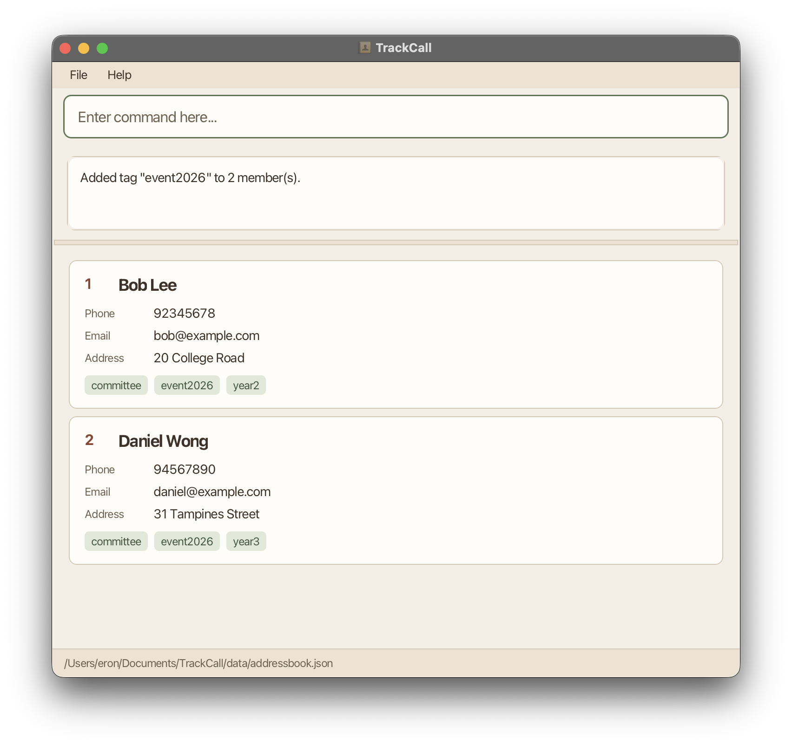

TrackCall helps a club's membership secretary maintain member contact details using typed commands.

This guide covers the **current source build**, based on TrackCall v1.4 alpha, and its seventeen available commands.
The selected-member privacy panel is newer than the v1.4 alpha release JAR.
Tag filtering, bulk tag editing, CSV import/export, and name sorting are available.

Start with [Quick start](#quick-start), or use the [command summary](#command-summary) to look up a command.

* Table of Contents
{:toc}

## Quick start

### Install and launch

1. Install Java **25**. On macOS, use the compatible JDK+FX distribution in the
   [course installation guide](https://se-education.org/guides/tutorials/javaInstallationMac.html).
2. Download `trackcall.jar` from the [team releases page](https://github.com/AY2627S1-CS2103T-W12-1/tp/releases).
3. Place it in an empty folder of your choice.
4. Open a terminal in that folder and run:

   ```text
   java -jar trackcall.jar
   ```

TrackCall opens with sample members and a welcome message on your first launch.
The released v1.4 JAR uses the earlier full-card layout. To use the selected-member panel shown below,
run this current source checkout with `./gradlew run`.

### Read the interface


*TrackCall with one sample member selected. Your data-file path will depend on where you placed the JAR.*

From top to bottom:

* **Command box:** type commands here.
* **Result area:** read success messages and errors.
* **Roster:** view member numbers, names, and tags. Contact details are hidden here.
* **Member details:** select a roster row to reveal that member's phone, email, and address.
  Use the adjacent copy icons to copy a field. Press **F2** to focus the roster, use the arrow keys
  to choose a member, and press **Escape** to hide the details and return to the command box.
* **Status bar:** see where your member data is saved.

Running a command hides the selected details. Successful `add`, `edit`, and `delete` feedback omits
phone, email, and address on screen. Select a member again to inspect those fields.

### Try your first commands

Type each command in the command box and press **Enter**.

1. **Open help:** enter `help`. Press **Escape** to close it.
2. **Show all members:** enter `list`.
3. **Add a member:** copy and run this command:

   ```text
   add n/Alice Tan p/91234567 e/alice@example.com a/12 Orchard Road
   ```

Alice appears in the list and TrackCall reports `Added member`. Your changes are saved automatically.

Use the [command summary](#command-summary) to choose your next task, or see [Your data](#your-data)
for storage and backup instructions.

## Commands

### Read command formats

* Use lowercase keywords without a leading slash: `help`, not `/help`.
* Replace `UPPER_CASE` placeholders with your own values.
* Square brackets mark optional input. `[t/TAG]...` means zero or more tags.
* Do not type the brackets or ellipsis.
* Submit each command on one line.

Use the [command summary](#command-summary) for a compact reference.

### Offline help: `help`

Open help by typing `help`, pressing **F1**, or choosing **Help → Help**.
The guide works without internet access and does not change or save the roster.

The overview groups all seventeen commands into four categories:
Browse members, Manage members, Remove records, and Help & session.
Each command has a short description and a runnable example.
The overview uses two columns in a wide window and one in a narrow window.

* **Open details:** select a command-name button or type `help COMMAND`, such as `help edit`.
  Details include syntax, an example, the expected result, usage notes, and common errors.
* **Return to the overview:** select **All commands**, or close help and type `help`.
* **Scroll:** use **Up/Down**, **Page Up/Page Down**, or **Home/End**.
* **Close:** press **Escape**.

Help accepts at most one lowercase topic.
`help ADD`, `help unknown`, and `help add edit` report errors.

### Add a member: `add`

Provide a name, phone, email, and address.
Required prefixes may appear in any order, but each must appear exactly once.
Separate each prefix from the preceding value with whitespace; pasted tabs also work.
Use a separate `t/` for each optional tag.
Add reserves whitespace-delimited single ASCII letters followed by `/` for field prefixes.
Only lowercase `n/`, `p/`, `e/`, `a/`, and `t/` are accepted; `x/extra` and `T/committee`
report an invalid command format. The standalone abbreviation `c/o` (in any letter case),
URLs, numeric slashes such as `12/3`, and slashes embedded in words remain address text.

| Field | Current rule |
| --- | --- |
| Name | ASCII letters, digits, and spaces. Cannot be blank. |
| Phone | At least three ASCII digits. No spaces or punctuation. |
| Email | A local part and domain separated by `@`, without spaces. See the email rules below. |
| Address | Non-blank text. |
| Tag | 1 to 30 ASCII letters or digits, without spaces. Tags are case-sensitive. |

**Email rules:**

* The local part contains ASCII letters or digits, optionally separated by single `+`, `_`, `.`, or `-` characters.
* Domain labels contain ASCII letters or digits, with hyphens allowed internally.
* The final domain label needs at least two characters.

For example:

```text
add n/Bob Lee p/92345678 e/bob@example.com a/20 College Road t/committee t/year1
```

This adds Bob with two tags, saves the roster, and shows the complete member list.
Repeated identical tags appear once.

A member is a duplicate only when its trimmed name, phone, email, and address all exactly match an
existing member, including case and internal spaces. Tags do not affect identity. A same-name member
with different contact details is allowed.

### Show all members: `list`

`list` removes name-search, email-search, and tag-filter restrictions and shows the full roster in its existing order.
It does not change or save records.

The result is `Showing 1 member.`, `Showing N members.`, or `No members in the address book.`
Extra arguments produce `Invalid command format. Usage: list` without changing the current view.

### Show selected members: `show`

`show 1 3 4 5` keeps members at those numbers in the **currently displayed list**.
The selected members stay in their current order and receive new displayed numbers starting at 1.
You can use `show` again with those new numbers, or use `list` to restore the full roster.

Supply one or more positive numbers separated by spaces. Repeating a number selects that member once.
If any number is invalid or outside the current list, the view stays unchanged. `show` does not change
or save member data.

### Sort members by name: `sort`

`sort` orders the currently displayed members by full name from A to Z, ignoring letter case.
It preserves the current search restriction and does not change or save the stored roster order.
Sorting stays active as members are added, edited, deleted, or searched. Use `list` to restore
the complete roster in stored order, or restart the app to return to stored order.
A successful `import` also restores the complete roster in stored order.
Check the displayed member numbers again before using `edit` or `delete`.
Extra arguments such as `sort date` produce `Invalid command format. Usage: sort`.

### Update a member: `edit`

1. Select the member and check their displayed number and contact details in the details panel.
2. Supply that number and at least one field:

   ```text
   edit 1 p/98765432 e/alice.new@example.com
   ```

This changes the first displayed member's phone and email. Omitted fields stay unchanged.
After saving, TrackCall shows the updated details and keeps the active search, tag filters, and sorting.
If the updated member no longer matches the search or filters, they disappear from view but remain
in the roster. Use `list` to show everyone again.
An edit that would make all four contact fields match another member is rejected.

**Supplied tags replace all existing tags.**

* Keep both tags: `edit 1 t/committee t/year1`.
* Remove all tags: `edit 1 t/`.

Check the member number again after any command that changes the list.

### Find members: `find`

`find Alice Tan` shows currently displayed members whose names contain **Alice or Tan**.

* Matching ignores letter case and uses complete words.
  `Alice` matches `Alice Tan`, but `Ali` does not.
* Each new `find` adds another name filter. For example, `find Alice Tan` followed by `find Tan`
  keeps members matching both searches.
* Email addresses, phone numbers, and tags are not searched.
* Supply at least one keyword.

The result reports `1 member listed.` or `N members listed.`
No matches produce `0 members listed.` and an empty list. No records are deleted.
Active name and tag filters appear as boxes under the command field. Name boxes are blue and tag boxes
are green. The boxes appear left to right in the order applied. With an unchanged roster, their order
does not change who matches:
`filter t/committee` then `find Alice` gives the same final members as `find Alice` then
`filter t/committee`. Select a box's **X** to remove only that condition, or use `list` to show everyone again.
Searching does not save the data file.

### Find members by email: `findemail`

Format: `findemail KEYWORD [MORE_KEYWORDS]...`

Search by a full email address or any part of an email address:

* `findemail alice@example.com` finds emails containing that address.
* `findemail @example.com` finds emails containing that domain fragment.
* `findemail @example.com @school.edu` finds emails containing **either** fragment.

Matching ignores letter case. Whitespace separates keywords, and any keyword can match.
Keywords are literal text, not regular expressions; names and phone numbers are not searched.
Supply at least one keyword. No matches produce `0 members listed.` and an empty list.

Each new `findemail` searches the full roster and replaces earlier name searches, email searches,
and tag filters. Active name sorting stays applied. Use `filter t/TAG` to narrow the email results,
or `list` to show everyone again. Searching does not change records or save the data file.
Check the current displayed numbers before using `edit` or `delete`. Editing keeps the email search;
if an edited email no longer matches, the member disappears from view but remains in the roster.
Use `help findemail` for the same instructions offline.

### Filter displayed members by tag: `filter`

`filter t/TAG` shows members with that tag from the **currently displayed list**.

1. Use `list` to start with everyone, `find` for name-search results, or `findemail` for email-search results.
2. Supply one tag:

   ```text
   filter t/committee
   ```

This keeps only committee members in the current view. Their order, including active name sorting,
stays the same, and their displayed numbers update.

* Matching is exact and case-sensitive: `committee` and `Committee` are different tags.
* Each filter narrows the current results. Run `filter t/year1` next to keep members with **both** tags.
  Applying the same tag again does not add a duplicate condition.
* A new `find` narrows these results by name. Use a box's **X** to remove one filter, or `list` to show everyone.
  A new `findemail` searches the whole roster and replaces previous filters.

The result reports `N member(s) listed with tag "TAG".` for one active tag filter. With multiple
active tags, it names every distinct tag in the order applied, for example:
`1 member(s) listed with tags "committee", "year1".` Use `list` or `findemail` to clear all active tag filters.
No matches produce a count of 0 and an empty list. Filtering does not change or save member data.

Check the displayed numbers before using `edit` or `delete`. Editing keeps the active search and filters.
If an edited member no longer matches, they disappear from view but remain in the roster.

Supply exactly one tag of 1 to 30 ASCII letters or digits, with no internal spaces. Surrounding spaces
are ignored. Missing or extra parameters and invalid tags are rejected without changing the view.
For example, `filter t/committee t/year1` is invalid; apply each tag in a separate command.

### Tag or untag a group: `tagall`, `untagall`

`tagall t/TAG` adds one tag to every member in the **currently displayed list**.
`untagall t/TAG` removes one tag from every displayed member.
Members hidden by a search or filter are not changed, and each member's other tags are kept.

1. Use `find` or `filter` to show the group, then check the displayed members.
2. Run `tagall` or `untagall` with one tag.

For example, to tag committee members for an event, run each command separately:

```text
list
filter t/committee
tagall t/event2026
```

Every displayed committee member now also has the `event2026` tag.



*After tagging the displayed committee members, their existing tags are kept.*

To export the roster afterwards, run `export members.csv`. This exports **every member in the roster**,
including those hidden by the committee filter.

Members who already have the tag (for `tagall`) or do not have it (for `untagall`) are skipped.
The result reports both counts:

* `Added tag "committee" to 9 member(s). 3 already had this tag.`
* `Removed tag "committee" from 12 member(s).`

The current search, filters, and sorting stay applied after the update.
If you remove the tag used by the active filter, the updated members disappear from view
because they no longer match. They are not deleted; run `list` to show everyone.

Supply exactly one tag of 1 to 30 ASCII letters or digits with no internal spaces. Spaces around the tag
are ignored, and matching is case-sensitive. Missing `t/`, empty tags, invalid tags, and more than one tag
are rejected without changing any member. If no members are displayed, TrackCall reports
`There are no members in the current list to update.` and changes nothing.

There is no confirmation or undo. A valid command saves the roster, even when every member is skipped.

### Rename a tag: `renametag`

`renametag t/CURRENT_TAG t/NEW_TAG` replaces one tag with another for **every member in the roster**,
including members hidden by `find` or `filter`. Each member's other tags are kept.

```text
renametag t/batch2026 t/alumni
```

Every member tagged `batch2026` is now tagged `alumni` instead. The result reports how many members changed:

* `Renamed tag "batch2026" to "alumni" for 15 member(s).`
* `Renamed tag "year1" to "year2" for 10 member(s). 2 already had "year2".`

A member who already has the new tag keeps a single copy of it.
Tags are case-sensitive, so `renametag t/committee t/Committee` is a valid rename.

The current search, filters, and sorting stay applied after the update.
If you rename the tag used by the active filter, the renamed members disappear from view
because they no longer match. They are not deleted; run `list` to show everyone.

Supply exactly two tags, each after `t/`, with 1 to 30 ASCII letters or digits and no internal spaces.
The two tags must be different. If no member has the current tag, TrackCall reports
`No member has the tag "CURRENT_TAG".` and changes nothing. Other invalid input is rejected without
changing any member.

There is no confirmation or undo. A valid command saves the roster.

### Delete a member: `delete`

`delete INDEX` removes one member using a positive number from the **currently displayed list**.

1. Run `find Alice` and check the results.
2. Use `delete 1` to remove the first match.

Other records remain, and the remaining matches are renumbered.
The result shows the removed member's details.

**Deletion is immediate, with no confirmation or undo.** Back up records you may need later.

### Clear all members: `clear`

`clear` removes the entire roster, including members hidden by a search.
It saves the empty roster and resets the search after a successful save.

**Clearing is immediate, with no confirmation or undo.**

| Situation | Feedback after saving |
| --- | --- |
| One member removed | `Cleared 1 member. The address book is now empty.` |
| Multiple members removed | `Cleared N members. The address book is now empty.` |
| Roster already empty | `The address book is already empty. No changes were made.` |

The count includes hidden members.
Extra arguments produce `Invalid command format. Usage: clear. This command removes all members.`

If saving fails, TrackCall restores the roster and previous view. It reports:
`Unable to clear the address book because the changes could not be saved. No members were removed.`
See [Correcting errors](#correcting-errors) for recovery steps.

### Export members to CSV: `export`

`export [FILEPATH]` writes every member to a UTF-8 CSV file, including members hidden by a search.
The columns are `name`, `phone`, `email`, `address`, and `tags`, so the exported file can be imported directly.
Tags for each member are sorted alphabetically and joined with semicolons.

* Without `FILEPATH`, the file is written to `addressbook.csv` beside the JAR. During development,
  it is written to the working directory.
* Packaged builds resolve relative paths from the JAR folder and accept absolute paths only inside
  that folder. The parent directory must already exist and be writable.
* An existing destination file is overwritten.
  The active roster file, preferences file, and running JAR cannot be used as export destinations.
  If exporting fails, an existing destination file is left unchanged.
* Export leaves the roster, current search, and automatic JSON data file unchanged.
* An empty roster produces a file containing only the column headers.

Examples:

* `export` writes `addressbook.csv` beside the JAR, or in the working directory during development.
* `export backups/members.csv` writes `members.csv` in the existing `backups` directory.
* `export member list.csv` writes `member list.csv`. Unlike `import`, do not put quotes around an export path;
  everything after `export` is used as the path.

### Import members from CSV: `import`

`import p/FILE_PATH` validates a local UTF-8 CSV file ending in `.csv`, appends unique members in file order, saves the
complete roster, and restores the full list in stored order. The import always checks the full roster,
including members hidden by `find` or `filter`.
Packaged builds read CSV files only from the JAR folder or its subfolders. Relative paths start there;
absolute paths outside that folder are rejected. During development, relative paths start in the working directory.
To import a file from Downloads in a packaged build, copy it into the same folder as the JAR file,
then run `import p/filename.csv`.

Use double quotes around a path containing whitespace:

```text
import p/"data/member list.csv"
```

The first row must contain these column names exactly once, in any order:

```text
name,phone,email,address,tags
```

Every later non-blank row must have exactly five fields. CSV quoting supports commas and doubled double
quotes. A double quote inside an unquoted field, such as `Main" Street`, is invalid CSV syntax.
Surrounding spaces and tabs are trimmed from field values and individual tags before validation;
internal spaces, tabs, and case are preserved. Line breaks inside fields are not supported. Separate tags
with semicolons; leave the tags field empty for no tags. An optional UTF-8 byte-order mark is accepted.

```text
name,phone,email,address,tags
John Doe,98765432,johnd@example.com,"John Street, Block 123",year1;committee
```

The whole file is validated before any member is added. Exact contact-detail duplicates against existing
members or earlier rows are skipped; tags are not merged. The result reports imported and skipped counts.
A header-only or duplicate-only file succeeds with zero imports and still retries automatic saving.

If a row, header, CSV structure, or UTF-8 encoding is invalid, no records or view state change. The first
error identifies the row where applicable. The source CSV is never modified.

### Finish your session: `exit`

`exit` closes TrackCall and its help window. It accepts no arguments.
Successful data changes have already been saved.
Exiting does not retry a failed save. Resolve storage errors first to keep unsaved changes.

## Correcting errors

### Invalid input

An unknown command points you to `help`.
A known command with missing or invalid input shows the problem and its rules.
Rejected input leaves the roster and current list unchanged.

* `add n/Alice` is incomplete. Use `help add`, then enter all four required fields.
* `delete 0` is invalid. Use `list`, check the member, and enter its displayed number.


*An invalid phone number leaves the member unchanged. Correct the command and press Enter to try again.*

### A save fails after add, edit, delete, tagall, untagall, renametag, or import

The change remains visible in this session, but the previous saved file stays unchanged.
The command box clears the input to avoid repeating an already-applied change.

1. Fix the reported file or folder problem.
2. Check the current list.
3. Use `edit` to reapply an existing field value. This retries saving without changing anything else.
   If the roster is empty, use `clear` to retry saving it.

For import, the complete imported batch remains in memory and TrackCall reports
`Could not save data to file: DETAILS`. Exiting before a successful retry loses unsaved changes.

### A save fails after clear

TrackCall restores every member and the previous view. It reports `No members were removed.`
The clear input stays in the command box.

Fix the storage problem. Retry only if you still want to remove the entire roster.

## Your data

TrackCall automatically saves after successful `add`, `edit`, `delete`, `tagall`, `untagall`, `renametag`,
`clear`, and `import` commands.
`help`, `list`, `show`, `sort`, `find`, `findemail`, `filter`, `export`, and `exit` do not save the roster.

### Locate or back up your roster

The default file is `data/addressbook.json` beside the JAR in a packaged build. During development,
it is relative to the working directory. The status bar shows its location. For development runs,
start from the same folder to keep using the same roster.

1. Close TrackCall.
2. Copy the data file to create a backup.
3. To move it to another computer you own, place the copy at the corresponding data-file location.
4. Start TrackCall and check the roster.

### Editing the file manually

Close TrackCall and make a backup first. Keep the existing JSON structure:

* A `persons` array contains the members.
* Each member has `name`, `phone`, `email`, `address`, and `tags` fields.
* Use `tags` for each member's group assignments.

### Missing or invalid files

| File state | Startup behaviour |
| --- | --- |
| Missing | Sample members are loaded. |
| Unreadable or invalid | A recovery dialog appears before the roster can be edited. |

Normal startup and read-only commands leave the member file unchanged.
If an expected roster is missing, close the app and repair or restore the file first.

### Automatic backup and recovery

Before replacing an existing valid roster, TrackCall saves its previous contents to
`data/addressbook.json.bak`. This is one previous saved version; each successful backup replaces it.
If the backup cannot be written, the roster save fails and the existing roster stays unchanged.

If the roster cannot be loaded, TrackCall first preserves its exact contents in a uniquely named
`data/addressbook.json.corrupt-....json` file. It then offers:

* **Restore backup**, when the backup is valid: restore the previous saved roster.
* **Start empty**: explicitly replace the unreadable roster with an empty roster.
* **Close**, the default: leave the roster unchanged so you can repair or restore it manually.

Restoration and starting empty keep both the preserved damaged file and the existing backup unchanged.
Subsequent normal saves resume rotating the backup. Recovery copies use unique filenames, so restarting
does not overwrite earlier copies. If the original cannot be preserved, TrackCall closes without opening
an editable roster. Fix the file or folder permissions, or restore a backup manually before restarting.

To restore a backup manually, close TrackCall, keep a copy of the current roster, and copy
`addressbook.json.bak` to `addressbook.json`. These files are stored beside each other in `data`.
Export cannot overwrite the automatic backup or a preserved recovery file.

## Field prefix syntax

Both `add` and `edit` reject unknown or uppercase single-letter field prefixes, including inside
an address. For example, `edit 1 a/Main Road T/committee` reports invalid input; use lowercase `t/`
to assign a tag. Standalone `c/o`, URLs, numeric slashes such as `12/3`, and slashes inside words
remain valid address text.

The [Developer Guide](DeveloperGuide.md#limitations) explains current limitations and records
ideas for later versions in its requirements appendix.

## FAQ

### How do I move my roster to another computer?

Close TrackCall and copy `data/addressbook.json` to the corresponding location on your other computer.
See [Your data](#your-data) for working-folder and backup instructions.

### Why did a member disappear after a search?

A search changes the displayed list, not the saved roster. Run `list` to show everyone.
Check the current displayed number before editing or deleting a member.

### Can I update a whole group's tags?

Yes. Use `find` or `filter t/TAG` to display the group, then use `tagall t/TAG` or `untagall t/TAG`.
Only the displayed members change. See [Tag or untag a group](#tag-or-untag-a-group-tagall-untagall).
To rename a group's tag for everyone, use `renametag`. See [Rename a tag](#rename-a-tag-renametag).

### What should I do after a save error?

Follow [Correcting errors](#correcting-errors) before exiting.
A failed `clear` save restores the roster.
Unsaved changes from `add`, `edit`, `delete`, `tagall`, `untagall`, `renametag`, and `import` remain visible
in memory.

## Command summary

| Task | Format | Example and result |
| --- | --- | --- |
| Open help | `help [COMMAND]` | `help add` opens the add instructions. |
| Add a member | `add n/NAME p/PHONE e/EMAIL a/ADDRESS [t/TAG]...` | The quick-start example adds Alice. |
| Show everyone | `list` | `list` restores the complete roster. |
| Show selected members | `show INDEX [MORE_INDEXES]...` | `show 1 3 4 5` keeps those members from the current list. |
| Sort by name | `sort` | Sorts the current view from A to Z, ignoring letter case. |
| Update a member | `edit INDEX [n/NAME] [p/PHONE] [e/EMAIL] [a/ADDRESS] [t/TAG]...` | `edit 1 p/98765432` changes member 1's phone. |
| Find by name | `find KEYWORD [MORE_KEYWORDS]` | `find Alice Tan` shows names containing Alice or Tan. |
| Find by email | `findemail KEYWORD [MORE_KEYWORDS]...` | `findemail @example.com` shows emails containing that fragment. |
| Filter by tag | `filter t/TAG` | `filter t/committee` narrows the displayed members. |
| Tag a group | `tagall t/TAG` | `tagall t/committee` adds the tag to every displayed member. |
| Untag a group | `untagall t/TAG` | `untagall t/committee` removes the tag from every displayed member. |
| Rename a tag | `renametag t/CURRENT_TAG t/NEW_TAG` | `renametag t/batch2026 t/alumni` renames the tag for every member. |
| Delete one member | `delete INDEX` | `delete 1` removes the first currently displayed member. |
| Clear the roster | `clear` | `clear` removes all members, including those hidden by a search. |
| Export members | `export [FILEPATH]` | `export members.csv` writes the full roster to CSV. |
| Import members | `import p/FILE_PATH` | `import p/members.csv` appends unique valid records. |
| Close the app | `exit` | `exit` ends the session. |

`INDEX` always refers to the currently displayed list. Check the member details before using `edit` or `delete`.
See [Commands](#commands) for parameter rules and expected results.
