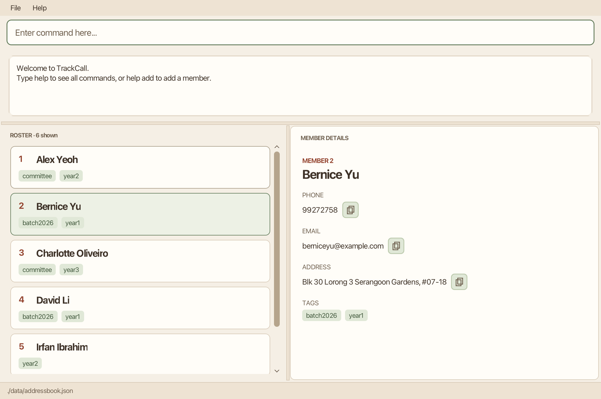
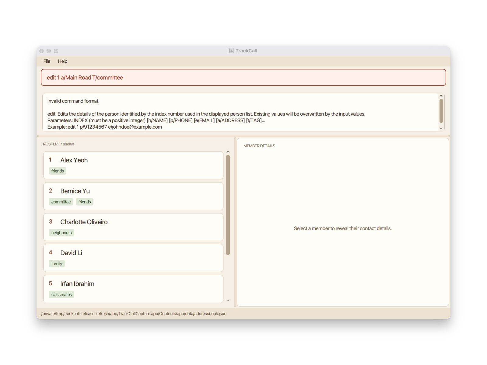

# TrackCall User Guide {id="user-guide"}

TrackCall helps a club's membership secretary maintain member contact details using typed commands.

The full feature set includes AB3's core member workflows: `add`, `edit`, `delete`, `clear`, `list`,
`find`, `help`, and `exit`, together with contact tags and local saving. TrackCall adds the membership,
search, group-editing, and CSV tools documented below.

This guide covers the **v1.5 preparation build (unreleased)** and its nineteen available commands.
Tag filtering, bulk tag editing, CSV import/export, and name sorting are available.

The published download is still [v1.4 alpha](https://github.com/AY2627S1-CS2103T-W12-1/tp/releases/tag/v1.4).
For that JAR, use the [version-matched User Guide](https://github.com/AY2627S1-CS2103T-W12-1/tp/blob/v1.4/docs/UserGuide.md).
The source build adds single-instance protection, clearing an address with `edit INDEX a/`, preservation of the
previous distinct backup, improved import-save recovery feedback, and less sensitive diagnostic logging.
These changes are not yet in the v1.4 download.

Start with [Quick start](#quick-start), browse the [feature groups](#commands), or use the
[command summary](#command-summary) to look up a command.

## Quick start

### Install and launch

1. Install Java **25**. On macOS, use the compatible JDK+FX distribution in the
   [course installation guide](https://se-education.org/guides/tutorials/javaInstallationMac.html).
2. Download `trackcall.jar` from the [team releases page](https://github.com/AY2627S1-CS2103T-W12-1/tp/releases).
3. Place it in an empty folder that you can write to. Keep the JAR and its data folder together.
4. Open a terminal in that folder and run:

   ```text
   java -jar trackcall.jar
   ```

TrackCall opens with sample members and a welcome message on your first launch.
In the v1.5 preparation build, only one instance can use a JAR folder at a time. If a second launch reports that TrackCall is already
running, use the existing window or close it before restarting. The `.trackcall.lock` file may remain
after exit; its presence alone does not block startup, and you do not need to delete it.
The v1.4 JAR does not enforce this restriction; keep only one window open to avoid overwriting another session's changes.
To run the preparation build from source, use `./gradlew run` after following the [Setting up guide](SettingUp.html).
Screenshots show the existing interface; the preparation changes above affect the specified behaviour.

### Read the interface



*TrackCall with one sample member selected. Your data-file path will depend on where you placed the JAR.*

From top to bottom:

* **Command box:** type commands here.
* **Result area:** read success messages and errors.
* **Roster:** view member numbers, names, and tags. Contact details are hidden here.
* **Member details:** select a roster row to reveal that member's phone, email, and address.
  Use the adjacent copy icons to copy a field. Press **F2** to focus the roster, use the arrow keys
  to choose a member, and press **Escape** to hide the details and return to the command box.
* **Status bar:** see where your member data is saved.

Running a command hides the selected details. Successful `add`, `edit`, and `delete` feedback omits
phone, email, and address on screen. Select a member again to inspect those fields.

### Try your first commands

Type each command in the command box and press **Enter**.

1. **Open help:** enter `help`. Press **Escape** to close it.
2. **Show all members:** enter `list`.
3. **Add a member:** copy and run this command:

   ```text
   add n/Alice Tan p/91234567 e/alice@example.com a/12 Orchard Road
   ```

Alice appears in the list and TrackCall reports `Added member`. Your changes are saved automatically.

Use the [command summary](#command-summary) to choose your next task, or see [Your data](#your-data)
for storage and backup instructions.

## Features {id="commands"}

Choose a task below. The six groups cover all **nineteen commands**, including the core AB3 commands
retained and adapted for TrackCall. Each group explains the relevant commands, examples, and error conditions.

| I want to… | Feature group | Commands |
| --- | --- | --- |
| Find members and organise the view | [Browse and find members](#browse-members) | `list`, `show`, `find`, `findemail`, `filter`, `sort` |
| Maintain contact details | [Add and update members](#manage-members) | `add`, `edit` |
| Manage overlapping groups | [Organise member groups](#manage-tags) | `tag`, `untag`, `tagall`, `untagall`, `renametag` |
| Move records between rosters | [Exchange rosters with CSV](#csv-files) | `export`, `import` |
| Remove old records | [Remove member records](#remove-records) | `delete`, `clear` |
| Get help or finish working | [Help and session](#help-and-session) | `help`, `exit` |

### Read command formats

* Use lowercase keywords without a leading slash: `help`, not `/help`.
* Replace `UPPER_CASE` placeholders with your own values.
* Square brackets mark optional input. `[a/ADDRESS]` means the address may be omitted;
  `[t/TAG]...` means zero or more tags.
* Do not type the brackets or ellipsis.
* Submit each command on one line.
* Examples are independent. A command using a member number needs a member at that number in the
  currently displayed list. Use `list` and inspect the roster before adapting an example to your data.

Use the [command summary](#command-summary) for a compact reference.

### Browse and find members {id="browse-members"}

Find the right members, narrow the displayed roster, or change its order.

#### Show all members: `list`

`list` clears name searches, email searches, tag filters, and `show` selections. It also turns off name sorting
and shows the full roster in stored order. It does not change or save records.

The result is `Showing 1 member.`, `Showing N members.`, or `No members in the roster.`
Extra arguments produce `Invalid command format. Usage: list` without changing the current view.

#### Show selected members: `show`

`show 1 3` shows only members 1 and 3 from the **currently displayed list**.
The selected members stay in their current order and receive new displayed numbers starting at 1.
You can use `show` again with those new numbers, or use `list` to restore the full roster.
While a `show` selection is active, a **Show: active** box appears under the command field.
It stays visible even if you remove other search or filter boxes. Hover over it to see how many times
`show` has been applied. Select its **X** to remove all `show` selections at once while keeping any
name, email, or tag filters. The **ROSTER** heading shows how many members are currently displayed,
including when the result is empty.

Supply one or more positive numbers separated by spaces. Repeating a number selects that member once.
If any number is invalid or outside the current list, the view stays unchanged. `show` does not change
or save member data.

#### Find members: `find`

`find Alice Tan` shows currently displayed members whose names contain **Alice or Tan**.

* Matching ignores letter case and accepts any contiguous part of a name word.
  `Alice`, `Ali`, `lic`, and `ice` all match `Alice Tan`.
  For example, `find ali tan` shows names containing either `ali` or `tan`.
* Each new `find` adds another name filter. For example, `find Alice Tan` followed by `find Tan`
  keeps members matching both searches.
* Email addresses, phone numbers, and tags are not searched.
* Supply at least one keyword.

The result reports `1 member listed.` or `N members listed.`
No matches produce `0 members listed.` and an empty list. No records are deleted.
Active name, email and tag filters appear as boxes under the command field. Search boxes are blue and tag boxes
are green. The boxes appear left to right in the order applied. With an unchanged roster, their order
does not change who matches:
`filter t/committee` then `find Alice` gives the same final members as `find Alice` then
`filter t/committee`. Select a box's **X** to remove only that condition, or use `list` to show everyone again.
Long filter labels are shortened with an ellipsis; hover over a label to read the complete condition.
When many conditions are active, scroll within the filter area to reach the remaining boxes.
You can also press Tab or Shift+Tab to move between their removal buttons; the focused box scrolls into view.
Removing a focused box moves focus to another remaining box, or back to the command field when none remain.
Searching does not save the data file.

#### Find members by email: `findemail`

Format: `findemail KEYWORD [MORE_KEYWORDS]...`

Search by a full email address or any part of an email address:

* `findemail alice@example.com` finds emails containing that address.
* `findemail @example.com` finds emails containing that domain fragment.
* `findemail @example.com @school.edu` finds emails containing **either** fragment.

Matching ignores letter case. Whitespace separates keywords, and any keyword can match.
Keywords are literal text, not regular expressions; names and phone numbers are not searched.
Supply at least one keyword. No matches produce `0 members listed.` and an empty list.

Each new `findemail` searches the full roster and replaces earlier name searches, email searches,
tag filters, and `show` selections. Active name sorting stays applied. Use `filter t/TAG` to narrow the email results,
or `list` to show everyone again. Searching does not change records or save the data file.
Check the current displayed numbers before using `edit` or `delete`. Editing keeps the email search;
if an edited email no longer matches, the member disappears from view but remains in the roster.
Use `help findemail` for the same instructions offline.
The filter row shows an **Email:** box with the search terms. Remove it with its **X** button to
clear only the email condition while keeping any later name or tag filters.

#### Filter displayed members by tag: `filter`

`filter t/TAG` shows members with that tag from the **currently displayed list**.

1. Use `list` to start with everyone, `find` for name-search results, or `findemail` for email-search results.
2. Supply one tag:

   ```text
   filter t/committee
   ```

This keeps only committee members in the current view. Their order, including active name sorting,
stays the same, and their displayed numbers update.

* Matching ignores letter case: `committee` and `Committee` identify the same tag.
* Each filter narrows the current results. Run `filter t/year1` next to keep members with **both** tags.
  Applying the same tag again does not add a duplicate condition.
* A new `find` narrows these results by name. Use a box's **X** to remove one filter, or `list` to show everyone.
  A new `findemail` searches the whole roster and replaces previous filters.

The result reports `N member(s) listed with tag "TAG".` for one active tag filter. With multiple
active tags, it names every distinct tag in the order applied, for example:
`1 member(s) listed with tags "committee", "year1".` Use `list` or `findemail` to clear all active tag filters.
No matches produce a count of 0 and an empty list. Filtering does not change or save member data.

Check the displayed numbers before using `edit`, `tag`, `untag`, or `delete`. Editing keeps the active search and filters.
If an edited member no longer matches, they disappear from view but remain in the roster.

Supply exactly one tag of 1 to 30 characters, using ASCII letters or digits with optional internal hyphens.
For example, `year-1` is valid. Surrounding spaces are ignored. Missing or extra parameters and invalid
tags are rejected without changing the view.
For example, `filter t/committee t/year1` is invalid; apply each tag in a separate command.

#### Sort members by name: `sort`

`sort` orders the currently displayed members by full name from A to Z, ignoring letter case.
It preserves the current search restriction and does not change or save the stored roster order.
Names that compare equally, including differences only in case or repeated spaces, keep their stored
relative order after tag or contact-detail updates.
Sorting stays active as members are added, edited, deleted, or searched. Use `list` to restore
the complete roster in stored order, or restart the app to return to stored order.
A successful `import` also restores the complete roster in stored order.
Check the displayed member numbers again before using `edit` or `delete`.
Extra arguments such as `sort date` produce `Invalid command format. Usage: sort`.

### Add and update members {id="manage-members"}

Keep member contact details up to date.

#### Add a member: `add`

Provide a name, phone, and email. Address and tags are optional.
Required prefixes may appear in any order, but each must appear exactly once.
Separate each prefix from the preceding value with whitespace; pasted tabs also work.
Use `a/` if you have an address, and a separate `t/` for each tag.
Add reserves whitespace-delimited single ASCII letters followed by `/` for field prefixes.
Only lowercase `n/`, `p/`, `e/`, `a/`, and `t/` are accepted; `x/extra` and `T/committee`
report an invalid command format. The standalone abbreviation `c/o` (in any letter case),
URLs, numeric slashes such as `12/3`, and slashes embedded in words remain address text.
Within an `a/` value, uppercase `A/` followed by a digit is also literal address text,
so `a/Block A/12` is accepted. Other uppercase or unknown field prefixes remain invalid.

| Field | Current rule |
| --- | --- |
| Name | Start with a Unicode letter or ASCII digit. Unicode letters, combining marks, ASCII digits, spaces, hyphens, and straight or curly apostrophes are accepted. |
| Phone | At least three ASCII digits, with an optional leading `+` and spaces between digits. Formatting is preserved. Hyphens, parentheses, and internal tabs are rejected. |
| Email | A local part and domain separated by `@`, without spaces. See the email rules below. |
| Address | Non-blank text when adding; `edit INDEX a/` clears an existing address. |
| Tag | 1 to 30 ASCII letters or digits with optional internal hyphens. Matching ignores letter case. |

Names such as `Anne-Marie`, `José Garcia`, and `O'Connor` keep their entered spelling,
including combining accents. Phone examples include `+6591234567` and `9123 4567`.
Phone formatting is stored, displayed, copied, and exported as entered; the app does not infer country
codes or treat differently formatted numbers as equal. Multiple spaces between digit groups are accepted.
Names retain their Unicode representation, so visually identical accented spellings can match differently in searches
or duplicate checks. Sorting uses case-insensitive text order rather than a language-specific alphabet;
for example, `Émile` sorts after `Zara`.

**Email rules:**

* The local part contains ASCII letters or digits, optionally separated by single `+`, `_`, `.`, apostrophe (`'`), or `-` characters.
* Domain labels contain ASCII letters or digits, optionally separated by single hyphens.
* The final domain label needs at least two characters.

For example:

```text
add n/Bob Lee p/92345678 e/bob@example.com a/20 College Road t/committee t/year1
```

This adds Bob with two tags, saves the roster, and shows the complete member list.
Repeated identical tags appear once.
If you omit `a/`, the address is shown as `(none)` until you add one with `edit`.

Duplicate checking ignores name capitalization, repeated whitespace and surrounding whitespace.
For example, `Alice Tan`, `alice tan` and `Alice  Tan` match when phone, email and address also match.
Those other fields are trimmed but otherwise compared exactly; tags are ignored.
Names keep their entered capitalization and spacing in storage and display. Accents and punctuation
are not removed by duplicate checking, and this rule does not expand the supported name characters.
A same-name member with different contact details is allowed.

A duplicate add is rejected. Use `find` to locate the existing member and `edit` to update it.
Older saved rosters containing these name variants still load without merging or deleting records.
Tag-only and unchanged-contact edits to those existing records remain available.

#### Update a member: `edit`

1. Select the member and check their displayed number and contact details in the details panel.
2. Supply that number and at least one field:

   ```text
   edit 1 p/98765432 e/alice.new@example.com
   ```

This changes the first displayed member's phone and email. Omitted fields stay unchanged.
Use `edit INDEX a/` to remove an address that is no longer known; the details panel then shows `(none)`.
After saving, TrackCall confirms the member's name and tags and keeps the active search, tag filters, and sorting.
The details panel stays hidden until you select a member again to inspect the changed contact fields.
If the updated member no longer matches the search or filters, they disappear from view but remain
in the roster. Use `list` to show everyone again.
An edit that would match another member under the duplicate rule above is rejected.
Changing only your own name's capitalization or spacing is allowed when it does not match another member.

**Supplied tags replace all existing tags.**

* Keep both tags: `edit 1 t/committee t/year1`.
* Remove all tags: `edit 1 t/`.

Check the member number again after any command that changes the list.

### Organise member groups {id="manage-tags"}

Use tags for overlapping groups, then update one member or the whole displayed group.

#### Add or remove one tag: `tag`, `untag`

Use `tag INDEX t/TAG` to add one tag to the member at a number in the **currently displayed list**.
Use `untag INDEX t/TAG` to remove one tag from that member. Both commands retain all other tags
and contact fields. For example:

```text
tag 2 t/committee
untag 2 t/friends
```

Check the displayed number after searching, filtering, showing selected members, or sorting. The
index identifies the member shown at that number when you submit the command. Hidden members are
not changed. Tags contain 1 to 30 ASCII letters or digits with optional internal hyphens; matching ignores letter case.
Adding `t/student` to a member who already has `Student` does not add a second tag.
If one `add` or `edit` command supplies both spellings, the first `t/` spelling is kept.

If the member already has the tag (for `tag`) or lacks it (for `untag`), TrackCall reports that
no change was made. A valid no-op still attempts to save. Searches, filters, sorting, and a `show`
selection remain active after the command. Removing a tag required by an active filter may hide the
member from that view; use `list` to show everyone again.

If saving fails, the member change remains visible in the current session while the previous saved
file stays unchanged. Follow [Correcting errors](#correcting-errors) before exiting.

#### Tag or untag a group: `tagall`, `untagall`

`tagall t/TAG` adds one tag to every member in the **currently displayed list**.
`untagall t/TAG` removes one tag from every displayed member.
Members hidden by a search or filter are not changed, and each member's other tags are kept.

1. Use `find` or `filter` to show the group, then check the displayed members.
2. Run `tagall` or `untagall` with one tag.

For example, to tag committee members for an event, run each command separately:

```text
list
filter t/committee
tagall t/event2026
```

Every displayed committee member now also has the `event2026` tag.

To export the roster afterwards, run `export members.csv`. This exports **every member in the roster**,
including those hidden by the committee filter.

Members who already have the tag (for `tagall`) or do not have it (for `untagall`) are skipped.
The result reports both counts:

* `Added tag "committee" to 9 member(s). 3 already had this tag.`
* `Removed tag "committee" from 12 member(s).`

The current search, filters, and sorting stay applied after the update.
If you remove the tag used by the active filter, the updated members disappear from view
because they no longer match. They are not deleted; run `list` to show everyone.

Supply exactly one tag of 1 to 30 ASCII letters or digits with optional internal hyphens. Spaces around the tag
are ignored, and matching ignores letter case. Missing `t/`, empty tags, invalid tags, more than one tag, and
other field prefixes such as `n/` are rejected without changing any member. If no members are displayed, TrackCall reports
`There are no members in the current list to update.` and changes nothing.

There is no confirmation or undo. A valid command saves the roster, even when every member is skipped.

#### Rename a tag: `renametag`

`renametag t/CURRENT_TAG t/NEW_TAG` replaces one tag with another for **every member in the roster**,
including members hidden by `find` or `filter`. Each member's other tags are kept.

```text
renametag t/batch2026 t/alumni
```

Every member tagged `batch2026` is now tagged `alumni` instead. The result reports how many members changed:

* `Renamed tag "batch2026" to "alumni" for 15 member(s).`
* `Renamed tag "year1" to "year2" for 10 member(s). 2 already had "year2".`

A member with both distinct tags keeps a single copy of the replacement tag.
Tags match regardless of letter case. To standardize capitalization across the roster, run
`renametag t/committee t/Committee`. Members already using `Committee` are skipped and the result
counts only members whose spelling changed. Supplying identical spellings is rejected.

The current search, filters, and sorting stay applied after the update.
If you rename the tag used by the active filter, the renamed members disappear from view
because they no longer match. They are not deleted; run `list` to show everyone.

Supply exactly two tags, each after `t/`, with 1 to 30 characters using ASCII letters or digits and
optional internal hyphens.
The two tags must be different. If no member has the current tag, TrackCall reports
`No member has the tag "CURRENT_TAG".` and changes nothing. Other invalid input is rejected without
changing any member.

There is no confirmation or undo. A valid command saves the roster.

### Exchange rosters with CSV {id="csv-files"}

Export a complete roster or bring existing member records into TrackCall.

#### Export members to CSV: `export`

`export [FILEPATH]` writes every member to a UTF-8 CSV file, including members hidden by a search.
The columns are `name`, `phone`, `email`, `address`, and `tags`, so the exported file can be imported directly.
Tags for each member are sorted in case-sensitive ASCII order (hyphens, digits, uppercase letters, then lowercase letters)
and joined with semicolons.
If an imported CSV file or saved JSON roster contains case variants of one tag on the same member,
TrackCall keeps the first spelling listed for that member. The retained spelling appears in the member
list and exports. On the next roster save, the other spellings are removed from the saved file.

* Without `FILEPATH`, the file is written to `addressbook.csv` beside the JAR. During development,
  it is written to the working directory.
* Packaged builds resolve relative paths from the JAR folder and accept absolute paths only inside
  that folder. The parent directory must already exist and be writable.
* The destination must end in `.csv` (ignoring letter case). Other extensions and missing extensions are rejected
  with `File must have a .csv extension.` Filenames may contain spaces.
* An existing destination file is overwritten.
  The active roster file, preferences file, their backups and recovery copies, application lock, and running JAR
  cannot be used as export destinations. These reserved paths are case-insensitive, including directory names,
  even before the files exist.
  If exporting fails, an existing destination file is left unchanged.
* A missing parent folder or a destination that is a folder produces an error explaining what to change.
  Create the parent folder first and choose a CSV filename. For write failures, check permissions and free disk space.
* Export leaves the roster, current search, and automatic JSON data file unchanged.
* An empty roster produces a file containing only the column headers.

Examples:

* `export` writes `addressbook.csv` beside the JAR, or in the working directory during development.
* `export backups/members.csv` writes `members.csv` in the existing `backups` directory.
* `export member list.csv` writes `member list.csv`. Unlike `import`, do not put quotes around an export path;
  everything after `export` is used as the path.

#### Import members from CSV: `import`

`import p/FILE_PATH` validates a local UTF-8 CSV file ending in `.csv`, appends unique members in file order, saves the
complete roster, and restores the full list in stored order. The import always checks the full roster,
including members hidden by `find` or `filter`.
Packaged builds read CSV files only from the JAR folder or its subfolders. Relative paths start there;
absolute paths outside that folder are rejected. During development, relative paths start in the working directory.
To import a file from Downloads in a packaged build, copy it into the same folder as the JAR file,
then run `import p/filename.csv`.

Use double quotes around a path containing whitespace:

```text
import p/"data/member list.csv"
```

The first row must contain these column names exactly once, in any order:

```text
name,phone,email,address,tags
```

Every later non-blank row must have exactly five fields. CSV quoting supports commas and doubled double
quotes. A double quote inside an unquoted field, such as `Main" Street`, is invalid CSV syntax.
Surrounding spaces and tabs are trimmed from field values and individual tags before validation;
internal spaces, tabs, and case are preserved. Line breaks inside fields are not supported. Separate tags
with semicolons; leave the tags field empty for no tags. Leave the address field empty when it is unknown.
An optional UTF-8 byte-order mark is accepted.

Imports accept files up to 10 MiB (10,485,760 bytes) and at most 10,000 non-blank member rows,
counted before duplicate removal. The header and blank rows do not count toward the member-row limit.
Larger files are rejected without importing any members; split them into smaller CSV files.
The file name must end in `.csv` (in any letter case). Renaming a PDF, spreadsheet, image, or other file to `.csv`
does not convert it: its contents must follow the UTF-8 CSV format above.

```text
name,phone,email,address,tags
John Doe,98765432,johnd@example.com,"John Street, Block 123",year1;committee
```

The whole file is validated before any member is added. Duplicates against existing members or earlier rows
are skipped using the same normalized-name rule as `add` and `edit`; tags are not merged.
The first accepted record keeps its name formatting. The result reports imported and skipped counts;
inspect the existing member and use `edit` if a skipped record was intended as an update.
A header-only or duplicate-only file succeeds with zero imports and still retries automatic saving.

If a row, header, CSV structure, or UTF-8 encoding is invalid, no records or view state change. The first
error identifies the row where applicable. The source CSV is never modified.
A missing file reports its resolved path; check the spelling and location. In a packaged build, keep the file
inside the JAR folder or one of its subfolders.

### Remove member records {id="remove-records"}

Remove one member or the whole roster with confirmation.

#### Delete a member: `delete`

`delete INDEX` removes one member using a positive number from the **currently displayed list**,
after you confirm the deletion.

1. Run `list`, then `find Alice`, and check the results. Select the intended member to check their contact details.
2. Use `delete 1`. TrackCall names the first match and its tags, then asks you to confirm:

   ```text
   Delete member Alice Tan?
   Tags: (none)
   Type y and press Enter to confirm. Any other input cancels the deletion.
   ```

   The tags shown depend on the member; Alice from the quick start has none.
   The command box is highlighted until you answer. Asking for confirmation does not change or save the roster.
3. Type `y` and press Enter to delete that member.

Any other input, including another command, cancels the deletion with
`Deletion cancelled. No member was removed.` That input is not run, so enter it again if you need it.
Only lowercase `y` confirms.

After you confirm, other records remain, and the remaining matches are renumbered.
The result identifies the removed member without displaying their phone, email, or address.

**There is no undo after you confirm.** Back up records you may need later.

#### Clear all members: `clear`

`clear` removes the entire roster, including members hidden by a search.
It saves the empty roster and resets the search after a successful save.

1. Run `clear`. TrackCall shows the total number of stored members, including anyone hidden by searches or filters.
2. Type `y` and press Enter to clear and save the entire roster.
   Any other input cancels without running that input as a command.

The roster, current view, and saved file stay unchanged while the prompt is pending or when you cancel.
An already-empty roster saves immediately without prompting, so `clear` can still retry an unsaved empty roster.
**There is no undo after confirmation.** Back up records you may need later.

| Situation | Feedback after saving |
| --- | --- |
| One member removed | `Cleared 1 member. The roster is now empty.` |
| Multiple members removed | `Cleared N members. The roster is now empty.` |
| Roster already empty | `The roster is already empty. No changes were made.` |

The count includes hidden members.
Extra arguments produce `Invalid command format. Usage: clear. This command removes all members.`

If saving fails, TrackCall restores the roster and previous view. It reports:
`Unable to clear the roster because the changes could not be saved. No members were removed. Run clear again to retry.`
See [Correcting errors](#correcting-errors) for recovery steps.

### Help and session {id="help-and-session"}

Read command instructions offline and close TrackCall when you are finished.

#### Offline help: `help`

Open help by typing `help`, pressing **F1**, or choosing **Help → Help**.
The guide works without internet access and does not change or save the roster.

The overview groups all nineteen commands into four categories:
Browse members, Manage members, Remove records, and Help & session.
Each command has a short description and a runnable example.
The overview uses two columns in a wide window and one in a narrow window.

* **Open details:** select a command-name button or type `help COMMAND`, such as `help edit`.
  Details include syntax, an example, the expected result, usage notes, and common errors.
* **Return to the overview:** select **All commands**, or close help and type `help`.
* **Scroll:** use **Up/Down**, **Page Up/Page Down**, or **Home/End**.
* **Close:** press **Escape**.

Help accepts at most one lowercase topic.
`help ADD`, `help unknown`, and `help add edit` report errors.

#### Finish your session: `exit`

`exit` closes TrackCall and its help window. It accepts no arguments.
Successful data changes have already been saved.
Exiting does not retry a failed save. Resolve storage errors first to keep unsaved changes.

## Correcting errors

### Invalid input

An unknown command points you to `help`.
A known command with missing or invalid input shows the problem and its rules.
Rejected input leaves the roster and current list unchanged.

* `add n/Alice` is incomplete. Use `help add`, then enter the required name, phone, and email fields.
* `delete 0` is invalid. Use `list`, check the member, and enter its displayed number.
* `tag 0 t/committee` and `untag 1 t/` are invalid. Use a positive current list number and one valid tag.



*An unsupported field prefix leaves the member unchanged. Use lowercase `t/`, then press Enter to try again.*

### Field prefix syntax {id="field-prefix-syntax"}

Both `add` and `edit` reject unknown or uppercase single-letter field prefixes, including inside
an address. For example, `edit 1 a/Main Road T/committee` reports invalid input; use lowercase `t/`
to assign a tag. Standalone `c/o`, URLs, numeric slashes such as `12/3`, and slashes inside words
remain valid address text.

The [Developer Guide](DeveloperGuide.html#limitations) explains current limitations and records
ideas for later versions in its requirements appendix.

### A save fails after changing records {id="a-save-fails-after-add-edit-delete-tag-untag-tagall-untagall-renametag-or-import"}

This applies to `add`, `edit`, `delete`, `tag`, `untag`, `tagall`, `untagall`, `renametag`, and `import`.

The change remains visible in this session, but the previous saved file stays unchanged.
The command box clears the input to avoid repeating an already-applied change.

1. Fix the reported file or folder problem.
2. Check the current list.
3. If no members are currently displayed, run `list` to see the full roster.
4. Use `edit` with the displayed member number and an existing field value, for example `edit 1 p/91234567`
   only when member 1 already has that phone number. This retries saving without changing anything else.
   If the entire roster is empty, use `clear` to retry saving it.

For import, the complete imported batch remains in memory. TrackCall reports
`Could not save data to file: DETAILS`, followed by the unsaved-change warning and retry instructions.
Exiting before a successful retry loses unsaved changes.

### A save fails after clear

TrackCall restores every member and the previous view. It reports `No members were removed.`
The submitted input stays in the command box (`y` after confirmation, or `clear` for an already-empty roster).

Fix the storage problem. Run `clear` again and confirm the new prompt only if you still want to remove the entire roster.
A second `y` alone cannot repeat the action.

## Your data

TrackCall automatically saves after successful `add`, `edit`, confirmed `delete`, `tag`, `untag`, `tagall`, `untagall`,
`renametag`, `clear`, and `import` commands.
`help`, `list`, `show`, `sort`, `find`, `findemail`, `filter`, `export`, and `exit` do not save the roster.

### Locate or back up your roster

The default file is `data/addressbook.json` beside the JAR in a packaged build. During development,
it is relative to the working directory. The status bar shows its location. For development runs,
start from the same folder to keep using the same roster.

1. Close TrackCall.
2. Copy the data file to create a backup.
3. To move it to another computer you own, place the copy at the corresponding data-file location.
4. Start TrackCall and check the roster.

### Editing the file manually

Close TrackCall and make a backup first. Keep the existing JSON structure:

* A `persons` array contains the members.
* Each member has `name`, `phone`, `email`, `address`, and `tags` fields. An empty `address` means none was provided.
* Use `tags` for each member's group assignments.

### Missing or invalid files

| File state | Startup behaviour |
| --- | --- |
| Missing | Sample members are loaded. |
| Unreadable or invalid | A recovery dialog appears before the roster can be edited. |

Normal startup and read-only commands leave the member file unchanged.
If an expected roster is missing, close the app and repair or restore the file first.

### Automatic backup and recovery

Before replacing an existing valid roster, TrackCall saves its previous contents to
`data/addressbook.json.bak`. This is the previous distinct saved version. A save with unchanged member data retries persistence
without replacing that backup, including `clear` on an already-empty roster.
If the backup cannot be written, the roster save fails and the existing roster stays unchanged.

If the roster cannot be loaded, TrackCall first preserves its exact contents in a uniquely named
`data/addressbook.json.corrupt-....json` file. It then shows why the roster could not be loaded,
for example `Reason: Tag names should be 1 to 30 characters long, using ASCII letters or digits with optional
internal hyphens`, and offers:

* **Restore backup**, when the backup is valid: restore the previous saved roster.
* **Start empty**: explicitly replace the unreadable roster with an empty roster.
* **Close**, the default: leave the roster unchanged so you can repair or restore it manually.

Restoration and starting empty keep both the preserved damaged file and the existing backup unchanged.
Subsequent normal saves resume rotating the backup. Recovery copies use unique filenames, so restarting
does not overwrite earlier copies. If the original cannot be preserved, TrackCall closes without opening
an editable roster. Fix the file or folder permissions, or restore a backup manually before restarting.

To restore a backup manually, close TrackCall, keep a copy of the current roster, and copy
`addressbook.json.bak` to `addressbook.json`. These files are stored beside each other in `data`.
Export cannot overwrite the automatic backup or a preserved recovery file.

## FAQ

### How do I move my roster to another computer?

Close TrackCall and copy `data/addressbook.json` to the corresponding location on your other computer.
See [Your data](#your-data) for working-folder and backup instructions.

### Why did a member disappear after a search?

A search changes the displayed list, not the saved roster. Run `list` to show everyone.
Check the current displayed number before editing, tagging, untagging, or deleting a member.

### How do I add or remove one member's tag? {id="how-do-i-add-or-remove-one-members-tag"}

Use `tag INDEX t/TAG` to add a tag or `untag INDEX t/TAG` to remove one. Both commands preserve
the member's other tags. Use `edit INDEX t/...` only when replacing the full tag set.

### Can I update a whole group's tags? {id="can-i-update-a-whole-groups-tags"}

Yes. Use `find` or `filter t/TAG` to display the group, then use `tagall t/TAG` or `untagall t/TAG`.
Only the displayed members change. See [Tag or untag a group](#tag-or-untag-a-group-tagall-untagall).
To rename a group's tag for everyone, use `renametag`. See [Rename a tag](#rename-a-tag-renametag).

### What should I do after a save error?

Follow [Correcting errors](#correcting-errors) before exiting.
A failed `clear` save restores the roster.
Unsaved changes from `add`, `edit`, `delete`, `tag`, `untag`, `tagall`, `untagall`, `renametag`, and `import` remain visible
in memory.

## Command summary

| Task | Format | Example and result |
| --- | --- | --- |
| Open help | `help [COMMAND]` | `help add` opens the add instructions. |
| Add a member | `add n/NAME p/PHONE e/EMAIL [a/ADDRESS] [t/TAG]...` | The quick-start example adds Alice. |
| Show everyone | `list` | `list` restores the complete roster. |
| Show selected members | `show INDEX [MORE_INDEXES]...` | `show 1 3` shows only members 1 and 3 from the current list. |
| Sort by name | `sort` | Sorts the current view from A to Z, ignoring letter case. |
| Update a member | `edit INDEX [n/NAME] [p/PHONE] [e/EMAIL] [a/ADDRESS] [t/TAG]...` | `edit 1 p/98765432` changes member 1's phone. |
| Add one tag | `tag INDEX t/TAG` | `tag 2 t/committee` adds one tag to displayed member 2. |
| Remove one tag | `untag INDEX t/TAG` | `untag 2 t/friends` removes one tag from displayed member 2. |
| Find by name | `find KEYWORD [MORE_KEYWORDS]...` | `find Alice Tan` shows names containing Alice or Tan. |
| Find by email | `findemail KEYWORD [MORE_KEYWORDS]...` | `findemail @example.com` shows emails containing that fragment. |
| Filter by tag | `filter t/TAG` | `filter t/committee` narrows the displayed members. |
| Tag a group | `tagall t/TAG` | `tagall t/committee` adds the tag to every displayed member. |
| Untag a group | `untagall t/TAG` | `untagall t/committee` removes the tag from every displayed member. |
| Rename a tag | `renametag t/CURRENT_TAG t/NEW_TAG` | `renametag t/batch2026 t/alumni` renames the tag for every member. |
| Delete one member | `delete INDEX`, then `y` | `delete 1`, then `y`, removes the first currently displayed member. |
| Clear the roster | `clear` | Run `clear`, then `y` to remove all members, including hidden ones. Any other reply cancels. |
| Export members | `export [FILEPATH]` | `export members.csv` writes the full roster to CSV. |
| Import members | `import p/FILE_PATH` | `import p/members.csv` appends unique valid records. |
| Close the app | `exit` | `exit` ends the session. |

`INDEX` always refers to the currently displayed list. Check the member details before using `edit` or `delete`.
See [Commands](#commands) for parameter rules and expected results.

## Diagnostic logs

TrackCall writes operation diagnostics to `trackcall.log.*` beside the JAR. Routine command,
result, and model-initialization logs omit member contact values. Older logs from previous versions
may still contain contact data; check them before sharing diagnostic files.
