# TrackCall User Guide {id="user-guide"}

TrackCall is a desktop app for the **membership secretary of a student club or society** who keeps the
contact details of tens to hundreds of members.

Members often belong to several overlapping groups, such as the committee, a year of study, or an event team.
If you type quickly, TrackCall lets you find a group and update it with a few short commands, instead of
scrolling and clicking through a spreadsheet or contacts app.

<p class="ug-topic"><strong>With TrackCall, you can:</strong></p>

- keep each member's name, phone, email, address, and groups in one roster that is saved automatically;
- narrow the roster by name, email, tag, or displayed number, and combine these conditions;
- add, remove, or rename a tag for every displayed member in one command;
- exchange member records with spreadsheets through CSV files;
- confirm before deleting, so one mistyped number does not remove a member.

<p class="ug-topic"><strong>Before you start</strong></p>

- You need to be able to open a terminal, but no programming knowledge.
- Terms such as *CSV* and *JAR* are explained in the [Glossary](#glossary).

<p class="ug-topic"><strong>Choose where to start</strong></p>

Start with [Quick start](#quick-start), browse the [feature groups](#commands), or use the
[command summary](#command-summary) to look up a command.

## Quick start

### Install and launch

1. Install Java **25**. On macOS, use the compatible JDK+FX distribution in the
   [course installation guide](https://se-education.org/guides/tutorials/javaInstallationMac.html).
2. Download `trackcall.jar` from the [team releases page](https://github.com/AY2627S1-CS2103T-W12-1/tp/releases).
3. Place it in an empty folder that you can write to. Keep the JAR and its data folder together.
4. Open a terminal in that folder and run:

   ```text
   java -jar trackcall.jar
   ```

<p class="ug-topic"><strong>First launch</strong></p>

TrackCall opens with six sample club members and a welcome message on your first launch.
Try the examples in this guide on them, then use `clear /all` to remove them when you are ready to enter your own members.

> **One window per folder**
>
> Only one TrackCall window can use a folder at a time. If a second launch reports
> `TrackCall is already running from this folder.`, use the existing window or close it before restarting.
> A `.trackcall.lock` file may remain in the folder after you exit; you do not need to delete it.

### Read the interface

Screenshots use fictional sample members. Each caption names the command and the visible result; your counts and member numbers depend on your roster. Select any screenshot to open it at full size.

<figure class="ug-figure">
<a class="ug-screenshot" href="images/user-guide/features/interface.jpg" aria-label="Open full-size screenshot: TrackCall with Bernice selected and her contact details displayed">
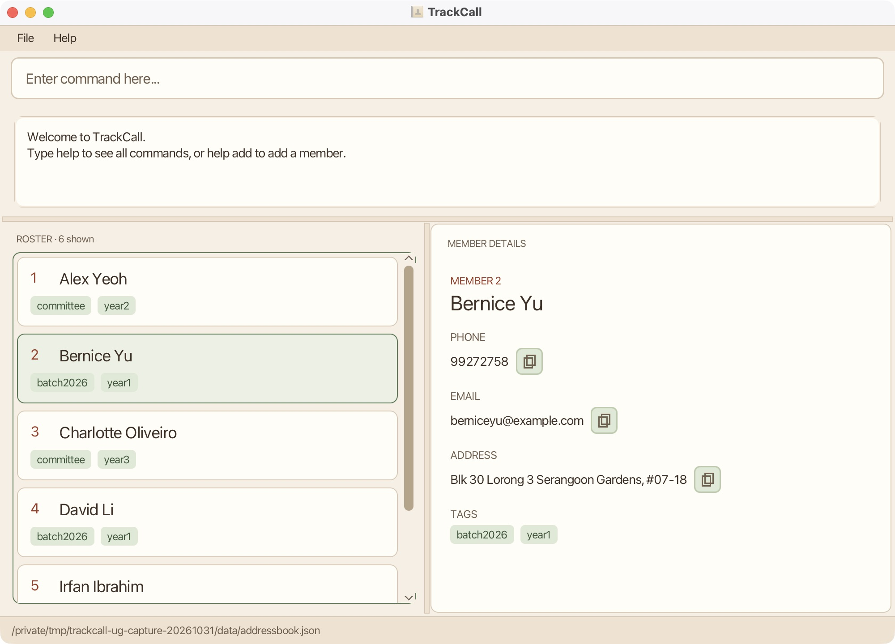
</a>
<figcaption>The command box and feedback are above the roster. Selecting Bernice reveals her details on the right; the status bar shows the data-file location.</figcaption>
</figure>

<p class="ug-topic"><strong>From top to bottom:</strong></p>

- **Command box:** type commands here.
- **Result area:** read success messages and errors.
- **Roster:** view member numbers, names, and tags. Contact details are hidden here.
- **Member details:** select a roster row to reveal that member's phone, email, and address.
  Use the adjacent copy icons to copy a field. Press **F2** to focus the roster, use the arrow keys
  to choose a member, and press **Escape** to hide the details and return to the command box.
- **Status bar:** see where your member data is saved.

<p class="ug-topic"><strong>After running a command</strong></p>

- Running a command hides the selected details.
- Successful `add`, `edit`, and `delete` feedback omits phone, email, and address on screen.
- Select a member again to inspect those fields.

### Try your first commands

Type each command in the command box and press **Enter**.

1. **Open help:** enter `help`. Press **Escape** to close it.
2. **Show all members:** enter `list`.
3. **Add a member:** copy and run this command:

   ```text
   add n/Alice Tan p/91234567 e/alice@example.com a/12 Orchard Road
   ```

<p class="ug-topic"><strong>Result</strong></p>

Alice appears in the list and TrackCall reports `Added member`. Your changes are saved automatically.

Use the [command summary](#command-summary) to choose your next task, or see [Your data](#your-data)
for storage and backup instructions.

## Features {id="commands"}

Choose a task below. The six groups cover all **nineteen commands**, including the core AB3 commands
retained and adapted for TrackCall. Each group explains the relevant commands, examples, and error conditions.

- **1. [Browse and find members](#browse-members):** find members and organise the roster with
  `list`, `show`, `find`, `findemail`, `filter`, and `sort`.
- **2. [Add and update members](#manage-members):** maintain contact details with `add` and `edit`.
- **3. [Organise member groups](#manage-tags):** manage overlapping groups with `tag`, `untag`,
  `tagall`, `untagall`, and `renametag`.
- **4. [Exchange rosters with CSV](#csv-files):** move records between rosters with `export` and `import`.
- **5. [Remove member records](#remove-records):** remove old records with `delete`, `clear`, and `clear /all`.
- **6. [Help and session](#help-and-session):** get help or finish working with `help` and `exit`.

### Read command formats

<p class="ug-topic"><strong>Command syntax</strong></p>

- Use lowercase keywords without a leading slash: `help`, not `/help`.
- Replace `UPPER_CASE` placeholders with your own values.
- Square brackets mark optional input. `[a/ADDRESS]` means the address may be omitted;
  `[t/TAG]...` means zero or more tags.
- Do not type the brackets or ellipsis.
- Submit each command on one line.

> **Pasting commands**
>
> The command box removes pasted tab characters, which can join words or change contact values.
> Replace tab separators with ordinary spaces before pasting, then check the displayed command and its
> contact values before pressing Enter. Type confirmation replies manually.

> **Before trying an example**
>
> Examples are independent. A command using a member number needs a member at that number in the
> currently displayed list. Use `list` and inspect the roster before adapting an example to your data.

Use the [command summary](#command-summary) for a compact reference.

### 1. Browse and find members {id="browse-members"}

Find the right members, narrow the displayed roster, or change its order.

<section class="ug-command">

#### 1.1 Show all members: `list` {id="show-all-members-list"}

<p class="ug-topic"><strong>Effect:</strong></p>

`list` clears name searches, email searches, tag filters, and `show` selections, then shows the full roster
in its stored order, retaining any order saved by `sort`. `list` does not change or save records.

<figure class="ug-figure">
<a class="ug-screenshot" href="images/user-guide/features/list.jpg" aria-label="Open full-size screenshot: Full six-member sample roster after list">
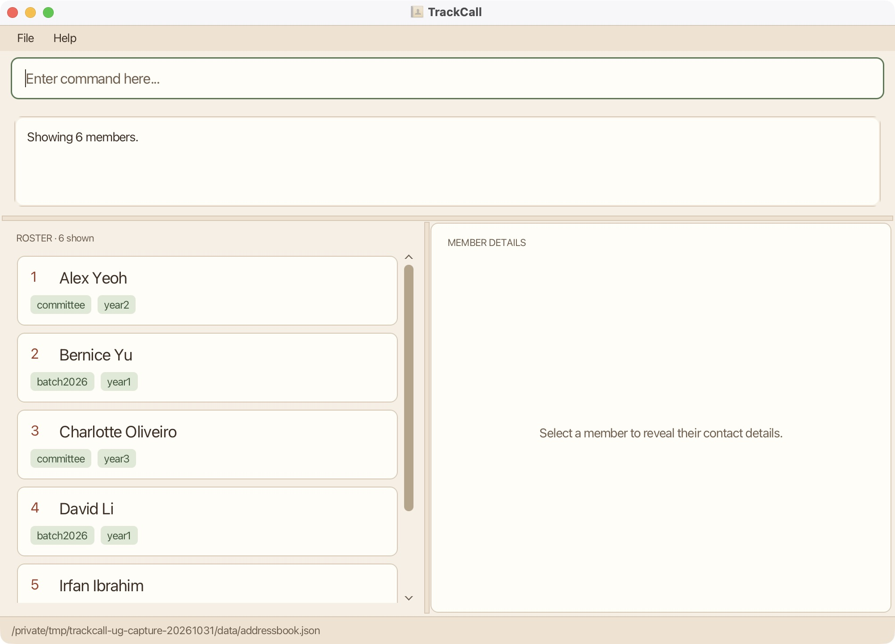
</a>
<figcaption>After <code>list</code>, all six sample members return and the selection boxes disappear. The feedback reads <code>Showing 6 members.</code></figcaption>
</figure>

<p class="ug-topic"><strong>Feedback:</strong></p>

The result is `Showing 1 member.`, `Showing N members.`, or `No members in the roster.`
Extra arguments produce `Invalid command format. Usage: list` without changing the current view.

</section>

<section class="ug-command">

#### 1.2 Show selected members: `show` {id="show-selected-members-show"}

<p class="ug-topic"><strong>Example:</strong></p>

`show 1 3` shows only members 1 and 3 from the **currently displayed list**.
The selected members stay in their current order and receive new displayed numbers starting at 1.
You can use `show` again with those new numbers, or use `list` to restore the full roster.

<figure class="ug-figure">
<a class="ug-screenshot" href="images/user-guide/features/show.jpg" aria-label="Open full-size screenshot: Alex and Charlotte displayed with a Show selection box">
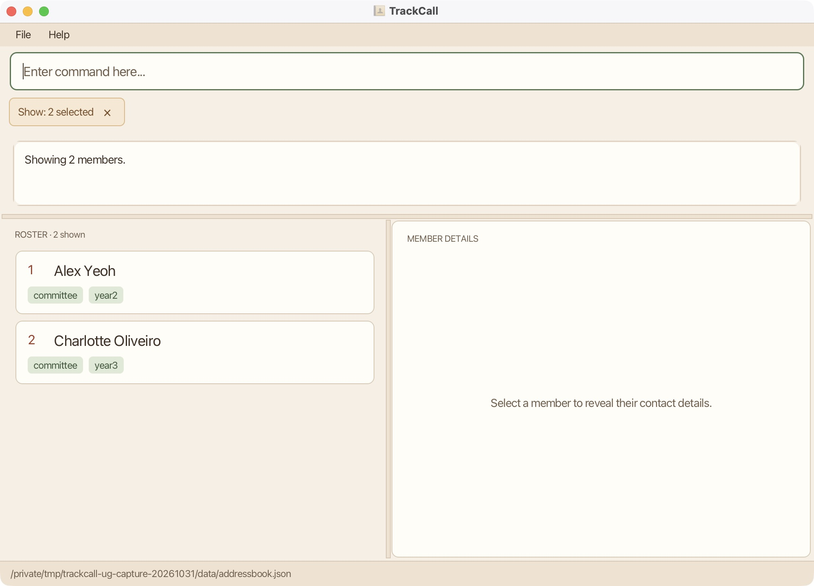
</a>
<figcaption>Starting from the sample roster, <code>show 1 3</code> keeps Alex and Charlotte. They are now displayed as 1 and 2, and the box records two selected members.</figcaption>
</figure>

<p class="ug-topic"><strong>Selection boxes:</strong></p>

- Each distinct `show` selection adds a box under the command field, such as **Show: 2 selected**.
- Repeating `show` with the same selected members does not add another box. The count is the number
  selected by that command.
- Hover over the box label to see the selected names.
- Boxes appear from left to right in command order, alongside name, email, and tag boxes.
- Select a box's **X** to remove only that selection while keeping the other conditions.
- The **ROSTER** heading shows how many members are currently displayed, including when the result is empty.

<p class="ug-topic"><strong>Empty selections:</strong></p>

If all members in a selection are deleted, its box remains as **Show: 0 selected**. Hovering over it
shows `Selected members: No selected members remain`; select its **X** to remove the empty selection.

<p class="ug-topic"><strong>Hover text:</strong></p>

Names in a `show` box's hover text are listed alphabetically, ignoring case. This does not change
the displayed roster order.

<p class="ug-topic"><strong>Valid input:</strong></p>

- Supply one or more positive numbers separated by spaces.
- Repeating a number selects that member once.
- If any number is invalid or outside the current list, the view stays unchanged.

`show` does not change or save member data.

</section>

<section class="ug-command">

#### 1.3 Find members: `find` {id="find-members-find"}

<p class="ug-topic"><strong>Example:</strong></p>

`find Alice Tan` shows currently displayed members whose names contain **Alice or Tan**.

<figure class="ug-figure">
<a class="ug-screenshot" href="images/user-guide/features/find.jpg" aria-label="Open full-size screenshot: David Li is the only result of a name search">
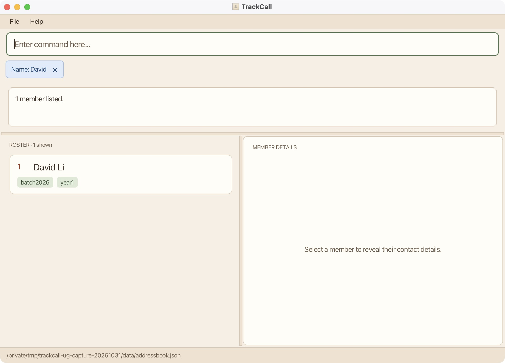
</a>
<figcaption>Sample-roster example: run <code>list</code>, then <code>find David</code>. David is the only result and a blue Name box records the search.</figcaption>
</figure>

<p class="ug-topic"><strong>Matching rules</strong></p>

- Matching ignores letter case and accepts any contiguous part of a name word.
  `Alice`, `Ali`, `lic`, and `ice` all match `Alice Tan`.
  For example, `find ali tan` shows names containing either `ali` or `tan`.
- Keywords within one `find` mean **or**, and the box joins them with `/`, so it reads `Name: Alice / Tan`.
  `find Alice Tan Lee` shows `Name: Alice / Tan / Lee`.
- Each distinct `find` adds another name filter. For example, `find Alice Tan` followed by `find Tan`
  keeps members matching both searches.
- Email addresses, phone numbers, and tags are not searched.
- Supply at least one keyword.

<p class="ug-topic"><strong>Repeated searches:</strong></p>

- Repeating an active search keeps its original box and reports `This name search is already active.`
- Keyword case, order, and repetition do not matter: `find Alice Tan` and `find TAN alice alice` are equivalent.
- A different query that leaves the same members visible adds its own box and reports `Results unchanged.`
  This also applies when the displayed list is empty.

<p class="ug-topic"><strong>Feedback:</strong></p>

The result includes `1 member listed.` or `N members listed.`
No matches produce `0 members listed.` and an empty list. No records are deleted.

<p class="ug-topic"><strong>Condition boxes:</strong></p>

- Active name, email and tag filters appear as boxes under the command field. Search boxes are blue and tag boxes
  are green.
- The boxes appear left to right in the order applied.
- With an unchanged roster, their order does not change who matches:
  `filter t/committee` then `find Alice` gives the same final members as `find Alice` then
  `filter t/committee`.
- Select a box's **X** to remove only that condition, or use `list` to show everyone again.

<figure class="ug-figure">
<a class="ug-screenshot" href="images/user-guide/features/combined-filters.jpg" aria-label="Open full-size screenshot: Tag year1 and Name David conditions are both active">
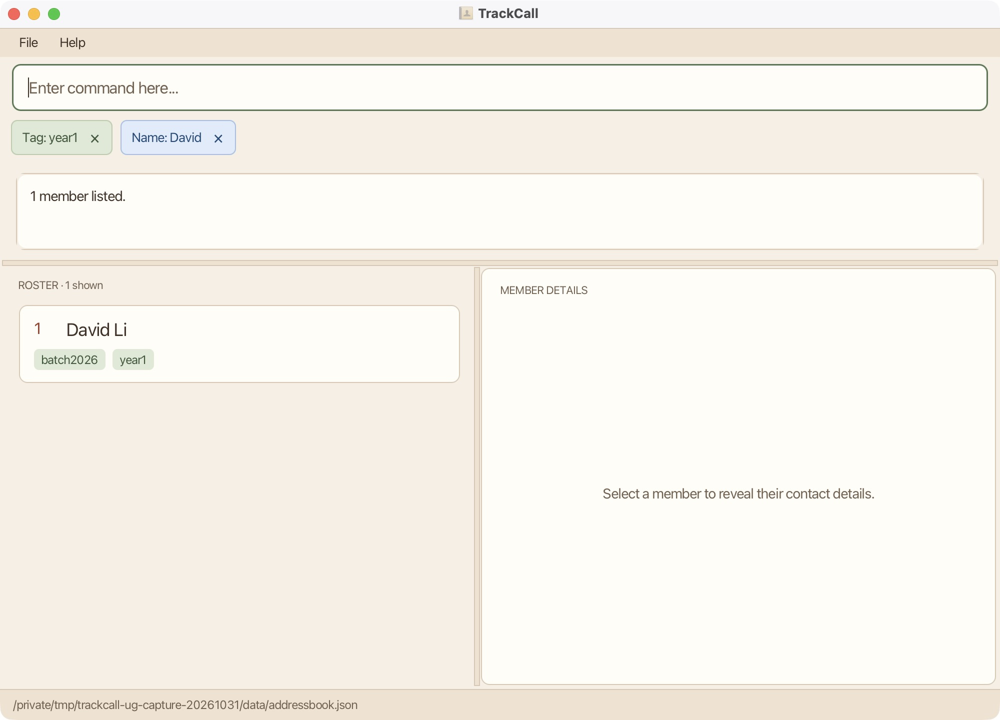
</a>
<figcaption>Run <code>list</code>, <code>filter t/year1</code>, then <code>find David</code>. Both boxes remain active: David satisfies both conditions. Removing one box keeps the other.</figcaption>
</figure>

<p class="ug-topic"><strong>Keyboard and long labels:</strong></p>

- Long filter labels are shortened with an ellipsis; hover over a label to read the complete condition.
- When many conditions are active, scroll within the filter area to reach the remaining boxes.
- You can also press Tab or Shift+Tab to move between their removal buttons; the focused box scrolls into view.
- Removing a focused box moves focus to another remaining box, or back to the command field when none remain.

Searching does not save the data file.

</section>

<section class="ug-command">

#### 1.4 Find members by email: `findemail` {id="find-members-by-email-findemail"}

**Format:** `findemail KEYWORD [MORE_KEYWORDS]...`

**Examples:** Search by a full email address or any part of an email address:

- `findemail alice@example.com` finds emails containing that address.
- `findemail @example.com` finds emails containing that domain fragment.
- `findemail @example.com @school.edu` finds emails containing **either** fragment.

<figure class="ug-figure">
<a class="ug-screenshot" href="images/user-guide/features/findemail.jpg" aria-label="Open full-size screenshot: Charlotte is displayed with an Email school.edu condition">
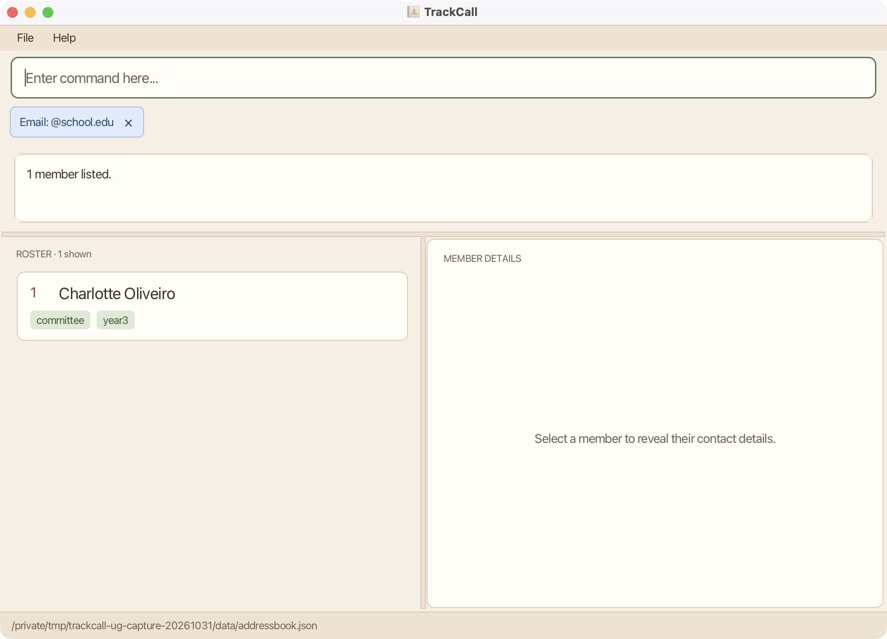
</a>
<figcaption>On the sample roster, <code>list</code> followed by <code>findemail @school.edu</code> finds Charlotte. Her displayed number becomes 1.</figcaption>
</figure>

<p class="ug-topic"><strong>Matching:</strong></p>

- Matching ignores letter case.
- Spaces, including pasted nonbreaking spaces, separate keywords; any keyword can match.
  Use ordinary spaces instead of tabs when pasting a search.
- Keywords are literal text, not regular expressions; names and phone numbers are not searched.
- Supply at least one keyword.
- No matches produce `0 members listed.` and an empty list.

<p class="ug-topic"><strong>Search conditions</strong></p>

- Each `findemail` narrows the **currently displayed list**. Earlier name searches, email searches,
  tag filters, and `show` selections stay active. The stored order stays the same.
- Each distinct search adds an **Email:** box in command order. Use its **X** to remove only that email condition.
  Keywords within one command mean **or** and are joined with `/` in the box, for example
  `Email: @example.com / @school.edu`.
- For example, `filter t/committee` then `findemail example` keeps committee members whose emails contain
  `example`. Running `findemail zara` next keeps only those whose emails also contain `zara`.
- Keywords within one command mean **any**; separate searches must **all** match.

<p class="ug-topic"><strong>Repeated searches</strong></p>

- Repeating an active query keeps its original box and reports `This email search is already active.`
  Keyword case, order, and repetition do not matter.
- A different query that leaves the same members visible adds its own box and reports `Results unchanged.`
  The existing conditions still apply, including after edits and when other boxes are removed.

<p class="ug-topic"><strong>Reset the view</strong></p>

Use `list` to clear all conditions and search the whole roster again.

<p class="ug-topic"><strong>Saving:</strong></p>

Searching does not change records or save the data file.

<p class="ug-topic"><strong>After editing:</strong></p>

Check the current displayed numbers before using `edit` or `delete`. Editing keeps the email search;
if an edited email no longer matches, the member disappears from view but remains in the roster.

<p class="ug-topic"><strong>Offline help:</strong></p>

Use `help findemail` for the same instructions offline.

</section>

<section class="ug-command">

#### 1.5 Filter displayed members by tag: `filter` {id="filter-displayed-members-by-tag-filter"}

**Format:** `filter t/TAG [t/MORE_TAGS]...`

<p class="ug-topic"><strong>Effect:</strong></p>

`filter t/TAG` shows members with that tag from the **currently displayed list**.

1. Use `list` to start with everyone, `find` for name-search results, or `findemail` for email-search results.
2. Supply one tag:

   ```text
   filter t/committee
   ```

<p class="ug-topic"><strong>Result:</strong></p>

This keeps only committee members in the current view. Their stored order stays the same,
and their displayed numbers update.

<figure class="ug-figure">
<a class="ug-screenshot" href="images/user-guide/features/filter.jpg" aria-label="Open full-size screenshot: Bernice and David match the year1 tag filter">
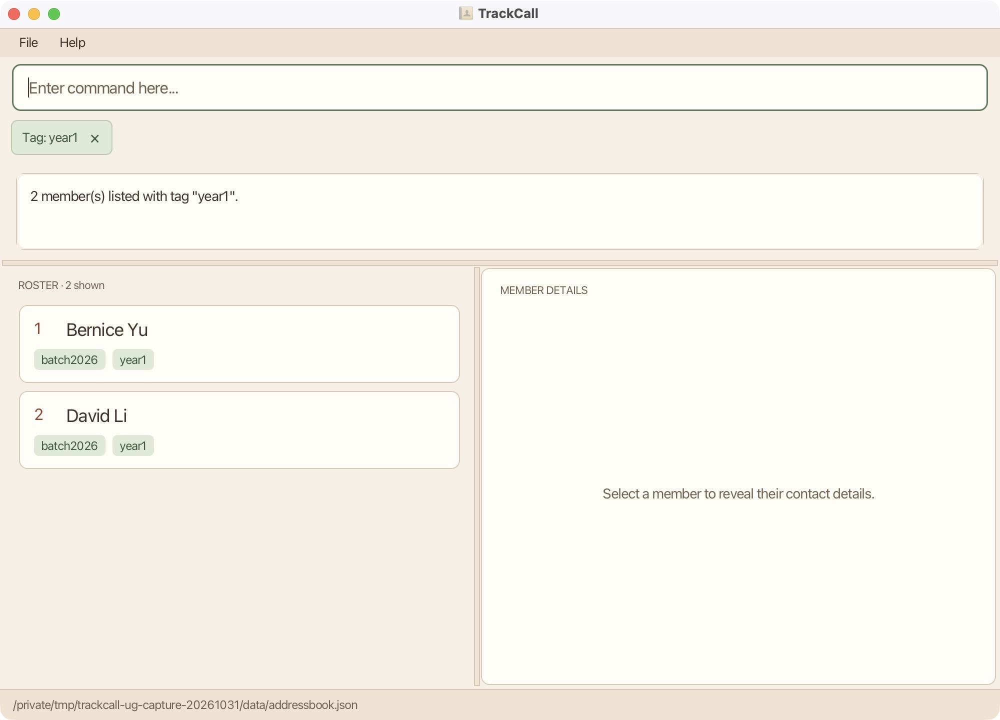
</a>
<figcaption>Another sample-roster example: <code>list</code>, then <code>filter t/year1</code> displays Bernice and David. The green box records the active tag condition.</figcaption>
</figure>

<p class="ug-topic"><strong>Matching rules</strong></p>

- Matching ignores letter case: `committee` and `Committee` identify the same tag.
- **Tags in the same command mean or.** `filter t/committee t/alumni` keeps members who have `committee`,
  `alumni`, or both. It adds one box that reads `Tag: committee / alumni`, and `filter t/a t/b t/c` shows
  `Tag: a / b / c`. The `/` stands for "or"; it is used instead of the word because a tag could itself be named
  `or`. Its **X** removes the whole group. Repeating a tag in one command counts it once.
- **Long groups are shortened.** A box names at most four tags. With more, the rest become `+N more`, so
  `filter t/a t/b t/c t/d t/e t/f` shows `Tag: a / b / c / d / +2 more`. Hover over the box to read every tag;
  the result message and the remove button's screen-reader text also list all of them.
- **Separate commands mean and.** Each filter narrows the current results. Run `filter t/year1` next to keep
  members with **both** conditions, here (`committee` or `alumni`) and `year1`.

<p class="ug-topic"><strong>Repeated filters</strong></p>

- Applying the same tags again, in any order or letter case, leaves the view unchanged. The result
  names the active spelling, says no changes were made, and shows the current count and active tags.
  For example, repeating `filter t/committee` begins with
  `Tag "committee" is already an active filter. No changes were made.`
  Repeating `filter t/alumni t/committee` after `filter t/committee t/alumni` begins with
  `A filter for the tags "committee" / "alumni" is already active. No changes were made.`

<p class="ug-topic"><strong>Search conditions</strong></p>

- A new `find` narrows these results by name. Use a box's **X** to remove one filter, or `list` to show everyone.
  A new `findemail` also narrows these results by email, retaining previous conditions.

<p class="ug-topic"><strong>Feedback:</strong></p>

- The result reports `N member(s) listed with tag "TAG".` for one active tag filter.
- With multiple active tags, it lists each active tag condition in the order applied, for example:
  `1 member(s) listed with tags "committee", "year1".`
- Tags that came from one command are joined with `/`,
  for example `2 member(s) listed with tags "committee" / "alumni".`
- In the list, a comma means **and** and a slash means **or**.
- When a group is listed next to other conditions it is put in parentheses so the two cannot be confused:
  `filter t/committee t/alumni` followed by `filter t/year1` reports
  `1 member(s) listed with tags ("committee" / "alumni"), "year1".`, meaning (`committee` or `alumni`) and `year1`.
- Repeats are removed within one condition only, so `filter t/committee t/alumni` followed by
  `filter t/committee` lists `("committee" / "alumni"), "committee"`: both conditions are active and must hold.
- Use `list` to clear all active conditions.
- No matches produce a count of 0 and an empty list.

Filtering does not change or save member data.

<p class="ug-topic"><strong>After editing:</strong></p>

Check the displayed numbers before using `edit`, `tag`, `untag`, or `delete`. Editing keeps the active search and filters.
If an edited member no longer matches, they disappear from view but remain in the roster.

<p class="ug-topic"><strong>Valid input:</strong></p>

- Supply at least one tag, each of 1 to 30 characters, using ASCII letters or digits with optional internal hyphens.
  For example, `year-1` is valid.
- Surrounding spaces are ignored.
- A missing `t/`, other parameters, and invalid or empty tags are rejected without changing the view.
- One invalid tag rejects the whole command, so `filter t/committee t/bad!` changes nothing.
- The error names the problem, such as `Tag contains unsupported character "!"…`, exactly as it does for
  `tagall` and `renametag`.

</section>

<section class="ug-command">

#### 1.6 Sort members by name: `sort` {id="sort-members-by-name-sort"}

<p class="ug-topic"><strong>Effect:</strong></p>

- `sort` reorders and saves the **entire roster** by full name from A to Z, ignoring letter case,
  surrounding spaces, and repeated spaces.
- It includes hidden members while keeping your current searches, tag filters, and `show` selections applied.
- Names that compare equally keep their current relative order.

<p class="ug-topic"><strong>Saving and later changes:</strong></p>

- The result reports `Sorted all N members by name (A to Z).`
- The saved order survives `list` and a restart and is used by `export`.
- An empty or already sorted roster also reports success and attempts to save.

<figure class="ug-figure">
<a class="ug-screenshot" href="images/user-guide/features/sort.jpg" aria-label="Open full-size screenshot: Seven-member roster sorted with Bob between Bernice and Charlotte">
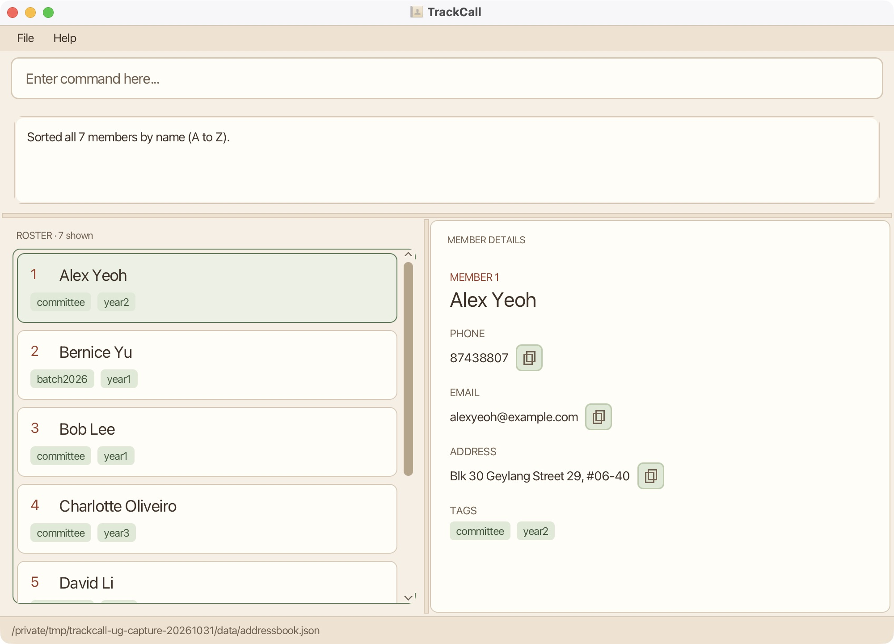
</a>
<figcaption>After adding Bob using the example below, <code>sort</code> saves the order of all seven members. Bob moves to number 3, between Bernice and Charlotte.</figcaption>
</figure>

<p class="ug-topic"><strong>After adding or editing:</strong></p>

- New members added with `add` or `import` go at the end.
- Editing a name keeps that member in the same roster position; run `sort` again when you want to reorder the updated roster.
- There is no command to restore the earlier insertion order.

<p class="ug-topic"><strong>Immediate save:</strong></p>

Sorting changes order rather than removing member records, so it saves immediately without
a deletion confirmation; inspect the roster before running it.

<p class="ug-topic"><strong>Save failure:</strong></p>

If saving fails, the new order remains in the current session but the previous saved file
is preserved; resolve the storage problem and retry before exiting.

<p class="ug-topic"><strong>Member numbers:</strong></p>

Check the displayed member numbers again before using `edit` or `delete`.

<p class="ug-topic"><strong>Valid input:</strong></p>

Extra arguments such as `sort date` produce `Invalid command format. Usage: sort`.

</section>

### 2. Add and update members {id="manage-members"}

Keep member contact details up to date.

<section class="ug-command">

#### 2.1 Add a member: `add` {id="add-a-member-add"}

<p class="ug-topic"><strong>Required and optional fields</strong></p>

- Provide a name, phone, and email. Address and tags are optional.
- Required prefixes may appear in any order, but each must appear exactly once.
- Separate each prefix from the preceding value with ordinary spaces; pasted tabs are removed.
- Use `a/` if you have an address, and a separate `t/` for each tag.

<p class="ug-topic"><strong>Field prefixes and address text</strong></p>

- **Field prefixes:** Add reserves whitespace-delimited single ASCII letters followed by `/` for field prefixes.
  Only lowercase `n/`, `p/`, `e/`, `a/`, and `t/` are accepted; `x/extra` and `T/committee`
  report an invalid command format.
- The standalone abbreviations `c/o`, `s/o`, and `d/o` (in any letter case), URLs, numeric slashes such as `12/3`,
  and slashes embedded in words remain address text.

- **Address text:** Within an `a/` value, uppercase `A/` followed by a digit is also literal address text,
  so `a/Block A/12` is accepted. Other uppercase or unknown field prefixes remain invalid.

<p class="ug-topic"><strong>Field rules</strong></p>

| Field | Current rule |
| --- | --- |
| Name | Start with a Unicode letter or ASCII digit. Unicode letters, combining marks, ASCII digits, spaces, periods, slashes, hyphens, and straight or curly apostrophes are accepted. |
| Phone | At least three ASCII digits, with an optional leading `+` and spaces between digits. Formatting is preserved. Hyphens and parentheses are rejected. Internal tabs are invalid, but command-box pasting removes them before validation. |
| Email | A local part and domain separated by `@`, without spaces. See the email rules below. |
| Address | Non-blank text when provided; Unicode-space-only values are rejected. `edit INDEX a/` clears an address. |
| Tag | 1 to 30 ASCII letters or digits with optional internal hyphens, such as `year-1`. Spaces, underscores, other symbols such as `@ # $ % .`, and accented letters are not allowed. Matching ignores letter case. |

<p class="ug-topic"><strong>Names, phone numbers and Unicode</strong></p>

- **Names and phone formatting:** Names such as `Anne-Marie`, `José Garcia`, and `O'Connor` keep their entered spelling,
  including combining accents. Names such as `Ravi s/o Kumar`, `Priya d/o Raman`, and `J. Tan` also keep their punctuation.
- Phone examples include `+6591234567` and `9123 4567`.
- Phone formatting is stored, displayed, copied, and exported as entered; the app does not infer country
  codes or treat differently formatted numbers as equal. Multiple spaces between digit groups are accepted.

- **Unicode and sorting:** Names retain their Unicode representation, so visually identical accented spellings can match differently in searches
  or duplicate checks. Sorting uses case-insensitive text order rather than a language-specific alphabet;
  for example, `Émile` sorts after `Zara`.

<p class="ug-topic"><strong>Email rules:</strong></p>

- The local part contains ASCII letters, digits, `+`, `_`, apostrophe (`'`), and `-`. Single periods separate nonempty parts.
- Domain labels contain ASCII letters, digits, and internal hyphens; labels start and end with a letter or digit.
- The final domain label needs at least two characters.

<p class="ug-topic"><strong>Example:</strong></p>

```text
add n/Bob Lee p/92345678 e/bob@example.com a/20 College Road t/committee t/year1
```

<p class="ug-topic"><strong>Result</strong></p>

- This adds Bob with two tags, saves the roster, and shows the complete member list.
- Repeated identical tags appear once.
- If you omit `a/`, the address is shown as `(none)` until you add one with `edit`.

<figure class="ug-figure">
<a class="ug-screenshot" href="images/user-guide/features/add.jpg" aria-label="Open full-size screenshot: New member Bob appears at the end of the sample roster">
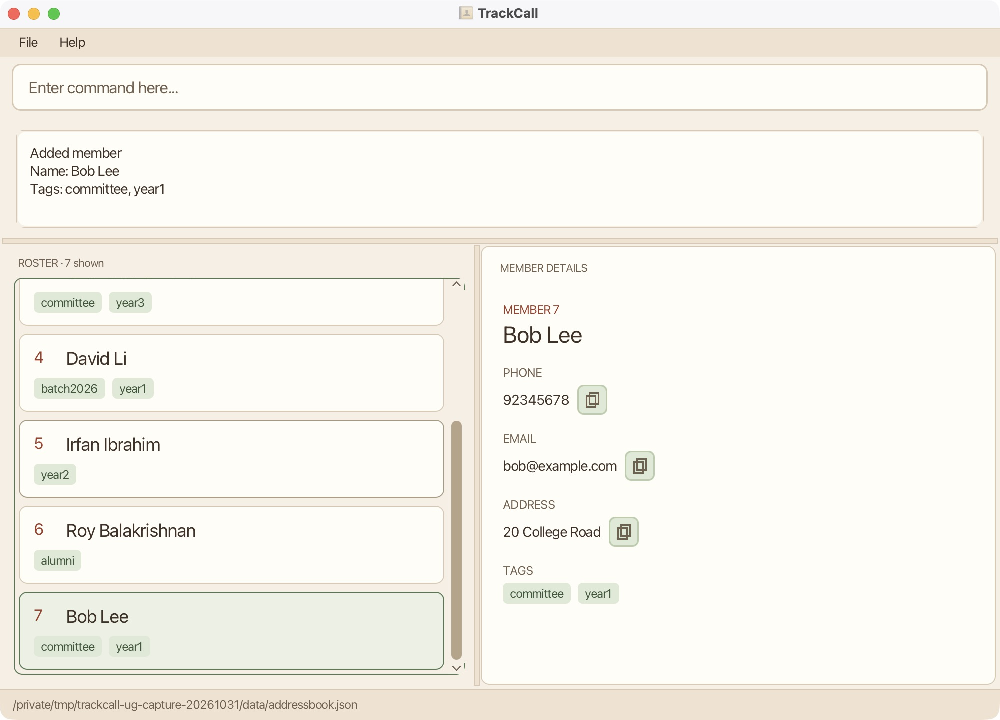
</a>
<figcaption>The example adds Bob as member 7 after the six sample members. Select his row to check his phone, email, address and two tags.</figcaption>
</figure>

<p class="ug-topic"><strong>Duplicate checks</strong></p>

- **Duplicate identity:** Duplicate checking ignores name capitalization, repeated whitespace and surrounding whitespace.
  For example, `Alice Tan`, `alice tan` and `Alice  Tan` match when phone, email and address also match.
  Unicode letter case is ignored too; for example, `ΟΣ`, `οσ` and `ος` match.

- **Phone and email:** ASCII spaces in phone numbers are ignored, but the leading `+` remains significant. Email local parts
  remain case-sensitive; domain capitalization is ignored. Address text is trimmed and compared exactly. Tags are ignored.

- **Stored spelling:** Names keep their entered capitalization and spacing in storage and display. Accents and punctuation
  are not removed by duplicate checking, and this rule does not expand the supported name characters.

- **Same-name members:** A same-name member with different contact details is allowed.

- **Rejected duplicates and older files:** A duplicate add is rejected. Use `find` to locate the existing member and `edit` to update it.

- Older saved rosters containing these name variants still load without merging or deleting records.
  Tag-only and unchanged-contact edits to those existing records remain available.

</section>

<section class="ug-command">

#### 2.2 Update a member: `edit` {id="update-a-member-edit"}

<p class="ug-topic"><strong>Steps</strong></p>

1. Select the member and check their displayed number and contact details in the details panel.
2. Supply that number and at least one field:

   ```text
   edit 1 p/98765432 e/alice.new@example.com
   ```

<p class="ug-topic"><strong>Result and current view</strong></p>

- This changes the first displayed member's phone and email. Omitted fields stay unchanged.
- Use `edit INDEX a/` to remove an address that is no longer known; the details panel then shows `(none)`.
- After saving, TrackCall confirms the member's name and tags and keeps the active search, tag filters, and roster order.
  Changing a name does not move the member; run `sort` again to reorder the roster.
- The details panel stays hidden until you select a member again to inspect the changed contact fields.

<figure class="ug-figure">
<a class="ug-screenshot" href="images/user-guide/features/edit.jpg" aria-label="Open full-size screenshot: Bob selected after his phone and email were updated">
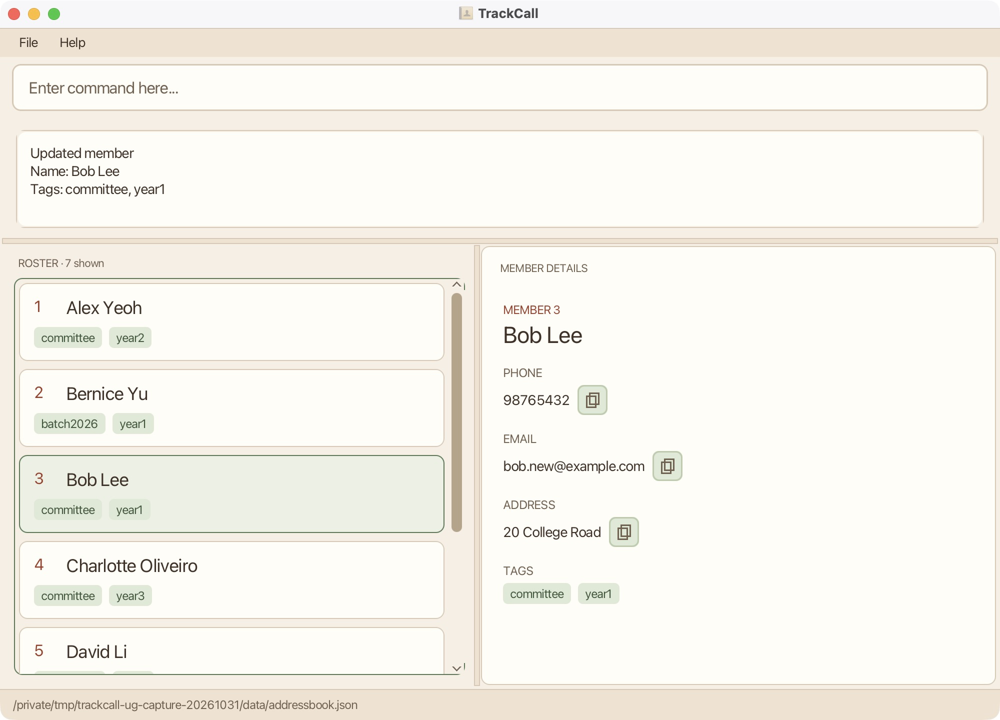
</a>
<figcaption>Worked example after adding Bob and running <code>sort</code>: <code>edit 3 p/98765432 e/bob.new@example.com</code>. Select Bob again to verify both new values; his address and tags are retained.</figcaption>
</figure>

- **After filtering:** If the updated member no longer matches the search or filters, they disappear from view but remain
  in the roster. Use `list` to show everyone again.

<p class="ug-topic"><strong>Duplicate checks</strong></p>

- An edit that would match another member under the duplicate rule above is rejected.
- Changing only your own name's capitalization or spacing is allowed when it does not match another member.

<p class="ug-topic"><strong>Replacing tags</strong></p>

> **Supplied tags replace all existing tags.**

- Keep both tags: `edit 1 t/committee t/year1`.
- Remove all tags: `edit 1 t/`.

> **Before the next command:** Check the member number again after any command that changes the list.

</section>

### 3. Organise member groups {id="manage-tags"}

Use tags for overlapping groups, then update one member or the whole displayed group.

<section class="ug-command">

#### 3.1 Add or remove one tag: `tag`, `untag` {id="add-or-remove-one-tag-tag-untag"}

<p class="ug-topic"><strong>Effect and example</strong></p>

- Use `tag INDEX t/TAG` to add one tag to the member at a number in the **currently displayed list**.
- Use `untag INDEX t/TAG` to remove one tag from that member.
- Both commands retain all other tags and contact fields.

For example:

```text
tag 2 t/volunteer
untag 2 t/volunteer
```

<p class="ug-topic"><strong>Feedback</strong></p>

With the sample members, the first command reports:

```text
Added tag "volunteer" to member 2.
Name: Bernice Yu
Tags: batch2026, volunteer, year1
```

<figure class="ug-figure">
<a class="ug-screenshot" href="images/user-guide/features/tag.jpg" aria-label="Open full-size screenshot: Bernice has the new volunteer tag alongside her original tags">
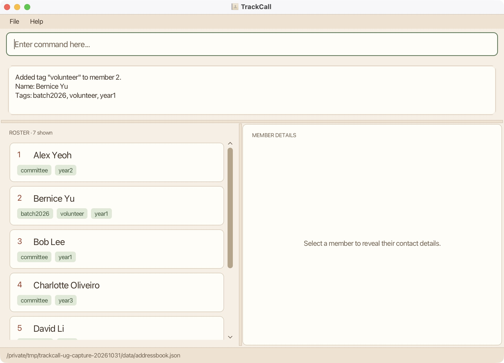
</a>
<figcaption><code>tag 2 t/volunteer</code> adds volunteer to Bernice while retaining batch2026 and year1.</figcaption>
</figure>

<figure class="ug-figure">
<a class="ug-screenshot" href="images/user-guide/features/untag.jpg" aria-label="Open full-size screenshot: Bernice retains batch2026 and year1 after volunteer is removed">
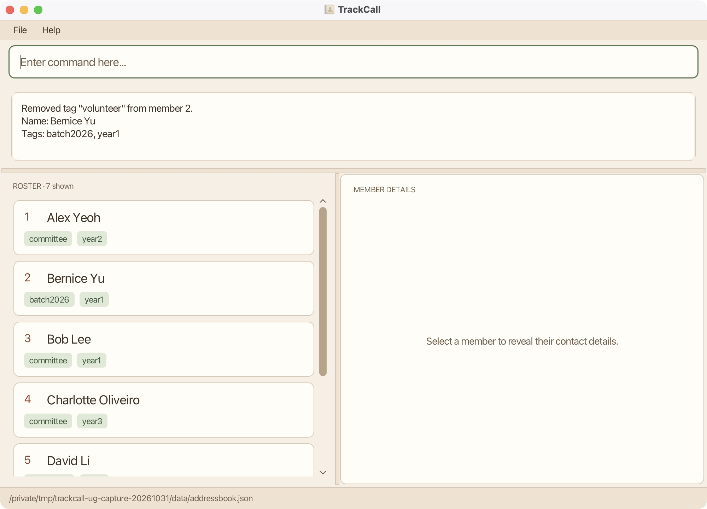
</a>
<figcaption><code>untag 2 t/volunteer</code> removes only volunteer. The original two tags remain.</figcaption>
</figure>

<p class="ug-topic"><strong>Member numbers and matching</strong></p>

- Check the displayed number after searching, filtering, showing selected members, or sorting.
  The index identifies the member shown at that number when you submit the command. Hidden members are not changed.
- Tags contain 1 to 30 ASCII letters or digits with optional internal hyphens; matching ignores letter case.
- Adding `t/student` to a member who already has `Student` does not add a second tag.

- **Repeated tag spellings:** If one `add` or `edit` command supplies both spellings, the first `t/` spelling is kept.

<p class="ug-topic"><strong>No-op and view behavior</strong></p>

- If the member already has the tag (for `tag`) or lacks it (for `untag`), TrackCall reports that
  no change was made, for example `Member 2 already has tag "committee". No changes were made.`
- A valid no-op still attempts to save.
- Searches, filters, and a `show` selection remain active after the command, and the stored roster order is preserved.
- Removing a tag required by an active filter may hide the member from that view; use `list` to show everyone again.

- **Save failure:** If saving fails, the member change remains visible in the current session while the previous saved
  file stays unchanged. Follow [Correcting errors](#correcting-errors) before exiting.

</section>

<section class="ug-command">

#### 3.2 Tag or untag a group: `tagall`, `untagall` {id="tag-or-untag-a-group-tagall-untagall"}

<p class="ug-topic"><strong>How it works</strong></p>

- **Effect:** `tagall t/TAG` adds one tag to every member in the **currently displayed list**.
- `untagall t/TAG` removes one tag from every displayed member.
- Members hidden by `find`, `findemail`, `filter`, or `show` are not changed, and each member's other tags are kept.

<p class="ug-topic"><strong>Steps</strong></p>

1. Use `find` or `filter` to show the group, then check the displayed members.
2. Run `tagall` or `untagall` with one tag.

<p class="ug-topic"><strong>Example</strong></p>

To tag year-2 members for an event, run each command separately:

```text
list
filter t/year2
tagall t/event2026
```

- **Result:** Every displayed year-2 member now also has the `event2026` tag.

<figure class="ug-figure">
<a class="ug-screenshot" href="images/user-guide/features/tagall.jpg" aria-label="Open full-size screenshot: Both displayed year2 members have event2026">
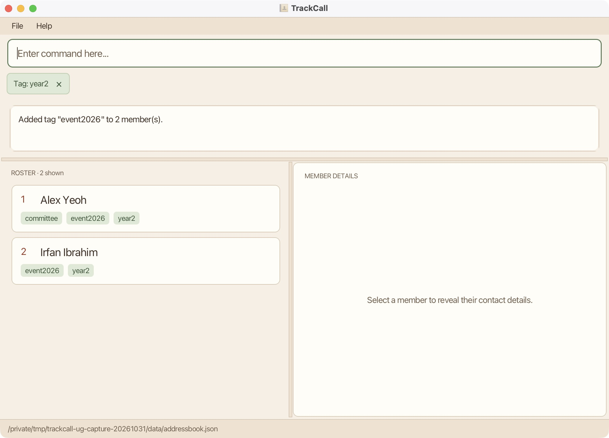
</a>
<figcaption><code>tagall t/event2026</code> adds the tag to Alex and Irfan in the year2 view. Hidden members are unchanged.</figcaption>
</figure>

<figure class="ug-figure">
<a class="ug-screenshot" href="images/user-guide/features/untagall.jpg" aria-label="Open full-size screenshot: Both year2 members retain their other tags after event2026 is removed">
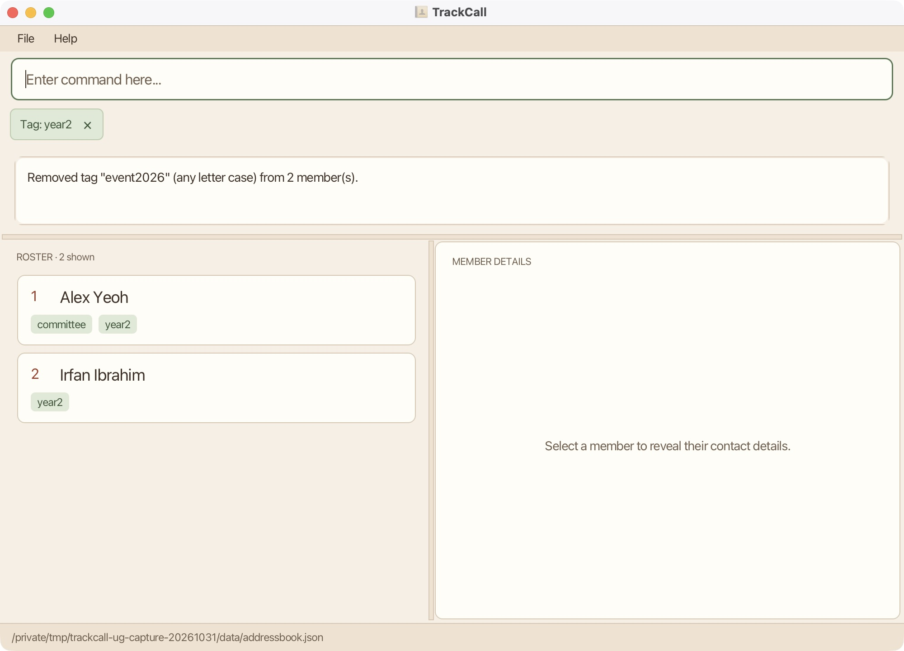
</a>
<figcaption>With the same view, <code>untagall t/event2026</code> removes the event tag from both members and keeps their other tags.</figcaption>
</figure>

- **Export the group:** To export the displayed year-2 members afterwards, run `export members.csv`.
  To export the entire roster, run `list` first.

<p class="ug-topic"><strong>Changed and skipped members</strong></p>

Members who already have the tag (for `tagall`) or do not have it (for `untagall`) are skipped.
The result reports both counts:

- `Added tag "event2026" to 9 member(s). 3 already had this tag (any letter case).`
- `Removed tag "committee" (any letter case) from 9 member(s). 3 did not have this tag.`

- **No changes:** When every displayed member is skipped, the result ends with `No changes were made.`, for example
  `Added tag "committee" to 0 member(s). 12 already had this tag (any letter case). No changes were made.`

<p class="ug-topic"><strong>After updating a group</strong></p>

- **Retained view:** The current search and filters stay applied; stored roster order is preserved.
  If you remove the tag used by an active single-tag filter, the updated members disappear from view
  because they no longer match. They are not deleted; run `list` to show everyone.

- **Hidden from view:** The result then also reports the current list, for example
  `0 member(s) listed with tag "committee". Run list to show everyone.`
- Updated members disappear only if they no longer satisfy **all** active conditions. With a filter group
  such as `filter t/committee t/alumni`, a member can stay visible by matching another alternative: after
  `untagall t/committee`, a member who also has `alumni` remains in the list.

<p class="ug-topic"><strong>Valid input and tag errors</strong></p>

- Supply exactly one tag of 1 to 30 ASCII letters or digits with optional internal hyphens.
  Spaces around the tag are ignored, and matching ignores letter case.
- Missing `t/`, empty tags, invalid tags, more than one tag, and other field prefixes such as `n/`
  are rejected without changing any member.
- If no members are displayed, TrackCall reports
  `There are no members in the current list to update. Run list to show everyone, or use find or filter to choose a group.`
  and changes nothing.

<p class="ug-topic"><strong>Correcting a tag</strong></p>

- **Unsupported characters:** Unsupported characters are identified in the error. For example, `tagall t/year_1` reports
  `Tag contains unsupported character "_". Use letters (A-Z, a-z), digits (0-9), or internal hyphens (-), e.g. year-1.`
  Use `tagall t/year-1` if you intended a hyphen.
- **Spaces and hyphens:** A space inside a tag, as in `tagall t/year 1`, reports `Tag cannot contain spaces. Use a hyphen instead, e.g. year-1.`
- A leading or trailing hyphen reports `Tag cannot start with a hyphen (-).` or
  `Tag cannot end with a hyphen (-).`, followed by an example.
- Consecutive hyphens such as `year--1` report
  `Tag cannot contain consecutive hyphens (--). Use a single hyphen, e.g. year-1.`

<p class="ug-topic"><strong>Other input errors</strong></p>

- Missing `t/` and unexpected text before it receive separate errors with the command usage.
- Other member fields are named in the error: for example, `untagall t/year1 e/year1@gmail.com` reports
  `Field e/ is not supported. This command accepts only t/TAG parameters.`
- A tag of 31 characters reports `Tag is too long: 31 characters. Maximum: 30.`

> **Saving and undo:** There is no confirmation or undo. A valid command saves the roster, even when every member is skipped.

</section>

<section class="ug-command">

#### 3.3 Rename a tag: `renametag` {id="rename-a-tag-renametag"}

<p class="ug-topic"><strong>How it works</strong></p>

- **Effect:** `renametag t/CURRENT_TAG t/NEW_TAG` replaces one tag with another for **every member in the current list**
  who has it.
- Members hidden by `find`, `findemail`, `filter`, or `show` keep the current tag.
- Each member's other tags are kept. To rename the tag for everyone, run `list` first.

<p class="ug-topic"><strong>Example</strong></p>

```text
renametag t/batch2026 t/alumni
```

<p class="ug-topic"><strong>Feedback</strong></p>

Every displayed member tagged `batch2026` is now tagged `alumni` instead. The result reports how many members changed:

- `Renamed tag "batch2026" to "alumni" for 15 member(s).`
- `Renamed tag "year1" to "year2" for 10 member(s). 2 already had "year2".`

<p class="ug-topic"><strong>Matching and spelling</strong></p>

- **Tag matching:** A member with both distinct tags keeps a single copy of the replacement tag.
  Tags match regardless of letter case.

- **Capitalization:** To standardize capitalization across the roster, run `list`, then
  `renametag t/committee t/Committee`. Members already using `Committee` are skipped and the result
  counts only members whose spelling changed.
- If every matching member already uses the new spelling,
  TrackCall reports `Every displayed member with this tag already uses "Committee". No changes were made.`
- Supplying identical spellings is rejected with `The new tag must be different from the current tag.`

- **Replacement spelling:** If a member already has the new tag in another letter case, that member keeps the spelling you typed in the
  command.

<p class="ug-topic"><strong>View and hidden members</strong></p>

- **Hidden members:** If hidden members still have the current tag after the update, the result says so, for example
  `2 hidden member(s) still have "friends". Run list, then renametag again to rename it for everyone.`

- **Retained view:** The current search and filters stay applied; stored roster order is preserved.
  If you rename the tag used by an active single-tag filter, the renamed members disappear from view
  because they no longer match. They are not deleted; run `list` to show everyone.

- **Hidden from view:** The result then also reports the current list, for example
  `0 member(s) listed with tag "batch2026". Run list to show everyone.`

<figure class="ug-figure">
<a class="ug-screenshot" href="images/user-guide/features/renametag.jpg" aria-label="Open full-size screenshot: An empty year2 view after both matching members were renamed to seniors">
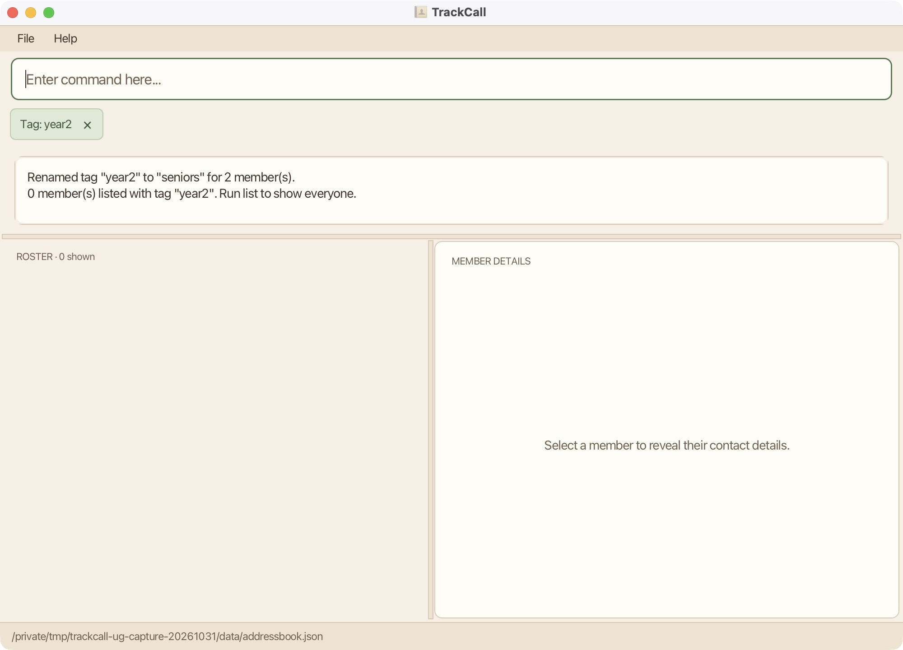
</a>
<figcaption>Worked example: <code>list</code>, <code>filter t/year2</code>, then <code>renametag t/year2 t/seniors</code>. Two members change, but the retained year2 condition now matches none. Run <code>list</code> to see them again.</figcaption>
</figure>

- Renamed members disappear only if they no longer satisfy **all** active conditions. With a filter group
  such as `filter t/batch2026 t/alumni`, a member who still matches another alternative stays visible.

<p class="ug-topic"><strong>Valid input and errors</strong></p>

- Supply exactly two tags, each after `t/`. If a different count is supplied, the error reports that count
  and asks for the current tag followed by the new tag.
- Each tag has 1 to 30 characters using ASCII letters or digits and optional internal hyphens.
  The two tags must be different.
- **No matching displayed members:** If no member in the current list has the current tag, TrackCall reports
  `No member in the current list has the tag "CURRENT_TAG".` and changes nothing, even if hidden members
  have it. When hidden members do have it, the message adds how many and suggests running `list` first:
  `3 hidden member(s) have it; run list first.`
- **Invalid tags:** If an invalid tag is given, the error starts with `Current tag:` or `New tag:`, so you can see which one to fix.
  Other invalid input is rejected without changing any member.

> **Saving and undo:** There is no confirmation or undo. A valid command saves the roster.

</section>

### 4. Exchange rosters with CSV {id="csv-files"}

Export displayed members or bring existing member records into TrackCall.

<section class="ug-command">

#### 4.1 Export members to CSV: `export` {id="export-members-to-csv-export"}

<p class="ug-topic"><strong>Effect and file contents</strong></p>

- `export [FILEPATH]` writes only the currently displayed members to a UTF-8 CSV file, in displayed order.
- Searches, tag filters, and `show` selections determine which members are exported; their current stored
  order determines the export order. Run `list` first to export the complete roster in stored order.
- The columns are `name`, `phone`, `email`, `address`, and `tags`, so the exported file can be imported directly.
- Tags for each member are sorted in case-sensitive ASCII order (hyphens, digits, uppercase letters, then lowercase letters)
  and joined with semicolons.

- **Duplicate tag spellings:** If an imported CSV file or saved JSON roster contains case variants of one tag on the same member,
  TrackCall keeps the first spelling listed for that member. The retained spelling appears in the member
  list and exports. On the next roster save, the other spellings are removed from the saved file.

<p class="ug-topic"><strong>File location and naming</strong></p>

- Without `FILEPATH`, the file is written to `addressbook.csv` beside the JAR. During development,
  it is written to the working directory.
- Packaged builds resolve relative paths from the JAR folder and accept absolute paths only inside
  that folder. The parent directory must already exist and be writable.
- The destination must end in `.csv` (ignoring letter case). Other extensions and missing extensions are rejected
  with `File must have a .csv extension.` Filenames may contain spaces.
- Double quotes are rejected anywhere in the export path, including directory names, because `import`
  cannot read filenames containing them. Choose another name; spaces do not need surrounding quotes.

<p class="ug-topic"><strong>Replacing files and handling errors</strong></p>

> An existing destination file is overwritten.

- The active roster file, preferences file, their backups and recovery copies, application lock, and running JAR
  cannot be used as export destinations. These reserved paths are case-insensitive, including directory names,
  even before the files exist.
- If exporting fails, an existing destination file is left unchanged.
- A missing parent folder or a destination that is a folder produces an error explaining what to change.
  Create the parent folder first and choose a CSV filename. For write failures, check permissions and free disk space.

<p class="ug-topic"><strong>Results and saved data</strong></p>

- Export leaves the roster, current search, and automatic JSON data file unchanged.
- An empty displayed list produces a file containing only the column headers, even if hidden members exist.
- When members are hidden, feedback reports both counts, for example:
  `Exported 3 displayed members to <path> (5 hidden members not exported).`
  If all members are visible, the existing `Exported 8 members to <path>.` feedback is retained.

<p class="ug-topic"><strong>Examples</strong></p>

- `export` writes `addressbook.csv` beside the JAR, or in the working directory during development.
- `export backups/members.csv` writes `members.csv` in the existing `backups` directory.
- `export member list.csv` writes `member list.csv`. Unlike `import`, do not put quotes around an export path;
  everything after `export` is used as the path.

<figure class="ug-figure">
<a class="ug-screenshot" href="images/user-guide/features/export.jpg" aria-label="Open full-size screenshot: Export feedback identifies three displayed and four excluded members">
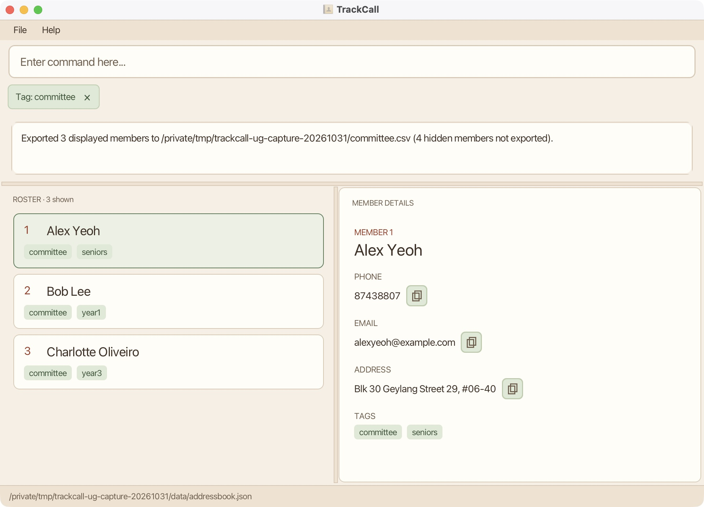
</a>
<figcaption>After adding Bob, run <code>list</code>, <code>filter t/committee</code>, then <code>export committee.csv</code>. Only Alex, Bob and Charlotte are exported; the feedback reports four hidden members excluded.</figcaption>
</figure>

</section>

<section class="ug-command">

#### 4.2 Import members from CSV: `import` {id="import-members-from-csv-import"}

<p class="ug-topic"><strong>How it works</strong></p>

- **Effect:** `import p/FILE_PATH` validates a local UTF-8 CSV file ending in `.csv`, appends unique members in file order, saves the
  complete roster, and restores the full list in stored order.
- The import always checks the full roster, including members hidden by `find` or `filter`.

<p class="ug-topic"><strong>File location and paths</strong></p>

- **File location:** Packaged builds read CSV files only from the JAR folder or its subfolders. Relative paths start there;
  absolute paths outside that folder are rejected. During development, relative paths start in the working directory.

- **From Downloads:** To import a file from Downloads in a packaged build, copy it into the same folder as the JAR file,
  then run `import p/filename.csv`.

<p class="ug-topic"><strong>Paths with spaces</strong></p>

Use double quotes around a path containing whitespace:

```text
import p/"data/member list.csv"
```

<p class="ug-topic"><strong>Header</strong></p>

The first row must contain these column names exactly once, in any order:

```text
name,phone,email,address,tags
```

<p class="ug-topic"><strong>CSV fields and whitespace</strong></p>

- **CSV fields:** Every later non-blank row must have exactly five fields. CSV quoting supports commas and doubled double
  quotes. A double quote inside an unquoted field, such as `Main" Street`, is invalid CSV syntax.
- **Whitespace:** Surrounding spaces and tabs are trimmed from field values and individual tags before validation;
  internal spaces, tabs, and case are preserved.
- Line breaks inside fields are not supported.
- Separate tags with semicolons; leave the tags field empty for no tags.
  Leave the address field empty when it is unknown.
- An optional UTF-8 byte-order mark is accepted.

<p class="ug-topic"><strong>Limits and file type</strong></p>

- **Limits and encoding:** Imports accept files up to 10 MiB (10,485,760 bytes) and at most 10,000 non-blank member rows,
  counted before duplicate removal. The header and blank rows do not count toward the member-row limit.
  Larger files are rejected without importing any members; split them into smaller CSV files.
- **File type:** The file name must end in `.csv` (in any letter case). Renaming a PDF, spreadsheet, image, or other file to `.csv`
  does not convert it: its contents must follow the UTF-8 CSV format above.

<p class="ug-topic"><strong>Example CSV</strong></p>

```text
name,phone,email,address,tags
Maya Chen,91234567,maya@example.com,10 College Road,year1;volunteer
```

Save this as `new-members.csv` beside the JAR, then run `import p/new-members.csv`.
You can also [download the example CSV](files/new-members.csv).

<figure class="ug-figure">
<a class="ug-screenshot" href="images/user-guide/features/import.jpg" aria-label="Open full-size screenshot: Import succeeds and restores the complete eight-member roster">
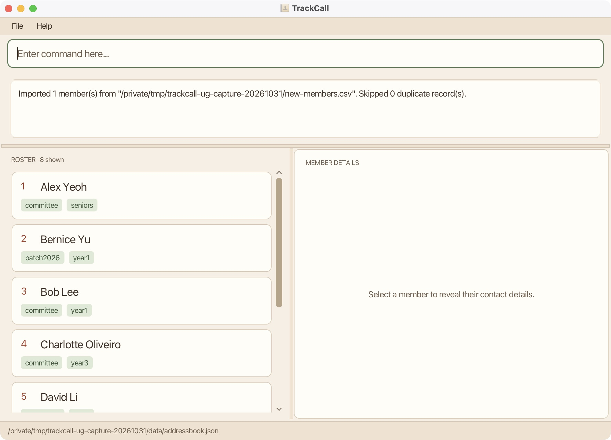
</a>
<figcaption>Importing the example into the seven-member roster adds Maya and skips zero duplicates. The earlier committee filter is cleared and all eight members are shown. Maya is appended at the end; scroll down to find her.</figcaption>
</figure>

<p class="ug-topic"><strong>Validation and duplicate handling</strong></p>

- The whole file is validated before any member is added.
- Duplicates against existing members or earlier rows are skipped using the same normalized-name rule as `add` and `edit`;
  tags are not merged. The first accepted record keeps its name formatting.
- The result reports imported and skipped counts; inspect the existing member and use `edit` if a skipped record was intended as an update.
- A header-only or duplicate-only file succeeds with zero imports and still retries automatic saving.

<p class="ug-topic"><strong>File errors</strong></p>

- **Rejected files:** If a row, header, CSV structure, or UTF-8 encoding is invalid, no records or view state change. The first
  error identifies the row where applicable. The source CSV is never modified.

- **Missing file:** A missing file reports its resolved path; check the spelling and location. In a packaged build, keep the file
  inside the JAR folder or one of its subfolders.

</section>

### 5. Remove member records {id="remove-records"}

Remove one member or the whole roster with confirmation.

<section class="ug-command">

#### 5.1 Delete a member: `delete` {id="delete-a-member-delete"}

- **Effect:** `delete INDEX` removes one member using a positive number from the **currently displayed list**,
  after you confirm the deletion.

<p class="ug-topic"><strong>Steps</strong></p>

1. Run `list` and check the displayed numbers. On the unchanged sample roster, Bernice is number 2.
   Select her row to verify the contact details.
2. Run `delete 2` only if Bernice is still displayed as number 2. TrackCall names that member and asks you to
   confirm. With the sample members, the prompt is:

   ```text
   Delete member 2, Bernice Yu?
   Tags: batch2026, year1
   Type yes and press Enter to confirm, or type anything else to cancel (except yes or y in any letter case).
   ```

   Asking for confirmation does not change or save the roster.

3. Check the name and tags in the prompt. Type `yes` and press Enter to delete that member, or `no` to cancel.

> After a search, use the **new displayed number**. For example, `find Bernice` on the sample roster shows her as 1,
> so the matching command is `delete 1`, not `delete 2`.

<figure class="ug-figure">
<a class="ug-screenshot" href="images/user-guide/features/delete.jpg" aria-label="Open full-size screenshot: Deletion confirmation names Bernice and leaves the roster unchanged">
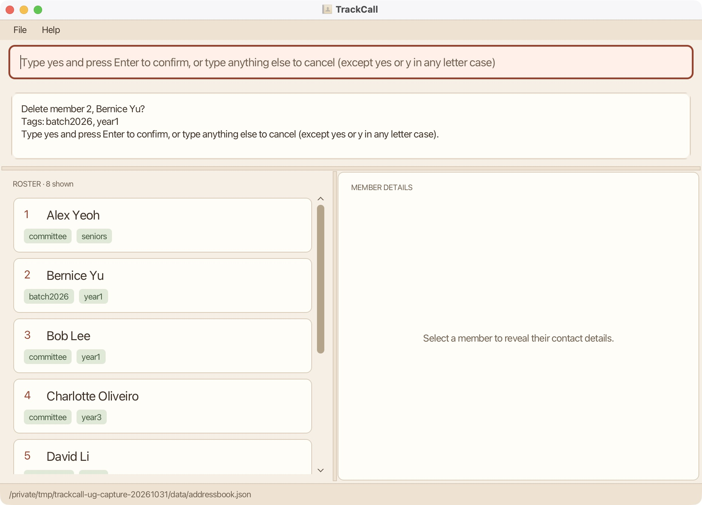
</a>
<figcaption><code>delete 2</code> asks about Bernice before changing any records. The highlighted command box is waiting for an answer; the screenshot shows a pending request, not a completed deletion.</figcaption>
</figure>

<p class="ug-topic"><strong>Confirmation and near misses</strong></p>

- Only `yes`, typed exactly in lowercase, confirms (spaces before or after it are ignored).
- Type confirmation replies manually. Pasting `y<TAB>es` (where `<TAB>` is a literal tab) displays `yes`
  and confirms if you press Enter.
- `y`, or `yes` in any other letter case (such as `Y`, `YES`, or `Yes`), does not confirm or cancel:
  it keeps the prompt pending and reminds you:
  `To confirm, type yes exactly, in lowercase, and press Enter, or type anything else to cancel (except yes or y in any letter case).`
- The reminder is followed by the original prompt, so the member to be deleted (or, for clearing, the selected member
  count) stays visible, including after you remove a filter box.

<p class="ug-topic"><strong>Cancelling or completing the deletion</strong></p>

- **Cancellation:** Any other input, such as `no` or another command, cancels the deletion with
  `Deletion cancelled. No member was removed.` That input is not run, so enter it again if you need it.

- **Commands used as replies:** When the input is a command, such as `list`, the result also says `"list" was not run. Enter it again to run it.`

- **Result:** After you confirm, TrackCall reports `Deleted member` with the member's name and tags. Phone, email, and address
  are not displayed. Other records remain, and the remaining members are renumbered.

> **There is no undo after you confirm.** Back up records you may need later.

</section>

<section class="ug-command">

#### 5.2 Clear members: `clear` or `clear /all` {id="clear-all-members-clear"}

<p class="ug-topic"><strong>Choose the scope</strong></p>

- **Scope:** `clear` removes only the currently displayed members. Hidden members are kept.
- `clear /all` removes every stored member, including hidden members.

<p class="ug-topic"><strong>Steps</strong></p>

1. Search, filter or use `show` to select the members to remove, then run `clear`.
   To remove everyone, run `clear /all` from any view.
2. Check the scope and member count in the prompt. Type lowercase `yes` to confirm.
   `y`, `Y` or another capitalization of `yes` keeps the prompt pending with a reminder.
   Any other reply cancels and is consumed without running it as a command.

<p class="ug-topic"><strong>Confirmation and current view</strong></p>

- **Confirmation targets and result:** The roster, view and saved file stay unchanged while confirmation is pending or cancelled.
- **Fixed targets:** The targets are fixed when the prompt appears. Removing a filter while waiting does not add targets.
- **View after clearing:** After displayed clearing, conditions remain applied and Show counts update. Run `list` to see hidden survivors.
  Whole-roster clearing resets the view after saving. There is no undo.

<p class="ug-topic"><strong>Example</strong></p>

`filter t/committee`, then `clear`, then `yes` removes committee members only;
`clear /all`, then `yes` removes everyone instead.

<figure class="ug-figure">
<a class="ug-screenshot" href="images/user-guide/features/clear-displayed.jpg" aria-label="Open full-size screenshot: Clear confirmation targets the three displayed committee members">
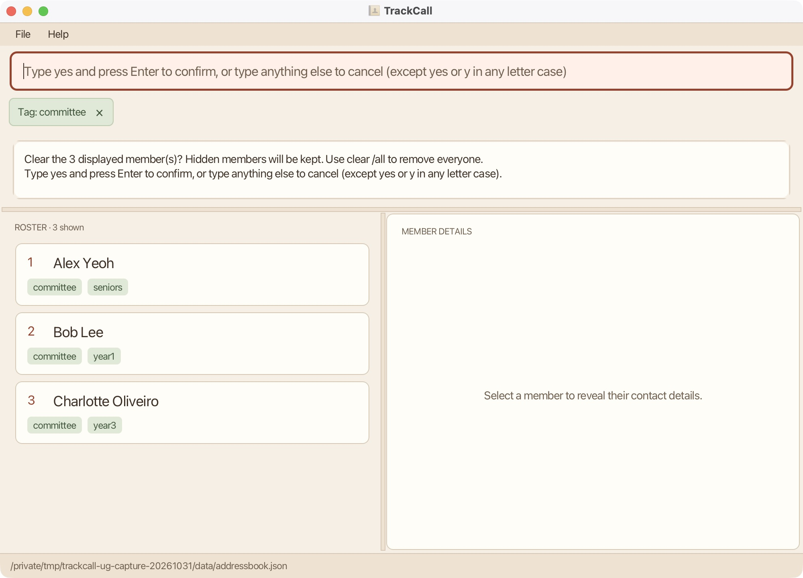
</a>
<figcaption>In this eight-member example, <code>clear</code> targets the three displayed committee members and keeps the five hidden members. Check the count before confirming.</figcaption>
</figure>

<figure class="ug-figure">
<a class="ug-screenshot" href="images/user-guide/features/clear-all.jpg" aria-label="Open full-size screenshot: Clear all confirmation targets eight members despite the three-member view">
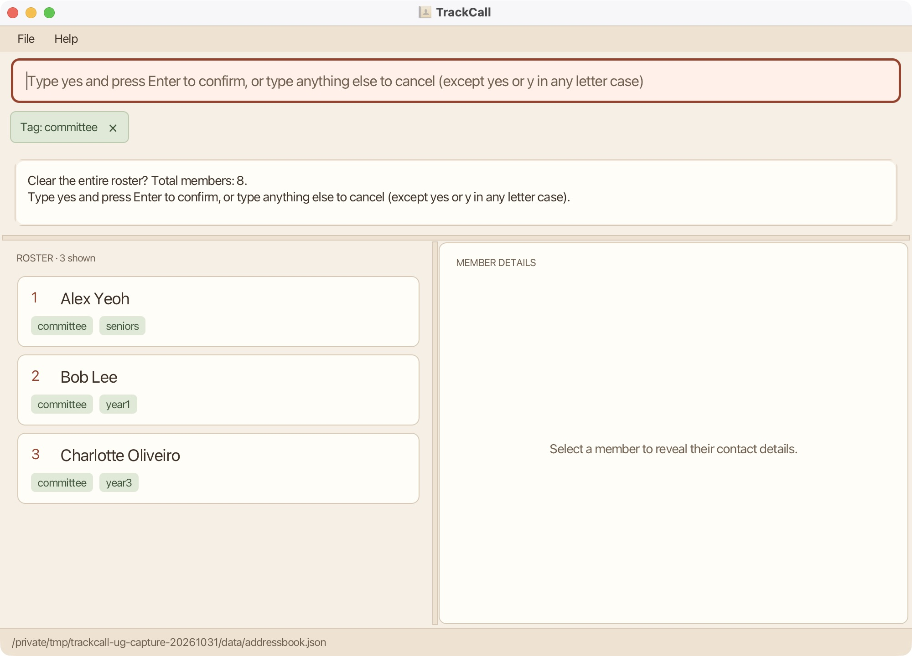
</a>
<figcaption>After cancelling the first prompt with <code>no</code>, <code>clear /all</code> asks to remove all eight members. The same three-member view does not limit this command.</figcaption>
</figure>

<p class="ug-topic"><strong>Empty lists and feedback</strong></p>

- **Empty lists:** An empty displayed list with hidden records reports an error without saving or asking to delete them.
  An already-empty roster saves immediately without confirmation, allowing an unsaved empty roster to be retried.

| Situation | Feedback after saving |
| --- | --- |
| Hidden members remain | `Cleared N displayed member(s). M member(s) remain in the roster.` |
| One member removed and none remain | `Cleared 1 member. The roster is now empty.` |
| Multiple members removed and none remain | `Cleared N members. The roster is now empty.` |
| Roster already empty | `The roster is already empty. No changes were made.` |

<p class="ug-topic"><strong>Input rules and save failures</strong></p>

- **Valid input:** Only the optional lowercase `/all` flag is accepted. Extra or repeated arguments leave records unchanged.
- **Save failure:** If saving fails, the complete roster and previous view are restored. Resolve the storage problem,
  then run `clear` or `clear /all` again and confirm the new prompt for the intended scope.
  See [Correcting errors](#correcting-errors) for recovery steps.

</section>

### 6. Help and session {id="help-and-session"}

Read command instructions offline and close TrackCall when you are finished.

<section class="ug-command">

#### 6.1 Offline help: `help` {id="offline-help-help"}

<p class="ug-topic"><strong>Open help and browse commands</strong></p>

- **Open help:** type `help`, press **F1**, or choose **Help → Help**.
  The guide works without internet access and does not change or save the roster.
- **Overview:** All nineteen commands appear in four categories:
  Browse members, Manage members, Remove records, and Help & session.
- Each command has a short description and a runnable example.
- The overview uses two columns in a wide window and one in a narrow window.

<figure class="ug-figure">
<a class="ug-screenshot" href="images/user-guide/features/help.jpg" aria-label="Open full-size screenshot: Offline help overview with command buttons grouped by task">
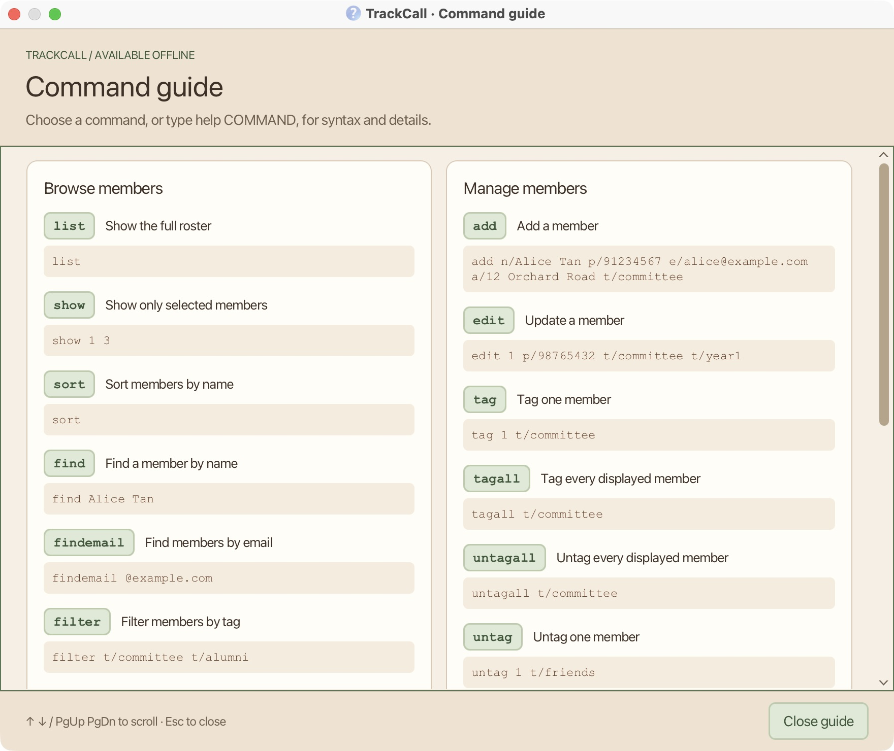
</a>
<figcaption><code>help</code> opens the command overview without changing the roster. Select a command button for details, or scroll to the remaining categories.</figcaption>
</figure>

<p class="ug-topic"><strong>Navigate and close help</strong></p>

- **Open details:** select a command-name button or type `help COMMAND`, such as `help edit`.
  Details include syntax, an example, the expected result, usage notes, and common errors.
- **Return to the overview:** select **All commands**, or close help and type `help`.
- **Scroll:** use **Up/Down**, **Page Up/Page Down**, or **Home/End**.
- **Close:** press **Escape**.

<p class="ug-topic"><strong>Input rules</strong></p>

- **Valid input:** Help accepts at most one lowercase topic.
  `help ADD`, `help unknown`, and `help add edit` report errors.

</section>

<section class="ug-command">

#### 6.2 Finish your session: `exit` {id="finish-your-session-exit"}

<p class="ug-topic"><strong>Effect and saving</strong></p>

- `exit` closes TrackCall and its help window. It accepts no arguments.
- Successful data changes have already been saved.

> Exiting does not retry a failed save. Resolve storage errors first to keep unsaved changes.

<figure class="ug-figure">
<a class="ug-screenshot" href="images/user-guide/features/exit-help.jpg" aria-label="Open full-size screenshot: Offline exit help explains saving and closing the application">
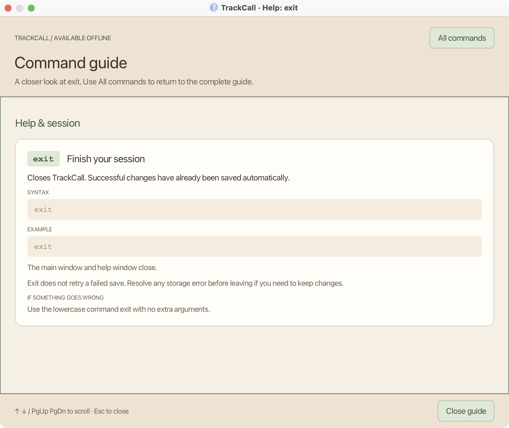
</a>
<figcaption><code>help exit</code> explains the command before you close the app. This is the help screen; running <code>exit</code> closes the application instead.</figcaption>
</figure>

</section>

## Correcting errors

### Invalid input

<p class="ug-topic"><strong>What happens:</strong></p>

- **Unknown command:** TrackCall points you to `help`.
- **Missing or invalid input:** a known command shows the problem and its rules.
- **Your records:** rejected input leaves the roster and current list unchanged.

<p class="ug-topic"><strong>Examples and corrections:</strong></p>

- `add n/Alice` is incomplete. Use `help add`, then enter the required name, phone, and email fields.
- `delete 0` is invalid. Use `list`, check the member, and enter its displayed number.
- `tag 0 t/committee` and `untag 1 t/` are invalid. Use a positive current list number and one valid tag.

<figure class="ug-figure">
<a class="ug-screenshot" href="images/user-guide/features/validation.jpg" aria-label="Open full-size screenshot: Uppercase tag prefix is rejected and the input remains available for correction">
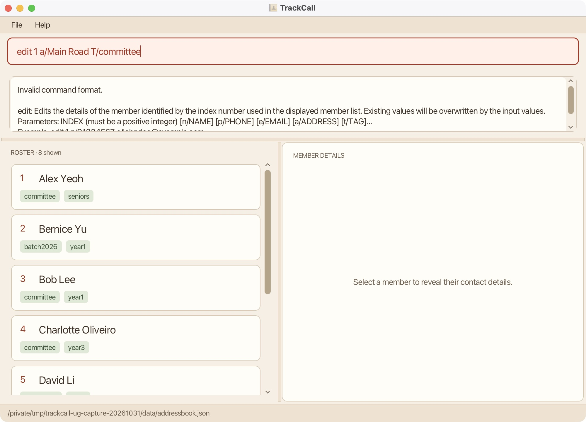
</a>
<figcaption><code>edit 1 a/Main Road T/committee</code> is rejected because <code>T/</code> is uppercase. The roster stays unchanged and the input remains visible. Change it to lowercase <code>t/</code>, then retry.</figcaption>
</figure>

### Field prefix syntax {id="field-prefix-syntax"}

<p class="ug-topic"><strong>Accepted input:</strong></p>

- **Accepted prefixes:** both `add` and `edit` reject unknown or uppercase single-letter field prefixes,
  including inside an address.
- **Address exception:** uppercase `A/` immediately followed by a digit within an `a/` value is literal text.
  For example, `a/Block A/12` is valid in both commands. Other unsupported prefixes remain invalid.
- **Other address text:** standalone `c/o`, `s/o`, and `d/o`, URLs, numeric slashes such as `12/3`, and slashes inside words remain valid.

> **Correction example:** `edit 1 a/Main Road T/committee` reports invalid input; use lowercase `t/` to assign a tag.

The [Developer Guide](DeveloperGuide.html#limitations) explains current limitations and records
ideas for later versions in its requirements appendix.

### A save fails after changing records {id="a-save-fails-after-add-edit-delete-tag-untag-tagall-untagall-renametag-or-import"}

**Affected commands:** `add`, `edit`, `delete`, `tag`, `untag`, `tagall`, `untagall`, `renametag`, `import`, and `sort`.

<p class="ug-topic"><strong>What happens:</strong></p>

- **Current session:** the change remains visible, but the previous saved file stays unchanged.
- **Command box:** the input clears to avoid repeating an already-applied change.

<p class="ug-topic"><strong>Retry saving:</strong></p>

1. Fix the reported file or folder problem.
2. Check the current list.
3. If no members are currently displayed, run `list` to see the full roster.
4. Use `edit` with the displayed member number and an existing field value, for example `edit 1 p/91234567`
   only when member 1 already has that phone number.

   This retries saving without changing anything else.
   If the entire roster is empty, use `clear` to retry saving it.

- **Import failures:** the complete imported batch remains in memory. TrackCall reports
  `Could not save data to file: DETAILS`, followed by the unsaved-change warning and retry instructions.

> **Before exiting:** complete a successful retry; otherwise, unsaved changes are lost.

### A save fails after clear

<p class="ug-topic"><strong>What happens:</strong></p>

- **Your records and view:** TrackCall restores every member and the previous view, reporting
  `No members were removed.`
- **Command box:** the submitted input stays there (`yes` after confirmation, or `clear` for an already-empty roster).
- **Failure details:** the feedback includes the storage failure reason.

<p class="ug-topic"><strong>Choose the appropriate recovery:</strong></p>

1. If the file changed outside TrackCall, restart to load those outside changes. Retry only when deliberately
   replacing them with the session's cleared roster; the outside version is kept in the backup.
2. For other failures, resolve the stated storage problem before retrying.
3. Run `clear` for displayed members or `clear /all` for everyone, then confirm the new prompt.
   A second `yes` alone cannot repeat the action.

## Your data

<p class="ug-topic"><strong>When your roster is saved:</strong></p>

- **Automatically saved:** successful `add`, `edit`, confirmed `delete`, `tag`, `untag`, `tagall`, `untagall`,
  `renametag`, `clear`, `import`, and `sort` commands.
- **No roster save:** `help`, `list`, `show`, `find`, `findemail`, `filter`, `export`, and `exit`.

### Locate or back up your roster

<p class="ug-topic"><strong>Find the file:</strong></p>

- **Packaged build:** the default file is `data/addressbook.json` beside the JAR.
- **Development runs:** the path is relative to the working directory. Start from the same folder to keep using the same roster.
- **Check the location:** read the status bar.

<p class="ug-topic"><strong>Back up or move the roster:</strong></p>

1. Close TrackCall.
2. Copy the data file to create a backup.
3. To move it to another computer you own, place the copy at the corresponding data-file location.
4. Start TrackCall and check the roster.

### Editing the file manually

> **Before editing:** close TrackCall and make a backup.

<p class="ug-topic"><strong>Changes made outside TrackCall:</strong></p>

- **If you edit while TrackCall is open:** a valid outside edit causes the next save to be refused with a warning,
  so your edits are not silently replaced.
- **To keep the outside edits:** exit and restart TrackCall. This session's unsaved changes are discarded.
- **To keep the roster shown in TrackCall instead:** run any command that changes the roster, such as `edit`
  with the displayed number and an existing field value. See
  [A save fails after changing records](#a-save-fails-after-add-edit-delete-tag-untag-tagall-untagall-renametag-or-import).
  Your edited version is then kept in `data/addressbook.json.bak`.
- **If the edited file is invalid:** every save is refused until you restart TrackCall and choose a recovery action.

<p class="ug-topic"><strong>Keep the existing JSON structure:</strong></p>

- A `persons` array contains the members.
- Each member has `name`, `phone`, `email`, `address`, and `tags` fields.
- An empty `address` means none was provided.
- Spaces before or after a value, including each tag, are ignored, as they are in commands.
- Use `tags` for each member's group assignments.

<p class="ug-topic"><strong>Encoding and valid values:</strong></p>

- Save the file as UTF-8. A byte order mark (BOM) at the start of the file, which some editors such as
  Windows Notepad add, is accepted.
- Every value must follow the same rules as in the [add](#add-a-member-add) command, and two members cannot have
  identical contact details.
- An address of only spaces is invalid. One invalid value makes the whole file invalid.

If the file cannot be loaded, the recovery dialog explains why.

### Missing or invalid files

| File state | Startup behaviour |
| --- | --- |
| **Missing** | Sample members are loaded. |
| **Unreadable or invalid** | A recovery dialog appears before the roster can be edited. |

- **File preservation:** normal startup and read-only commands leave the member file unchanged.
- **Unexpectedly missing roster:** close the app and repair or restore the file first.

### Automatic backup and recovery

<p class="ug-topic"><strong>How backups work:</strong></p>

- **Backup location:** before replacing an existing valid roster, TrackCall saves its previous contents to
  `data/addressbook.json.bak`.
- **Backup version:** this is the previous distinct saved version. A save with unchanged member data retries
  persistence without replacing that backup, including `clear` on an already-empty roster.
- **Outside edits:** an explicit retry after an outside-change warning still backs up the outside file's exact
  contents, even if its members match the session's roster.
- **Backup failure:** if the backup cannot be written, the roster save fails and the existing roster stays unchanged.

<p class="ug-topic"><strong>When the roster cannot be loaded:</strong></p>

- **Preserved copy:** TrackCall first saves the file's exact contents in a uniquely named
  `data/addressbook.json.corrupt-....json` file.
- **Failure reason:** the dialog explains why the roster could not be loaded after `Reason:`.

<p class="ug-topic"><strong>Example reasons:</strong></p>

- `The data file is not saved as UTF-8 text. Save it again with UTF-8 encoding in your text editor, then restart TrackCall.`
- `The data file is not valid JSON near line L, column C. Check the quotes, commas and brackets there.`
  (L and C are numbers.)
- `The data file must contain a "persons" list.`
- `Addresses must be on one line. Remove the line break from the address.`
- `Tag names should be 1 to 30 characters long, using ASCII letters or digits with optional internal hyphens`

<p class="ug-topic"><strong>Recovery choices:</strong></p>

- **Restore backup**, when the backup is valid: restore the previous saved roster.
- **Start empty**: explicitly replace the unreadable roster with an empty roster.
- **Close**, the default: leave the roster unchanged so you can repair or restore it manually.

<p class="ug-topic"><strong>After recovery:</strong></p>

- **Preserved files:** restoration and starting empty keep both the preserved damaged file and the existing backup unchanged.
- **Later saves:** subsequent normal saves resume rotating the backup. Recovery copies use unique filenames,
  so restarting does not overwrite earlier copies.
- **If preservation fails:** TrackCall closes without opening an editable roster. Fix the file or folder permissions,
  or restore a backup manually before restarting.
- **Export protection:** export cannot overwrite the automatic backup or a preserved recovery file.

<p class="ug-topic"><strong>Restore a backup manually:</strong></p>

1. Close TrackCall.
2. Keep a copy of the current roster.
3. Copy `addressbook.json.bak` to `addressbook.json`. These files are stored beside each other in `data`.

## FAQ

### How do I move my roster to another computer?

- Close TrackCall and copy `data/addressbook.json` to the corresponding location on your other computer.
- See [Your data](#your-data) for working-folder and backup instructions.

### Why did a member disappear after a search?

A search changes the displayed list, not the saved roster.

- Run `list` to show everyone.
- Check the current displayed number before editing, tagging, untagging, or deleting a member.

### How do I add or remove one member's tag? {id="how-do-i-add-or-remove-one-members-tag"}

- Use `tag INDEX t/TAG` to add a tag or `untag INDEX t/TAG` to remove one.
- Both commands preserve the member's other tags.
- Use `edit INDEX t/...` only when replacing the full tag set.

### Can I update a whole group's tags? {id="can-i-update-a-whole-groups-tags"}

Yes. Use `find` or `filter t/TAG` to display the group, then use `tagall t/TAG` or `untagall t/TAG`.

- Only the displayed members change. See [Tag or untag a group](#tag-or-untag-a-group-tagall-untagall).
- To rename a tag for the displayed members, use `renametag`. See [Rename a tag](#rename-a-tag-renametag).

### What should I do after a save error?

Follow [Correcting errors](#correcting-errors) before exiting.

- A failed `clear` save restores the roster.
- Unsaved changes from `add`, `edit`, `delete`, `tag`, `untag`, `tagall`, `untagall`, `renametag`, `import`, and `sort` remain visible
  in memory.

## Command summary

| Task | Format | Example and result |
| --- | --- | --- |
| **Open help** | `help [COMMAND]` | `help add` opens the add instructions. |
| **Add a member** | `add n/NAME p/PHONE e/EMAIL [a/ADDRESS] [t/TAG]...` | The quick-start example adds Alice. |
| **Show everyone** | `list` | `list` restores the complete roster. |
| **Show selected members** | `show INDEX [MORE_INDEXES]...` | `show 1 3` shows only members 1 and 3 from the current list. |
| **Sort by name** | `sort` | Reorders and saves the entire roster from A to Z, ignoring letter case. |
| **Update a member** | `edit INDEX [n/NAME] [p/PHONE] [e/EMAIL] [a/ADDRESS] [t/TAG]...` | `edit 1 p/98765432` changes member 1's phone. |
| **Add one tag** | `tag INDEX t/TAG` | `tag 2 t/committee` adds one tag to displayed member 2. |
| **Remove one tag** | `untag INDEX t/TAG` | `untag 2 t/year1` removes one tag from displayed member 2. |
| **Find by name** | `find KEYWORD [MORE_KEYWORDS]...` | `find Alice Tan` shows names containing Alice or Tan. |
| **Find by email** | `findemail KEYWORD [MORE_KEYWORDS]...` | `findemail @example.com` shows emails containing that fragment. |
| **Filter by tag** | `filter t/TAG [t/MORE_TAGS]...` | `filter t/committee t/alumni` shows members with either tag. |
| **Tag a group** | `tagall t/TAG` | `tagall t/committee` adds the tag to every displayed member. |
| **Untag a group** | `untagall t/TAG` | `untagall t/committee` removes the tag from every displayed member. |
| **Rename a tag** | `renametag t/CURRENT_TAG t/NEW_TAG` | `renametag t/batch2026 t/alumni` renames the tag for every displayed member. |
| **Delete one member** | `delete INDEX`, then `yes` | `delete 1`, then `yes`, removes the first currently displayed member. |
| **Clear members** | `clear [/all]` | `clear` removes displayed members; `clear /all` removes everyone. Confirm with `yes`. |
| **Export members** | `export [FILEPATH]` | `export members.csv` writes the displayed members to CSV; run `list` first for everyone. |
| **Import members** | `import p/FILE_PATH` | `import p/members.csv` appends unique valid records. |
| **Close the app** | `exit` | `exit` ends the session. |

> `INDEX` always refers to the currently displayed list. Check the member details before using `edit` or `delete`.

See [Commands](#commands) for parameter rules and expected results.

## Glossary

| Term | Meaning |
| --- | --- |
| **CSV** | A plain-text table file (comma-separated values) that spreadsheet apps such as Excel and Google Sheets can open and save. |
| **Displayed list** | The members currently shown in the roster after any `find`, `findemail`, `filter`, or `show`. |
| **Index** | The number shown beside a member in the displayed list, such as `2` in `edit 2 p/91234567`. |
| **JAR** | The single `trackcall.jar` file you download and run with Java. |
| **JSON** | The text format of TrackCall's data file, `data/addressbook.json`. |
| **Prefix** | The short label before a value in a command, such as `n/` for a name or `t/` for a tag. |
| **Roster** | Every member stored in TrackCall, including members hidden from the displayed list. |
| **Tag** | A short group label on a member, such as `committee` or `year1`. A member can have several tags. |
| **Terminal** | The app where you type commands to your computer: Terminal on macOS and Linux, or Command Prompt or PowerShell on Windows. |
| **UTF-8** | The standard text encoding that most spreadsheet apps can use when saving CSV files. |
