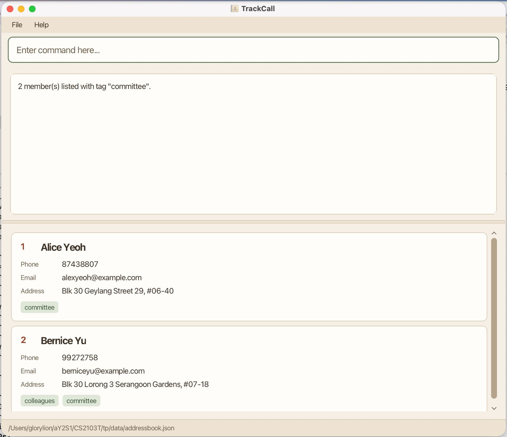

# TrackCall

**Keep your club's member records organised, one command at a time.**

TrackCall helps membership secretaries maintain contact details, find the right members, and manage
overlapping groups using tags. A compact roster and a separate details panel keep the workspace easy to scan.

  <a class="btn btn-primary" href="https://github.com/AY2627S1-CS2103T-W12-1/tp/releases/latest">Download the latest release</a>
  <a class="btn btn-outline-primary" href="UserGuide.html#quick-start">Get started</a>
  <a class="btn btn-outline-secondary" href="UserGuide.html#commands">Explore features</a>

Requires **Java 25**. TrackCall works with local files and includes offline help for all nineteen commands.

## Interface

Type a command, read the result, then select a member to view and copy their contact details.
Names and tags stay in the roster; the details panel appears when you select a member.
See [Read the interface](UserGuide.html#read-the-interface) for keyboard shortcuts and a tour of the workspace.

## Available features {id="features-in-v14-alpha"}

The complete feature set includes all **nineteen commands** below. TrackCall retains and adapts
AB3's core `add`, `edit`, `delete`, `clear`, `list`, `find`, `help`, and `exit` commands alongside
its membership features. The [release notes](#releases) identify what changed in each version.

### Browse and find members

* [**List all members: `list`**](UserGuide.html#show-all-members-list) — restore the complete roster and reset searches and filters.
* [**Select a subset: `show`**](UserGuide.html#show-selected-members-show) — keep only selected members from the displayed list.
* [**Search names: `find`**](UserGuide.html#find-members-find) — match partial name words, ignoring letter case.
* [**Search email addresses: `findemail`**](UserGuide.html#find-members-by-email-findemail) — narrow displayed members by a full address or an email fragment.
* [**Filter by tag: `filter`**](UserGuide.html#filter-displayed-members-by-tag-filter) — narrow the displayed members; combine successive filters to find overlapping groups.
* [**Sort by name: `sort`**](UserGuide.html#sort-members-by-name-sort) — show the current results in case-insensitive A–Z order.

### Add and update members

* [**Add a member: `add`**](UserGuide.html#add-a-member-add) — record a name, phone, email, optional address, and any group tags.
* [**Edit a member: `edit`**](UserGuide.html#update-a-member-edit) — update supplied contact fields or replace the member's tags while keeping other fields unchanged.

Select a member to view and copy their contact details. The roster keeps names and tags visible,
with [keyboard shortcuts](UserGuide.html#read-the-interface) for selecting members and returning to the command box.

### Organise member groups

* [**Add one member's tag: `tag`**](UserGuide.html#add-or-remove-one-tag-tag-untag) — add a group assignment while preserving their other tags.
* [**Remove one member's tag: `untag`**](UserGuide.html#add-or-remove-one-tag-tag-untag) — remove one assignment without replacing the rest.
* [**Tag a displayed group: `tagall`**](UserGuide.html#tag-or-untag-a-group-tagall-untagall) — add a tag to every displayed member.
* [**Untag a displayed group: `untagall`**](UserGuide.html#tag-or-untag-a-group-tagall-untagall) — remove a tag from every displayed member.
* [**Rename a tag: `renametag`**](UserGuide.html#rename-a-tag-renametag) — replace a tag for every displayed member who has it.

### Exchange rosters with CSV

* [**Export a roster: `export`**](UserGuide.html#export-members-to-csv-export) — write every member, including hidden members, to a CSV file.
* [**Import member records: `import`**](UserGuide.html#import-members-from-csv-import) — validate a complete CSV file, append unique members, and report skipped duplicates.

### Remove member records

* [**Delete one member: `delete`**](UserGuide.html#delete-a-member-delete) — review a confirmation prompt before removing the selected record.
* [**Clear the roster: `clear`**](UserGuide.html#clear-all-members-clear) — remove all members, including hidden records,
  after confirming with `yes`. An already-empty roster saves without prompting. There is no undo after confirming.

### Help and session

* [**Read help offline: `help`**](UserGuide.html#offline-help-help) — browse all commands or open one command's syntax, examples, and common errors.
* [**Finish your session: `exit`**](UserGuide.html#finish-your-session-exit) — close TrackCall after resolving any save errors.

### Local data and recovery

* [**Automatic local saving**](UserGuide.html#your-data) — keep member records and tags between sessions, building on AB3's local storage.
* [**Backups and recovery**](UserGuide.html#automatic-backup-and-recovery) — keep the previous saved roster and choose a recovery action if the current file cannot be read.

Read-only commands leave the roster file unchanged. The performance target is **500 members**;
this is not a hard record limit.

## Releases

See what changed and browse screenshots of each release:

* [v1.4 - TrackCall](releases/v1.4/RELEASE_NOTES.html)
* [v1.3 - TrackCall](releases/v1.3/RELEASE_NOTES.html)

## Find the right guide

| I want to… | Start here |
| --- | --- |
| Install TrackCall and look up commands | [User Guide](UserGuide.html) |
| Understand the design and implementation | [Developer Guide](DeveloperGuide.html) |
| Run the application from source | [Setup instructions](SettingUp.html) |
| Meet the people building TrackCall | [About Us](AboutUs.html) |

## Acknowledgements

Based on [AddressBook Level 3](https://se-education.org/addressbook-level3)
from the [SE-EDU initiative](https://se-education.org).
