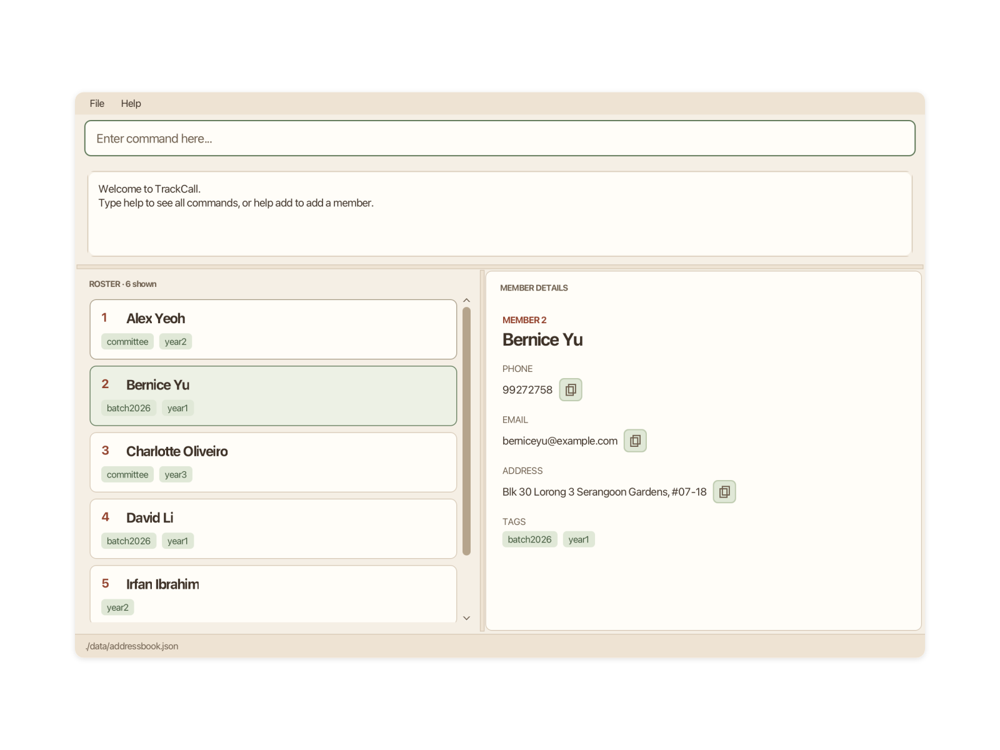
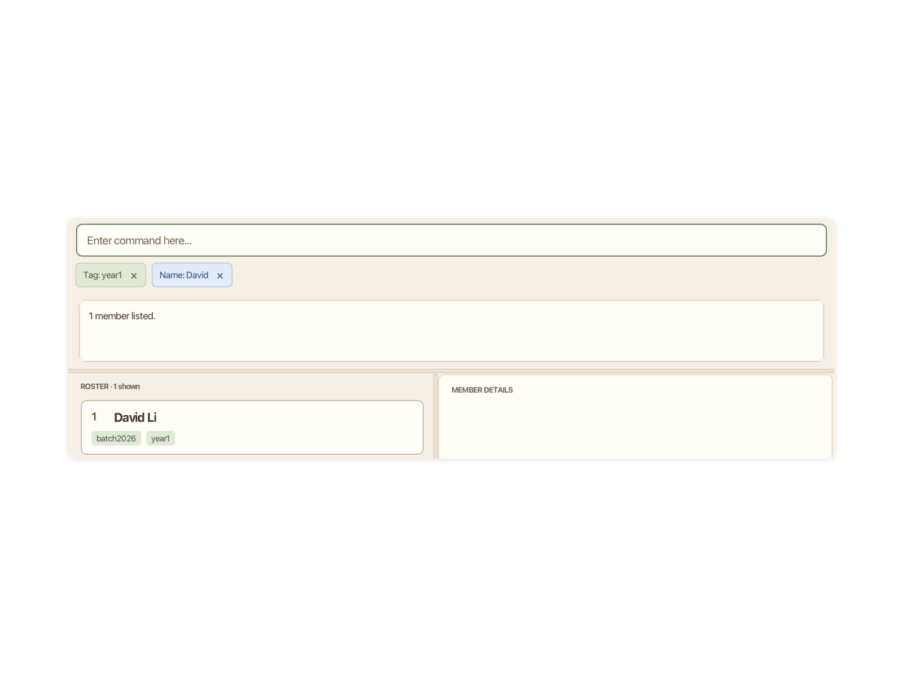
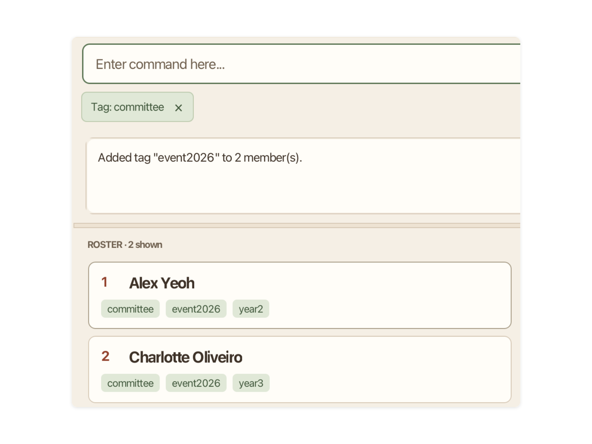
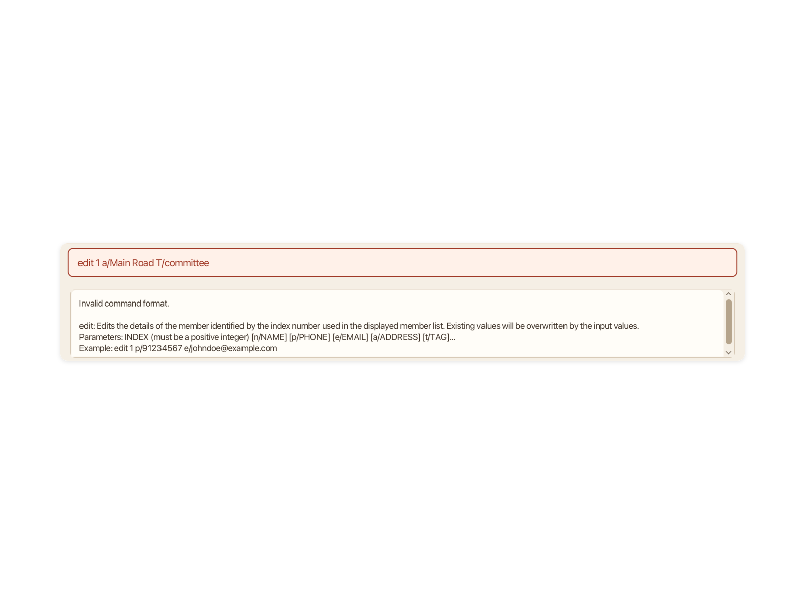

# v1.5 - TrackCall

TrackCall v1.5 makes searches, group changes, CSV export, and clearing follow the members currently displayed. It keeps the nineteen-command workflow for managing a club or society's membership roster, and sorting now saves the order of the whole roster.

## What's New in v1.5

* **Choose which members to clear.** `clear` removes only the displayed members and keeps hidden members. Use `clear /all` to remove everyone. When there are members to remove, both forms ask for lowercase `yes` before proceeding. The prompt identifies the scope; a failed save restores the previous roster and view.
* **Build a search one step at a time.** Each `find` or `findemail` narrows the current list while retaining earlier searches, tag filters, and `show` selections. Keywords within one search match any supplied keyword; separate conditions must all match. Remove a condition using its X button, or use `list` to return to the full roster.
* **Combine overlapping groups.** `filter t/committee t/year1` includes members with either tag. A later `filter t/event2026` keeps only members who also have that tag. Tag matching ignores letter case, and equivalent repeated conditions do not add duplicate boxes.
* **Keep the order you choose.** `sort` orders the entire roster by name from A to Z, ignoring letter case and differences in surrounding or repeated whitespace. It preserves active conditions and saves the new order, which remains after `list` and a restart. New or imported members are appended; run `sort` again when needed.
* **Export and update the group you can see.** `export` writes the displayed members in their displayed order. `renametag`, like `tagall` and `untagall`, changes only displayed members. Use `list` first when the operation should include everyone.
* **Check destructive actions more carefully.** `delete INDEX` names the selected member and asks for lowercase `yes`. Confirmation targets are fixed when the prompt appears. Mistyped confirmations such as `y` or `Yes` keep the prompt open; other replies cancel without running another command.
* **Handle names and pasted input consistently.** Names support Unicode letters, combining marks, hyphens, and apostrophes. Duplicate checks recognise names that differ only in letter case or whitespace. Tags ignore letter case and allow letters, digits, and internal hyphens. Whitespace-only addresses, including Unicode spaces, are rejected; an empty `a/` in `edit` explicitly clears an address.
* **Protect saved rosters and improve guidance.** Outside edits are detected before overwriting a data file. Backups preserve the previous distinct saved roster, and unreadable data is preserved during recovery. Updated User and Developer Guides explain the current commands, confirmation steps, input rules, and recovery options.

**Release status:** v1.5 release candidate; binary publication pending. Find published builds on the [team releases page](https://github.com/AY2627S1-CS2103T-W12-1/tp/releases), and use **Java 25** with `trackcall.jar`.

See the [User Guide](https://ay2627s1-cs2103t-w12-1.github.io/tp/UserGuide.html) for command instructions and the [Developer Guide](https://ay2627s1-cs2103t-w12-1.github.io/tp/DeveloperGuide.html) for design, implementation, and testing guidance.

## Complete feature set

This release includes **nineteen commands**. It carries forward the v1.4 workflow and retains and adapts AB3's core `add`, `edit`, `delete`, `clear`, `list`, `find`, `help`, and `exit` commands. `clear /all` is an option of `clear`, rather than an additional command.

| Task | Commands | Available in v1.5 |
| --- | --- | --- |
| Maintain member records | `add`, `edit` | Record a name, phone, email, optional address, and tags; update contact details or replace a member's tags. Select a member to read and copy contact fields. |
| Browse and find members | `list`, `show`, `find`, `findemail`, `filter`, `sort` | Show all or selected members, combine partial-name and email searches with tag conditions, and save the whole roster's name order. Remove active conditions individually. |
| Organise member groups | `tag`, `untag`, `tagall`, `untagall`, `renametag` | Change one displayed member's tag, or add, remove, or rename a tag for displayed members while preserving other tags and contact fields. Tag matching ignores case. |
| Exchange rosters | `export`, `import` | Export displayed members in displayed order to UTF-8 CSV. Validate an entire CSV before appending unique member records, including records without an address. |
| Remove records | `delete`, `clear` | Confirm before deleting one displayed member, clearing displayed members, or clearing everyone with `clear /all`. Hidden members survive plain `clear`. |
| Get help and finish working | `help`, `exit` | Read the offline catalogue or help for one command, then close the application. |

Successful data changes are saved locally. Automatic backups and startup recovery help protect the saved roster. See the installation and limitations below for file locations and save-error guidance.

## TrackCall in Action

These real application captures from the User Guide use sample member data and a consistent frame. They illustrate the workflows shown below; select an image to view it at full size. Successful commands clear the command box, so each caption identifies the relevant command.

### 1. A compact roster with selected-member details

Names and tags remain visible in the roster. Selecting Bernice Yu opens her phone, email, address, tags, and contact-field copy buttons alongside it.

<p align="center">
  <a href="framed-roster-overview.svg"></a>
</p>

### 2. Narrow the current list with another condition

This detail view shows the result of `filter t/year1` and then `find David`: the Tag and Name conditions remain visible together. Only David Li matches both; each condition has its own X button.

<p align="center">
  <a href="framed-cumulative-search.svg"></a>
</p>

### 3. Update the displayed group together

With the committee filter active, `tagall t/event2026` adds the event tag to the two displayed members. This roster close-up shows Alex Yeoh and Charlotte Oliveiro retaining their existing tags.

<p align="center">
  <a href="framed-bulk-tag-update.svg"></a>
</p>

### 4. Correct a field prefix before an edit is applied

`edit 1 a/Main Road T/committee` is rejected because the tag prefix must be lowercase `t/`. This feedback close-up shows the highlighted input and the expected edit format.

<p align="center">
  <a href="framed-field-validation.svg"></a>
</p>

<details>
<summary>Installation, screenshot provenance and known limitations</summary>

## Install and run

1. Install **Java 25**. On macOS, use the compatible JDK+FX distribution described in the [User Guide](https://ay2627s1-cs2103t-w12-1.github.io/tp/UserGuide.html#quick-start).
2. When available, download the v1.5 **`trackcall.jar`** from the [team releases page](https://github.com/AY2627S1-CS2103T-W12-1/tp/releases). Keep this filename without spaces or additional special characters.
3. Place the JAR in an empty folder you can write to. Back up existing roster data before replacing an installation.
4. Open a terminal in that folder and check the installed Java version:

   ```text
   java -version
   ```

5. Once the output reports Java 25, launch TrackCall:

   ```text
   java -ea -jar trackcall.jar
   ```

The application opens with sample members on first launch. Use `help` for the offline command catalogue or `help COMMAND` for one command. The nineteen commands are `add`, `edit`, `delete`, `clear`, `list`, `show`, `find`, `findemail`, `filter`, `sort`, `tag`, `untag`, `tagall`, `untagall`, `renametag`, `import`, `export`, `help`, and `exit`.

Data is saved beside the packaged JAR in `data/addressbook.json`. CSV paths must remain inside the JAR's folder or its subfolders. Keep the JAR and its data folder together when moving an installation.

## Screenshot provenance

The gallery reuses actual application captures from the User Guide. [SCREENSHOTS.json](SCREENSHOTS.json) records their source files and framing details; [SHA256SUMS.txt](SHA256SUMS.txt) provides checksums for the screenshot images.

## Remaining limitations

* **No undo:** confirmed deletion and clearing cannot be undone in the application. Check the prompt and retain an independent backup for recovery.
* **Saving can fail:** after most data changes, a failed save leaves changes in memory. Follow the User Guide's recovery steps before exiting; `exit` does not retry saving. A failed clear restores the previous roster and view.
* **Sorting is explicit:** adding, importing, or editing a member does not automatically sort the roster again. Run `sort` when you want to reorder it.
* **CSV has a defined format:** import accepts UTF-8 CSV with the required five-column header, at most 10 MiB and 10,000 nonblank member rows. Embedded line breaks are unsupported. CSV files and export destinations must stay within the application's folder or its subfolders.
* **Input rules still apply:** tags contain 1–30 ASCII letters or digits with optional internal hyphens. Phone numbers and email addresses use the formats described in the User Guide; they are not unrestricted text fields.
* **One running instance per data location:** close the existing TrackCall instance before launching another against the same application folder.

</details>
